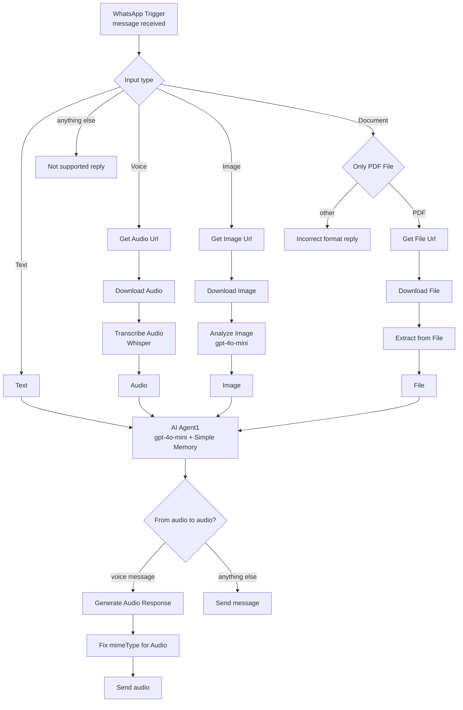

# AI WhatsApp Chatbot with n8n | Answer Text, Voice Notes, Images, and PDFs with OpenAI

**Workflow file:** [`AI-Powered WhatsApp Chatbot for Text, Voice, Images & PDFs.json`](../AI-Powered%20WhatsApp%20Chatbot%20for%20Text%2C%20Voice%2C%20Images%20%26%20PDFs.json)

This n8n workflow turns your WhatsApp Business number into an AI WhatsApp chatbot that understands more than text. People can message it, send a voice note, share a photo, or forward a PDF, and the bot replies in the same chat. Voice notes are transcribed and answered with a spoken reply. Images get a detailed description. PDFs are read and summarized. The bot remembers the last 10 exchanges with each person, so follow-up questions work naturally.

It runs on the official WhatsApp Cloud API and OpenAI, with no third-party WhatsApp gateways.

---

## What it's used for

- **A multimodal AI assistant on WhatsApp.** Give customers, clients, or your team an assistant in the app they already use, without asking them to install anything.
- **Hands-free voice conversations.** Send a voice note and get a voice note back, which is useful on the road or for people who prefer speaking to typing.
- **Describing and answering questions about images.** Send a photo on its own for a detailed description, or add a question in the caption, such as "What brand is this?". The description prompt is written so someone who can't see the photo can picture it, making the bot useful for blind and low-vision users as well as for reading signs, labels, and screenshots.
- **Quick PDF summaries and answers.** Forward a contract, invoice, or report to get the key points back, or ask something specific in the caption, such as "What are the payment terms?".
- **A starting point for a business chatbot.** Swap in your own system prompt, tools, or knowledge base to build an AI WhatsApp chatbot for support, sales, or bookings.

## At a glance

| | |
|---|---|
| **Trigger** | A WhatsApp message sent to your WhatsApp Business number |
| **Understands** | Text, voice notes and audio files, images, and PDF documents |
| **Replies with** | Text. Voice notes and audio files are answered with a voice message. |
| **Questions about media** | A caption sent with a photo or PDF is treated as the question |
| **Replies come from** | The WhatsApp number the person messaged, so there's no phone number to configure |
| **AI models** | OpenAI `gpt-4o-mini` (chat and image analysis), Whisper `whisper-1` (transcription), `tts-1` with the `onyx` voice (spoken replies) |
| **Memory** | The last 10 exchanges with each WhatsApp user |
| **Unsupported content** | A reply listing what the bot accepts. Documents other than PDFs get a "PDF only" reply. |
| **WhatsApp connection** | Official WhatsApp Cloud API (Meta) |
| **Credentials** | WhatsApp OAuth API, WhatsApp API, Header Auth (for downloading media), OpenAI |

---

## How it works

The canvas has one lane for each message type (**Text**, **Voice**, **Image**, and **Document**), a **Response** section, and a large note on the left explaining how to get WhatsApp API access.

### Step 1: Receive and sort the message

| Node | What it does |
|---|---|
| `WhatsApp Trigger` | Receives every message sent to your WhatsApp Business number. Delivery and read receipts are ignored, so the bot's own replies don't start new runs. |
| `Input type` | Sends the message to the Text, Voice, Image, or Document lane. Anything else, such as stickers, videos, locations, contacts, and reactions, goes to the fallback output. |
| `Not supported` | Replies: "You can only send text messages, images, audio files and PDF documents." |

### Step 2: Turn each message into text for the AI

Every lane ends with a node that puts the content into a single `text` field for the agent.

**Text**

| Node | What it does |
|---|---|
| `Text` | Passes the message text to the agent. |

**Voice**

| Node | What it does |
|---|---|
| `Get Audio Url` | Asks WhatsApp for a temporary download link for the voice note or audio file. |
| `Download Audio` | Downloads the audio using your access token. |
| `Transcribe Audio` | Transcribes it with OpenAI Whisper (`whisper-1`). |
| `Audio` | Passes the transcript to the agent. |

**Image**

| Node | What it does |
|---|---|
| `Get Image Url` | Asks WhatsApp for a temporary download link for the image. |
| `Download Image` | Downloads the image using your access token. |
| `Analyze Image` | Sends the image to `gpt-4o-mini` with a detailed description prompt: an overview, then people and objects, colors and composition, any visible text, the setting, and the mood. |
| `Image` | Builds the agent's prompt from the photo's caption and the image description. If there's no caption, the request is "Describe the following image". |

**Document**

| Node | What it does |
|---|---|
| `Only PDF File` | Checks that the document's file type is `application/pdf`. |
| `Incorrect format` | Replies "Sorry but you can only send PDF files" to any other document type. |
| `Get File Url` | Asks WhatsApp for a temporary download link for the PDF. |
| `Download File` | Downloads the PDF using your access token. |
| `Extract from File` | Extracts the PDF's text. |
| `File` | Builds the agent's prompt from the PDF's caption and the PDF's text. If there's no caption, the request is "Describe this file". |

Because the caption becomes the question, a photo captioned "What brand is this?" or a PDF captioned "What are the payment terms?" gets a direct answer instead of a general description.

### Step 3: Generate the reply

| Node | What it does |
|---|---|
| `AI Agent1` | Answers the message. Its system prompt asks for concise, accurate replies formatted for reading on a phone, and for the agent to say when an image is unclear, audio is hard to understand, or a file can't be read. |
| `OpenAI Chat Model` | The model behind the agent, `gpt-4o-mini`. |
| `Simple Memory` | Keeps the last 10 exchanges for each person, using their WhatsApp ID as the session key (`memory_<wa_id>`), so follow-up questions have context. |

### Step 4: Send the reply

| Node | What it does |
|---|---|
| `From audio to audio?` | Checks whether the original message was a voice note or audio file. |
| `Generate Audio Response` | Turns the agent's reply into speech with OpenAI text-to-speech (`tts-1`, voice `onyx`). |
| `Fix mimeType for Audio` | Changes the audio file type from `audio/mp3` to `audio/mpeg`, which WhatsApp accepts. |
| `Send audio` | Sends the spoken reply. |
| `Send message` | Sends the reply as text for every other message type. |

Every reply, including the `Not supported` and `Incorrect format` messages, is sent from the WhatsApp number that received the message. If your WhatsApp Business Account has more than one number, each person is answered from the number they messaged.

---

## Setup

### 1. Get WhatsApp Cloud API access

The note on the left of the canvas walks through each screen in Meta's dashboard. In short:

1. Create an app at [developers.facebook.com/apps](https://developers.facebook.com/apps), choose **Business**, and add the **WhatsApp** product.
2. Link or create a WhatsApp Business Account and add a phone number. Meta also gives you a free test number.
3. Collect these values:

| Value | Where to find it |
|---|---|
| App ID and App Secret | **App settings → Basic** |
| Access token | **WhatsApp → API Setup**. The temporary token expires after 24 hours. For production, create a permanent System User token with the `whatsapp_business_messaging` and `whatsapp_business_management` permissions. |
| WhatsApp Business Account ID | **WhatsApp → API Setup** |

Your n8n instance must be reachable over public HTTPS so Meta can deliver messages to it.

### 2. Import the workflow

In n8n, go to **Workflows → Import from File** and select the workflow file.

### 3. Create the credentials

| Credential | Values | Nodes |
|---|---|---|
| WhatsApp OAuth API | **Client ID** = your App ID, **Client Secret** = your App Secret | `WhatsApp Trigger` |
| WhatsApp API | Your access token and WhatsApp Business Account ID | `Get Audio Url`, `Get Image Url`, `Get File Url`, `Send message`, `Send audio`, `Not supported`, `Incorrect format` |
| Header Auth | **Name** = `Authorization`, **Value** = `Bearer <your access token>` | `Download Audio`, `Download Image`, `Download File` |
| OpenAI | Your OpenAI API key | `Analyze Image`, `Transcribe Audio`, `OpenAI Chat Model`, `Generate Audio Response` |

There's no phone number to set in the nodes. Replies are sent from the number that received each message.

### 4. Activate and test

Activate the workflow. n8n subscribes your Meta app to incoming messages automatically, so you don't need to paste a webhook URL into Meta's dashboard.

Then message your WhatsApp number and try:

1. A text question, then a follow-up that depends on it, to check memory
2. A voice note, which should get a voice reply
3. A photo with no caption, then a photo with a question in the caption
4. A PDF with a question in the caption
5. A Word document, which should get the "PDF only" reply
6. A sticker, which should get the "not supported" reply

If you're using Meta's test number, add your own phone number under **WhatsApp → API Setup → To** first. Test numbers can only message recipients on that list.

### 5. Make it yours

- **Give the bot your business's knowledge and voice:** edit the system message in `AI Agent1`. To let it look things up, attach tools to the agent, such as an HTTP Request tool for your API or a vector store with your documents.
- **Change the default request for photos and PDFs:** edit the fallback text ("Describe the following image" or "Describe this file") in `Image` and `File`.
- **Always reply from one specific number:** in `Send message`, `Send audio`, `Not supported`, and `Incorrect format`, switch **Sender Phone Number (or ID)** from expression to fixed and pick the number.
- **Change the reply voice:** pick `alloy`, `echo`, `fable`, `nova`, `onyx`, or `shimmer` in `Generate Audio Response`.
- **Always reply in text:** delete `From audio to audio?` and connect `AI Agent1` straight to `Send message`.
- **Remember more or less:** change **Context Window Length** in `Simple Memory`.
- **Keep conversations after a restart:** replace `Simple Memory` with Postgres Chat Memory or Redis Chat Memory, using the same session key.
- **Accept more document types:** add the file type to `Only PDF File` and give it its own **Extract from File** operation, such as CSV, XLSX, or plain text.
- **Use a stronger model:** change the model in `OpenAI Chat Model` and `Analyze Image`.
- **Limit who can use the bot:** add an IF node after `WhatsApp Trigger` that only continues for approved numbers in `messages[0].from`.

---

## Troubleshooting

| Symptom | Likely cause |
|---|---|
| The bot doesn't respond at all | The workflow isn't active, n8n isn't reachable over public HTTPS, or the App Secret in the WhatsApp OAuth API credential is wrong. n8n ignores messages it can't verify with the App Secret. |
| "The WhatsApp App ID … already has a webhook subscription" | Meta allows one webhook per app. Another workflow, or a test run of this one, is using it. Deactivate the other workflow, or remove the subscription under **WhatsApp → Configuration** in Meta's dashboard. |
| Messages to some phones fail on a test number | Meta test numbers can only message recipients added under **WhatsApp → API Setup**. |
| Voice notes, images, or PDFs fail at a **Download** node | The Header Auth credential is missing, its value doesn't start with `Bearer `, or the access token expired |
| Everything stopped working after a day | The temporary access token expired after 24 hours. Create a permanent System User token and update both the WhatsApp API and Header Auth credentials. |
| The bot says a PDF is empty | The PDF is a scan, an image of text with no text layer. `Extract from File` can only read PDFs that contain real text. |
| Very long PDFs fail or get partial answers | The PDF's text is longer than the model can read in one go |
| The bot replies "You can only send…" to reactions or stickers | Reactions, stickers, videos, locations, and contacts go to the unsupported branch |
| The bot forgets earlier messages | `Simple Memory` is cleared when n8n restarts and isn't shared between workers in queue mode. Use Postgres or Redis Chat Memory instead. |
