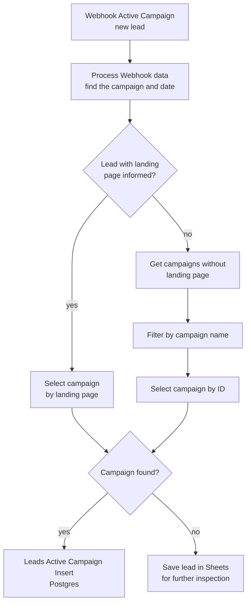

# ActiveCampaign Leads Archiving in Postgres with n8n | Match Every Lead to Its Campaign for Reporting

**Workflow file:** [`ActiveCampaign Leads Archiving in Postgres.json`](../ActiveCampaign%20Leads%20Archiving%20in%20Postgres.json)

This n8n workflow archives every new ActiveCampaign lead in a Postgres database, linked to the marketing campaign it came from. When ActiveCampaign sends a new lead, the workflow works out which campaign the lead signed up through, finds that campaign in your Postgres campaigns table, and saves the lead with its UTM parameters, traffic source, device, browser, and location. Leads whose campaign can't be found are saved to a Google Sheet instead, so you can see which campaigns are missing from the table.

With every lead stored against its campaign, you can build Postgres tables and materialized views on top of the data and connect them to a reporting tool such as Looker Studio to break down leads by campaign, source, device, and region.

---

## What it's used for

- **Reporting on lead quality by campaign.** Every lead is stored with the ID of the campaign it came from, ready for SQL queries and dashboards.
- **Understanding where leads come from.** UTM source, medium, campaign, term, and content are kept for every lead, along with the traffic source.
- **Profiling your audience.** Device, browser, operating system, city, state, country, and postal code show who your campaigns reach, so you can adjust targeting.
- **Keeping a permanent lead archive.** Leads are copied out of ActiveCampaign as they arrive, so your history doesn't depend on your CRM plan or contact limits.
- **Catching untracked campaigns.** Leads from campaigns that aren't in your campaigns table land in a Google Sheet, so you can add the missing campaigns.

## At a glance

| | |
|---|---|
| **Trigger** | An ActiveCampaign webhook, sent when a new lead comes in |
| **Campaign matching** | By landing page URL, or by campaign name for campaigns without a landing page |
| **Storage** | Postgres: a `campanhas_active_campaign` table of campaigns and a `leads_active_campaign` table of leads |
| **Unmatched leads** | Appended to a Google Sheet for review |
| **Data saved per lead** | Email, date, traffic source, UTM parameters, device, browser, operating system, postal code, city, state, and country |
| **Reporting** | Not included. Build views and dashboards on the Postgres tables, for example in Looker Studio. |
| **AI** | None |
| **Credentials** | Postgres, Google Sheets |

The table and column names are in Portuguese. Their meanings are listed in **Step 3** below.

---

## How it works



### How campaign data is stored in ActiveCampaign

The workflow expects each campaign to have its own set of contact custom fields in ActiveCampaign, all starting with the same campaign prefix. For a campaign with the prefix `lancamento10`, the fields are:

| Custom field | Contains |
|---|---|
| `lancamento10datasource` | The date and time the lead came in through this campaign |
| `lancamento10pagina` | The landing page URL the lead signed up on |
| `lancamento10source` | The traffic source, for example `facebook` |
| `lancamento10utmsource` | UTM source |
| `lancamento10utmmedium` | UTM medium |
| `lancamento10utmcampaign` | UTM campaign |
| `lancamento10utmterm` | UTM term |
| `lancamento10utmcontent` | UTM content |

These fields are shared by all campaigns: `dispositivo` (device), `browser`, `sis_operacional` (operating system), `cep` (postal code), `cidade` (city), `estado` (state), and `pais` (country).

A contact who signed up for several campaigns has a `…datasource` field for each one. The workflow uses the most recent of those dates to decide which campaign the new lead belongs to.

### Step 1: Receive the lead

| Node | What it does |
|---|---|
| `Webhook Active Campaign` | Receives the lead from ActiveCampaign as a `POST` request. ActiveCampaign sends contact data form-encoded, and n8n keeps the keys as they are, such as `contact[email]` and `contact[fields][lancamento10pagina]`. |
| `Process Webhook data` | Finds every `contact[fields][…datasource]` field, picks the one with the most recent date, and returns the campaign prefix (for example `lancamento10`) as `campaign` and that date as `date`. |

### Step 2: Find the campaign

Campaigns are looked up in `campanhas_active_campaign` in one of two ways.

**Leads with a landing page**

| Node | What it does |
|---|---|
| `Lead with landing page informed?` | Checks whether the lead's `…pagina` field has a URL. |
| `Select campaign by landing page` | Looks for a campaign whose `landing_page` matches the lead's URL. The URL is cleaned first: anything from `/?` onward is removed, `http:` becomes `https:`, and trailing slashes are dropped. Both the `.com` and `.com.br` versions of the URL are tried, so either one in the table matches. |

**Leads without a landing page**

| Node | What it does |
|---|---|
| `Get campaigns without landing page` | Reads every campaign whose `landing_page` is empty. |
| `Filter by campaign name` | Keeps the campaign whose `nome_campanha` matches the lead's campaign prefix, ignoring hyphens and letter case. For example, `WEBINAR-JAN` matches the prefix `webinarjan`. |
| `Select campaign by ID` | Reads the matching campaign's row again by its `id`. |

**Both paths**

| Node | What it does |
|---|---|
| `Campaign found?` | Continues to Postgres if a campaign `id` was found. Otherwise the lead goes to the review sheet. It only checks the first result. |

### Step 3: Save the lead

| Node | What it does |
|---|---|
| `Leads Active Campaign Insert` | Inserts the lead into `leads_active_campaign`, with the campaign's `id` in `id_correspondente`. |
| `Save lead in Sheets for further inspection` | Appends the lead to a Google Sheet, with the campaign prefix and cleaned landing page, so you can add the missing campaign to `campanhas_active_campaign`. |

Each lead row in Postgres contains:

| Column | Meaning | Source field |
|---|---|---|
| `id_correspondente` | ID of the matching campaign | `id` from `campanhas_active_campaign` |
| `email` | Lead's email address | `contact[email]` |
| `data` | When the lead came in | The most recent `…datasource` field |
| `fonte` | Traffic source, trimmed and in capitals | `…source` |
| `utm_source`, `utm_medium`, `utm_campaign`, `utm_term`, `utm_content` | UTM parameters | `…utmsource`, `…utmmedium`, `…utmcampaign`, `…utmterm`, `…utmcontent` |
| `dispositivo` | Device | `dispositivo` |
| `navegador` | Browser | `browser` |
| `sistema_operacional` | Operating system | `sis_operacional` |
| `cep` | Postal code | `cep` |
| `cidade` | City | `cidade` |
| `estado` | State | `estado` |
| `pais` | Country | `pais` |

The review sheet gets the same lead fields, plus `nome_campanha` (the campaign prefix, in capitals), `landing_page` (the cleaned URL), and `expert`, which is set to a fixed value in the node.

---

## Setup

### 1. Create the Postgres tables

The workflow needs two tables in the `public` schema. This is a minimal version with the columns the workflow reads and writes. Add your own columns, indexes, and views as needed.

```sql
CREATE TABLE campanhas_active_campaign (
  id            SERIAL PRIMARY KEY,
  nome_campanha TEXT NOT NULL,
  landing_page  TEXT
);

CREATE TABLE leads_active_campaign (
  id                  SERIAL PRIMARY KEY,
  id_correspondente   INTEGER NOT NULL REFERENCES campanhas_active_campaign (id),
  email               TEXT NOT NULL,
  data                TIMESTAMP,
  fonte               TEXT,
  utm_source          TEXT,
  utm_medium          TEXT,
  utm_campaign        TEXT,
  utm_term            TEXT,
  utm_content         TEXT,
  dispositivo         TEXT,
  navegador           TEXT,
  sistema_operacional TEXT,
  cep                 TEXT,
  cidade              TEXT,
  estado              TEXT,
  pais                TEXT
);
```

### 2. Add your campaigns

Add one row to `campanhas_active_campaign` per campaign:

- **Campaigns with a landing page:** set `landing_page` to the page's URL with `https://`, no query string, and no trailing slash, for example `https://example.com/lancamento10`.
- **Campaigns without a landing page:** leave `landing_page` empty and set `nome_campanha` to the campaign's custom-field prefix. Hyphens and capitals are ignored, so `WEBINAR-JAN` works for the prefix `webinarjan`.

```sql
INSERT INTO campanhas_active_campaign (nome_campanha, landing_page) VALUES
  ('LANCAMENTO-10', 'https://example.com/lancamento10'),
  ('WEBINAR-JAN', NULL);
```

### 3. Create the review sheet

Create a Google Sheet with these column headers in the first row: `expert`, `nome_campanha`, `landing_page`, `fonte`, `email`, `utm_source`, `utm_medium`, `utm_campaign`, `utm_term`, `utm_content`, `data`, `dispositivo`, `sistema_operacional`, `pais`, `estado`, `cidade`, `cep`, `navegador`.

### 4. Import the workflow and connect credentials

In n8n, go to **Workflows → Import from File** and select the workflow file. Then connect:

| Service | Nodes |
|---|---|
| Postgres | `Select campaign by landing page`, `Get campaigns without landing page`, `Select campaign by ID`, `Leads Active Campaign Insert` |
| Google Sheets | `Save lead in Sheets for further inspection` |

### 5. Point the nodes at your own resources

| Node | Change |
|---|---|
| `Save lead in Sheets for further inspection` | Select your review sheet. The node still points to the original project's spreadsheet. Also change or remove the fixed `expert` value. |
| The four Postgres nodes | Check that the schema (`public`) and table names match your database. |

### 6. Connect ActiveCampaign

1. Activate the workflow and copy the **Production URL** from `Webhook Active Campaign`.
2. In ActiveCampaign, add a webhook that sends new leads to that URL. This can be an account webhook under **Settings → Developer → Manage Webhooks**, or a **Webhook** action in the automation your campaigns use.
3. Choose the event that fires when a new lead signs up, such as a contact being added or a form being submitted.
4. Send a test lead, then check `leads_active_campaign` or the review sheet for the new row.

### 7. Make it yours

- **Change how landing pages are matched:** edit the two `landing_page` conditions in `Select campaign by landing page`. They currently try `.com` and `.com.br` versions of each URL, so adjust them for your own domains.
- **Store more fields:** add the column to `leads_active_campaign`, then map it in `Leads Active Campaign Insert` from `$('Webhook Active Campaign').item.json.body['contact[fields][your_field]']`.
- **Get alerts for unmatched leads:** add a Slack or email node after `Save lead in Sheets for further inspection`.
- **Build the reporting layer:** create Postgres views or materialized views that join `leads_active_campaign` to `campanhas_active_campaign`, and connect them to Looker Studio or another BI tool.

---

## Troubleshooting

| Symptom | Likely cause |
|---|---|
| The workflow never runs | The workflow isn't active, or the ActiveCampaign webhook points to the test URL instead of the production URL |
| Leads go to the review sheet even though the campaign exists | The `landing_page` in the table doesn't match the cleaned URL (check `https://`, trailing slashes, and the domain), or `nome_campanha` doesn't match the campaign prefix |
| Every lead goes to the review sheet | The custom fields don't follow the `<prefix>datasource` naming, so no campaign is detected. Check the output of `Process Webhook data`. |
| Leads are matched to the wrong campaign | The contact has several `…datasource` fields and the most recent date isn't the campaign they just joined |
| `Leads Active Campaign Insert` fails with "Cannot read properties of undefined (reading 'trim')" | The lead has no `…source` field for its campaign. Add the field in ActiveCampaign, or change the `fonte` mapping to `(…source] ?? '').trim()`. |
| `Save lead in Sheets for further inspection` fails with "Cannot read properties of undefined (reading 'split')" | The lead has no `…pagina` field at all and its campaign wasn't found by name |
| `relation "…" does not exist` | The tables haven't been created, or they're in a different schema than `public` |
| Insert fails with a foreign key or "null value" error | The campaign `id` or `email` is missing, or the table has extra required columns the workflow doesn't fill |
