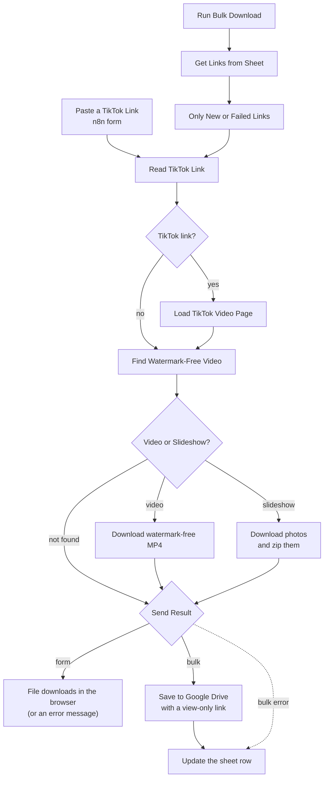

# Download TikTok Videos Without Watermarks with n8n | TikTok Downloader Form and Bulk Google Drive Archive

**Workflow file:** [`Download TikTok Videos Without Watermarks.json`](../Download%20TikTok%20Videos%20Without%20Watermarks.json)

This n8n workflow lets you download TikTok videos without watermarks from your own n8n instance. Paste a TikTok link into a simple n8n form and the original video downloads straight to your browser, with no TikTok watermark, in the highest quality TikTok serves. Photo slideshows download as a .zip of the photos. For larger jobs, list links in a Google Sheet and the workflow downloads them all to Google Drive and writes the results back to the sheet.

The video comes directly from TikTok's own servers. There are no third-party downloader sites, ads, or download limits.

---

## What it's used for

- **Saving reference content.** Creators and social media managers can save TikToks they want to study or reference, without the watermark covering part of the frame.
- **Archiving your own TikToks.** Keep clean copies of your brand's videos to repost on Instagram Reels, YouTube Shorts, or your website.
- **Building a swipe file.** Bulk mode logs each video's creator, caption, quality, and Drive link in a Google Sheet, so good ideas are easy to find later.
- **Competitor and trend research.** Download a list of TikToks in one run for analysis or team review.
- **Adding TikTok downloads to other automations.** The workflow is a starting point for anything that needs the original video file, such as transcription, clipping, or reposting.

Only download videos you own or have permission to reuse.

## At a glance

| | |
|---|---|
| **Trigger** | An n8n form (one link at a time), or a manual run that reads links from a Google Sheet |
| **Supported links** | TikTok video links (`tiktok.com/@user/video/…`), photo slideshow links (`tiktok.com/@user/photo/…`), and share links from the app (`vm.tiktok.com/…`) |
| **Returns** | An MP4 video without a watermark, or a .zip of a slideshow's photos |
| **Video quality** | The highest-resolution H.264 version TikTok offers for the video |
| **Video source** | TikTok's own servers (the clean file TikTok's web player uses) |
| **Storage** | Form: the file downloads in your browser. Bulk: Google Drive, with results written back to your Google Sheet. |
| **Error handling** | A clear message for invalid links, private or deleted posts, bot checks, and failed downloads. Failed bulk rows are marked `error` and retried on the next run. |
| **AI** | None |
| **Credentials** | None for the form. Google Sheets and Google Drive for bulk mode. |

---

## How it works

### How it downloads TikTok videos without watermarks

Every TikTok video page includes data describing the video, including several versions of the file at different resolutions and codecs. The versions TikTok's web player streams have no watermark. TikTok adds the watermark only to a separate "download" version (`downloadAddr`), which this workflow never uses.

The workflow loads the TikTok page the way a browser does, reads that data, picks the best watermark-free version, and downloads it with the cookies TikTok set when the page loaded. TikTok requires those cookies to release the file.

The canvas is organized into four labeled sections.

### Step 1: Paste a TikTok link or run a bulk list

| Node | What it does |
|---|---|
| `Paste a TikTok Link` | An n8n form titled **Download TikTok Videos Without Watermarks**, with one required **TikTok link** field and a **Download without watermark** button. |
| `Run Bulk Download` | Starts bulk mode when you click **Execute workflow** on it. |
| `Get Links from Sheet` | Reads every row of your Google Sheet. |
| `Only New or Failed Links` | Keeps rows that have a `tiktok_url` and aren't marked `downloaded`, so finished rows are skipped and failed rows are retried. |
| `Read TikTok Link` | Pulls the first TikTok link out of whatever was pasted, so text like "check this out https://vm.tiktok.com/abc/!" still works. Records whether the link came from the form or the sheet, the sheet row number, and the browser ID (User-Agent) used for every request. |
| `Is It a TikTok Link?` | Sends TikTok links on to be loaded. Anything else goes straight to `Find Watermark-Free Video`, which returns the "doesn't look like a TikTok link" message. |

### Step 2: Find the watermark-free video

| Node | What it does |
|---|---|
| `Load TikTok Video Page` | Requests the TikTok page as a desktop Chrome browser. Share links redirect to the full video page automatically. It waits 1.5 seconds between links in bulk mode, tries twice if a request fails, and passes failures on as an error message instead of stopping. |
| `Find Watermark-Free Video` | Reads the video data embedded in the page. For videos, it picks the highest-resolution H.264 version, falls back to any other codec, and then to the default stream (`playAddr`). For slideshows, it collects the photo links. It also keeps TikTok's cookies and builds the file name from the creator's handle and the video ID. |
| `Video or Slideshow?` | Sends videos, slideshows, and posts that couldn't be found to their own branches. |

The workflow prefers H.264 because it plays in every app and editor. TikTok's H.265 versions don't open in many Windows and Android players. If a video only has an H.265 version, that version is used.

### Step 3: Download TikTok videos without watermarks

| Node | What it does |
|---|---|
| `Download Watermark-Free Video` | Downloads the clean MP4 using TikTok's cookies, waiting up to 2 minutes. It tries twice if the download fails. |
| `Name Video File` | Names the file `tiktok_<creator>_<video ID>.mp4`, for example `tiktok_mock.creator_7251387037834595630.mp4`. If the download failed, it passes on an error message instead. |
| `Split Slideshow Photos` | Splits a slideshow into one item per photo. |
| `Download Slideshow Photos` | Downloads each photo. |
| `Combine Slideshow Photos` | Groups each slideshow's photos back together and names them `tiktok_<creator>_<post ID>_01.jpg`, `_02.jpg`, and so on. |
| `Photos Downloaded?` | Continues if at least one photo downloaded. Otherwise it passes on an error message. |
| `Zip Slideshow Photos` | Zips the photos into `tiktok_<creator>_<post ID>.zip`. |

The finished file, video or zip, is stored in a field called `tiktokFile`.

### Step 4: Send the file

| Node | What it does |
|---|---|
| `Send Result` | Routes each result by where the link came from (form or sheet) and whether it succeeded. |
| `Return Watermark-Free File` | Shows **Your TikTok download is ready** and downloads the file in the browser. |
| `Show Error` | Shows **Couldn't download that TikTok** and the reason. |
| `Upload to Google Drive` | Bulk mode only. Saves the file to Google Drive. It uploads to the root of My Drive until you choose a folder. |
| `Share Link (View Only)` | Gives the file a link anyone can open to watch or download it. Nobody can edit it, and it doesn't appear in Drive search. |
| `Build Downloaded Row` / `Build Error Row` | Prepare the results for the sheet. |
| `Update Sheet Row` | Writes the results to the row the link came from, in the same sheet selected in `Get Links from Sheet`. New columns are created automatically. |

After a bulk run, each row in your sheet contains:

| Column | Meaning |
|---|---|
| `tiktok_url` | The TikTok link you added |
| `status` | `downloaded` or `error` |
| `file_name` | The file name in Google Drive |
| `drive_link` | A view-only link to the file |
| `creator` | The creator's handle, for example `@username` |
| `caption` | The post's caption, including hashtags |
| `quality` | The video's resolution, for example `1080p`, or the number of photos in a slideshow |
| `error` | Why the download failed, when it did |
| `updated_at` | When the row was last processed |

---

## Setup

### 1. Import the workflow

In n8n, go to **Workflows → Import from File** and select the workflow file.

### 2. Try the form

The form needs no credentials.

1. Open `Paste a TikTok Link` and click **Execute step**. The test form opens in a new tab.
2. Paste a TikTok link and click **Download without watermark**.
3. The video downloads in your browser when it's ready, usually within a few seconds.

To use the form without the editor open, publish the workflow and copy the **Production URL** from `Paste a TikTok Link`. Anyone with that link can use the form, so see **Make it yours** to add a login.

### 3. Set up bulk download (optional)

1. Create a Google Sheet with a column named `tiktok_url` in the first row, and paste one TikTok link per row below it.
2. Connect your Google Sheets credential in `Get Links from Sheet` and `Update Sheet Row`.
3. In `Get Links from Sheet`, choose your spreadsheet and sheet **From list** or **By URL**. `Update Sheet Row` writes back to the same sheet automatically.
4. Connect your Google Drive credential in `Upload to Google Drive` and `Share Link (View Only)`.
5. In `Upload to Google Drive`, choose the folder for downloaded videos.
6. Click **Execute workflow** on `Run Bulk Download`.

When the run finishes, every row shows `downloaded` with a Drive link, or `error` with the reason. Run it again at any time: rows marked `downloaded` are skipped, and rows marked `error` are retried.

### 4. Test it

Before relying on the workflow, try:

1. A regular TikTok video link
2. A share link copied from the TikTok app
3. A photo slideshow link
4. Some text that isn't a link, to check the error message

### 5. Make it yours

- **Require a login for the form:** in `Paste a TikTok Link`, set **Authentication** to **Basic Auth**.
- **Give the form a readable URL:** set **Path** in the `Paste a TikTok Link` options, for example `tiktok-downloader`.
- **Run bulk downloads on a schedule:** replace `Run Bulk Download` with a **Schedule Trigger** to pick up new rows every hour or day.
- **Change the file names:** edit `fileBaseName` in `Find Watermark-Free Video`.
- **Keep Drive files private:** delete `Share Link (View Only)` and connect `Upload to Google Drive` directly to `Build Downloaded Row`. The `drive_link` column still works for anyone the folder is shared with.
- **Slow down bulk runs:** raise **Batch Interval** in `Load TikTok Video Page` if TikTok starts showing bot checks during large runs.
- **Prefer H.265:** in `Find Watermark-Free Video`, change `includes('h264')` to `includes('h265')`. H.265 files are smaller at the same quality but don't play everywhere.

---

## Troubleshooting

| Symptom | Likely cause |
|---|---|
| The form link shows "not found" or doesn't respond | The workflow isn't published, or you're using the test URL without clicking **Execute step** first |
| "That doesn't look like a TikTok link" | The pasted text has no `tiktok.com` link in it |
| "TikTok didn't return this post" | The post is private, deleted, age-restricted, or not available in your server's region |
| "TikTok sent back a page without the video data" | TikTok showed a bot check to your n8n server. Wait a few minutes and try again. If it keeps happening, update the browser ID (User-Agent) in `Read TikTok Link`, or raise **Batch Interval** for bulk runs. |
| Every link fails with the bot check message | TikTok is blocking your server's IP address. This is common on some cloud hosts. Route `Load TikTok Video Page` through a scraping proxy or API, or run n8n from a different network. |
| "Found the video but couldn't download it" | TikTok rejected the file request, usually temporarily. Try again in a minute. |
| Every link stopped working at once | TikTok changed how its pages are built. Check the output of `Load TikTok Video Page` for a `__UNIVERSAL_DATA_FOR_REHYDRATION__` script and update `Find Watermark-Free Video` to match. |
| The video doesn't play in some apps | The video only had an H.265 version. Convert it, or open it in a player that supports H.265, such as VLC. |
| Long videos fail to download | They take longer than 2 minutes. Raise **Timeout** in the `Download Watermark-Free Video` options. |
| Bulk run fails with "Parameter Document is required" | No sheet is selected in `Get Links from Sheet` |
| Bulk run fails with "Sheet with ID … not found" | The sheet in `Get Links from Sheet` was chosen **By Name**. Choose it **From list** or **By URL** instead. |
| Bulk run finishes but nothing is downloaded | Every row is already marked `downloaded`, or the link column isn't named exactly `tiktok_url` |
| Drive links say "You need access" | `Share Link (View Only)` failed, or your Google Workspace admin blocks "anyone with the link" sharing |
