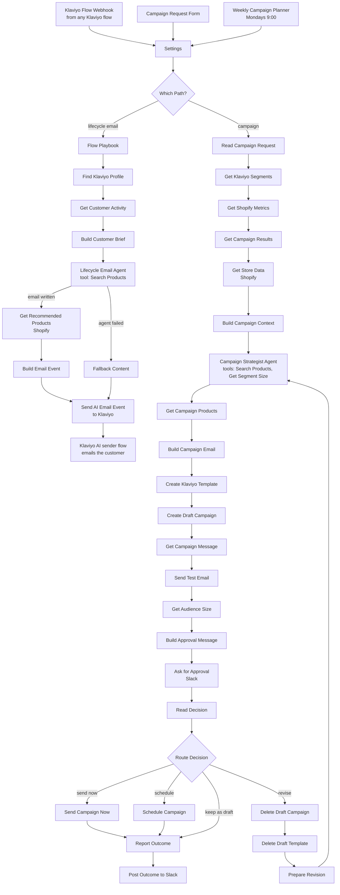

# How to Automate Email Marketing for Ecommerce | AI Agents That Write Your Shopify Store's Klaviyo Flows and Campaigns

**Workflow file:** [`ai-ecommerce-email-marketing-automation-shopify-klaviyo.json`](../ai-ecommerce-email-marketing-automation-shopify-klaviyo.json)

This n8n workflow automates email marketing for an ecommerce store on Shopify and Klaviyo with two AI agents. The **Lifecycle Email Agent** writes every email in your Klaviyo flows (abandoned checkout, welcome, browse abandonment, post-purchase, win-back) for the one customer receiving it, using what Klaviyo knows about them. The **Campaign Strategist Agent** plans and writes your marketing campaigns from your Klaviyo segments, past campaign results, and Shopify sales, builds them in Klaviyo, and asks you to approve them in Slack.

Most ecommerce email automation stops at a template: every customer in a flow gets the same email, and campaigns start from a blank page. Here the emails are written from each customer's real data, products come from your live Shopify catalog, and Klaviyo still does the sending, so your templates, unsubscribes, Smart Sending, flow filters, and revenue reporting keep working as they do today.

---

## What it's used for

- **Personal flow emails.** An abandoned checkout email that names what is in the cart and recommends products that go with it. A win-back email that mentions what the customer bought before and what is new since. Each one is written for the person receiving it.
- **Using the data already in Klaviyo.** The agent reads each customer's orders, open cart, recently viewed products, email engagement, and Klaviyo's predictions (lifetime value, churn risk, expected next order date).
- **Planning campaigns from data.** Ask for "launch the fall collection to past buyers" in a form, or let the agent plan one campaign every Monday from your best sellers, new arrivals, stock levels, and which past campaigns made the most revenue.
- **Recommending products that exist.** Products come from Shopify and are checked before they go in an email: active, in stock, with the real price and link. The AI can't invent a product, price, or discount.
- **Keeping a person in charge of campaigns.** Every campaign arrives in Slack as a draft with a test email in your inbox. Send it, schedule it, keep it as a draft, or send it back with notes for a new version.

## At a glance

| | |
|---|---|
| **Triggers** | A webhook step in any Klaviyo flow, a campaign request form, and a weekly schedule (Mondays at 9:00) |
| **AI agents** | Lifecycle Email Agent and Campaign Strategist Agent (n8n AI Agent with OpenAI `gpt-5-mini`) |
| **Agent tools** | Search Products (Shopify), Get Segment Size (Klaviyo) |
| **Klaviyo data used** | Profiles, predictive analytics, events from the last 180 days, segments, and campaign results from the last 90 days |
| **Shopify data used** | Product search, best sellers from the last 30 days, new arrivals, stock levels |
| **Flow emails** | Sent by Klaviyo from an **AI Email Ready** event, with your template |
| **Campaigns** | Built in Klaviyo as a draft (template plus campaign), with a test email and Slack approval |
| **Approval options** | Send now, schedule, revise with notes (up to 3 versions), or keep as a draft |
| **APIs** | Klaviyo API revision `2026-10-15`, Shopify Admin GraphQL API `2026-10` |
| **Credentials** | Klaviyo private API key, Shopify OAuth2, OpenAI, Slack, and a secret header for the Klaviyo webhook |

---

## How it works



The canvas is organized into six labeled sections.

### Step 1: Triggers and settings

| Node | What it does |
|---|---|
| `Klaviyo Flow Webhook` | Receives a POST from a webhook step in a Klaviyo flow at `/webhook/klaviyo-ai-email`. It checks the secret header and answers Klaviyo right away, so the flow is never held up. |
| `Campaign Request Form` | A form at `/form/ai-email-campaign` where you describe a campaign. It answers right away; the draft arrives in Slack a few minutes later. |
| `Weekly Campaign Planner` | Starts a campaign every Monday at 9:00, in the workflow's time zone, using the weekly brief in `Settings`. |
| `Settings` | Your store details, used by both agents (see Setup). |
| `Which Path?` | Sends Klaviyo webhook calls to the Lifecycle Email Agent, and form and weekly runs to the Campaign Strategist Agent. |

### Step 2: Lifecycle emails: read the customer in Klaviyo

Each Klaviyo webhook call names the flow, the step, and the customer's email, for example `{"flow": "abandoned_checkout", "step": 2, "email": "jane@example.com"}`.

| Node | What it does |
|---|---|
| `Flow Playbook` | Looks up the flow in the playbook and adds its instructions: the goal of the flow, what this step's email should do, which products to show, and when a discount is allowed. An unknown flow uses the `default` entry. If the call has no valid email, the run stops there. |
| `Find Klaviyo Profile` | Finds the customer's Klaviyo profile by email, with their subscriptions and Klaviyo's predictive analytics. |
| `Get Customer Activity` | Reads up to 250 of the customer's events from the last 180 days, newest first, with each event's metric name. |
| `Build Customer Brief` | Turns the profile and events into a short brief for the agent (see below). |

The playbook comes with these flows. Edit the code in `Flow Playbook` to change any instruction, or add your own flows.

| Flow key | Steps | Discount rule |
|---|---|---|
| `welcome` | 1 welcome and best sellers, 2 brand story and matching products, 3 answer common doubts | Never |
| `abandoned_checkout` | 1 friendly reminder of the cart, 2 help them decide plus one related product, 3 last reminder | Step 3 only, and only for customers with fewer than 2 orders |
| `browse_abandonment` | 1 the product they viewed, 2 alternatives | Never |
| `post_purchase` | 1 thank you and a care tip, 2 products that go with the order, 3 review request | Never |
| `replenishment` | 1 time to restock what they bought | Never |
| `win_back` | 1 what is new since their last order, 2 a warm last attempt | Step 2 only, and only when churn risk is above 0.5 or unknown |
| `default` | Any other flow key: a helpful email with products that fit | Never |

The customer brief gives the agent:

- First name, location, and when the profile was created
- Email marketing consent status
- Number of orders, average order value, and the last 3 orders with their items
- Klaviyo's predicted lifetime value, churn risk, expected next order date, and average days between orders
- The open checkout (or the last item added to cart) with its items and value
- Up to 6 recently viewed products
- Last open, last click, and clicks in the last 30 days
- Up to 5 recent email subjects, so it doesn't repeat them
- Up to 10 simple custom profile properties

The checkout link for the email button is taken from the latest checkout event. You can also pass it in the webhook as `cta_url`.

### Step 3: Lifecycle Email Agent writes and sends

| Node | What it does |
|---|---|
| `Lifecycle Email Agent` | Writes the email for this customer in your brand voice. It calls `Search Products` to find products to recommend, and returns a subject, preview text, headline, body, button text, product ids, whether to offer a discount, and one sentence on the data it used. |
| `OpenAI Chat Model` | `gpt-5-mini`, shared by both agents. |
| `Search Products` | A tool that searches active products in Shopify (GraphQL `products` query) and returns up to 8 with their id, type, tags, stock, and price. |
| `Lifecycle Email Format` | Makes the agent return the fields above as JSON. |
| `Get Recommended Products` | Looks up the chosen products in Shopify by id. |
| `Build Email Event` | Keeps only products that are active and in stock (up to `max_products`), with their real link, image, and price. It strips HTML and Klaviyo template tags from the copy, then builds the **AI Email Ready** event. |
| `Fallback Content` | If the agent fails, builds the same event from the playbook's fallback copy, so the customer still gets an email. |
| `Send AI Email Event` | Sends the event to Klaviyo (`POST /api/events`), with up to 3 tries. |

Each event has a unique id made from the flow, step, profile, and date. If Klaviyo retries the webhook, the repeated event is ignored and the customer gets one email.

The **AI Email Ready** event has these properties, which the Klaviyo template uses:

| Property | Contents |
|---|---|
| `subject`, `preview_text`, `headline` | The subject line, preview text, and headline |
| `body_paragraphs` | A list of 1 to 4 short paragraphs |
| `cta_text`, `cta_url` | The button text and link: the checkout link for cart emails, otherwise your store |
| `products`, `has_products` | Up to 3 recommended products, each with `title`, `url`, `image_url`, and `price` |
| `cart_items`, `has_cart` | The items in the open checkout, each with `title`, `quantity`, `price`, and `image_url` |
| `offer_discount` | `true` when the discount rule allows a discount for this customer |
| `flow`, `flow_name`, `step` | Which flow and step the email is for |
| `ai_generated`, `ai_reasoning` | Whether the AI wrote it, and the data it used |

### Step 4: Campaigns: gather Klaviyo and Shopify data

| Node | What it does |
|---|---|
| `Read Campaign Request` | Takes the form answers (brief, products to feature, audience, offer), or the `weekly_brief` from `Settings` for the weekly run. |
| `Get Klaviyo Segments` | Lists your active Klaviyo segments, following Klaviyo's pages of results. |
| `Get Shopify Metrics` | Finds the Shopify **Placed Order** metric in Klaviyo. |
| `Get Campaign Results` | Pulls delivered, open rate, click rate, order rate, and revenue for each campaign in the last 90 days, with Placed Order as the conversion. |
| `Get Store Data` | Reads from Shopify: up to 5 line items from each of the last 30 orders placed in the last 30 days (for best sellers), the 12 newest active products, and the 12 active products with the most stock. |
| `Build Campaign Context` | Builds the agent's brief: the request, the segments, past campaigns sorted by revenue, the best sellers with units sold, new arrivals, and the products with the most stock. It stops with a clear error if no segments were found. |

### Step 5: Campaign Strategist Agent builds the draft in Klaviyo

| Node | What it does |
|---|---|
| `Campaign Strategist Agent` | Picks one segment, 2 to 6 products, and the angle, using what worked in past campaigns, and writes the email: campaign name, subject, preview text, headline, intro, up to 3 sections, button, offer (only one from the request), and 2 or 3 sentences on the data behind its choices. |
| `Get Segment Size` | A tool the agent can use to check how many people are in a segment. |
| `Campaign Format` | Makes the agent return those fields as JSON. |
| `Get Campaign Products` | Looks up the chosen products in Shopify. |
| `Build Campaign Email` | Checks that the segment is one of yours, keeps only active, in-stock products, and builds the email HTML: your logo or store name, headline, a "Hi {first name}" greeting, intro, offer box, button, sections, a product grid with images and prices, and a footer with your address and an unsubscribe link. The button only links to your own store. |
| `Create Klaviyo Template` | Saves the HTML as a code template in Klaviyo. |
| `Create Draft Campaign` | Creates the campaign in Klaviyo with the segment as its audience and one email that uses the template, your sender, the subject, and the preview text. It is not sent. |
| `Get Campaign Message` | Gets the campaign's email message id, used for scheduling. |
| `Send Test Email` | Sends a test of the template to `approver_email`. |
| `Get Audience Size` | Counts the people in the segment for the Slack message. |
| `Build Approval Message` | Writes the Slack message: campaign, audience and size, subject, preview text, headline, offer, products, and the agent's reasoning. |

### Step 6: Approve in Slack

| Node | What it does |
|---|---|
| `Ask for Approval` | Posts the draft to your Slack channel with a **Review campaign** button, and waits up to 72 hours for an answer. |
| `Read Decision` | Reads the answer. A send time must be in the format `2026-11-12 10:00`, in your `timezone`, and at least 15 minutes away. |
| `Route Decision` | Sends the campaign, schedules it, revises it, or keeps it as a draft. |
| `Send Campaign Now` | Starts sending the campaign in Klaviyo. |
| `Schedule Campaign` | Schedules the email for the time you entered. |
| `Delete Draft Campaign` / `Delete Draft Template` | For a revision, removes the old draft and its template from Klaviyo. |
| `Prepare Revision` | Sends your notes and the previous draft back to the agent, which writes a new version. You get a new test email and Slack message. |
| `Report Outcome` / `Post Outcome to Slack` | Confirms in Slack what happened: sending, scheduled, kept as a draft (with the reason), or Klaviyo's error. |

The form in Slack has three fields:

| Field | Use |
|---|---|
| **What should we do?** | Send now, Schedule for the time below, Revise with my notes, or Keep as a draft in Klaviyo |
| **Send time** | For scheduling, for example `2026-11-12 10:00` |
| **Notes for the AI** | For revising, for example "Make it less salesy and feature the new wool sweater first" |

A campaign can have up to `max_revisions` versions (3 by default). After that, a revise request keeps the draft. No answer within 72 hours also keeps the draft.

---

## Setup

Plan on about 45 minutes, most of it in Klaviyo.

### 1. Create the credentials

| Credential | How to create it | Nodes |
|---|---|---|
| **Klaviyo API** (HTTP Header Auth) | In Klaviyo, go to **Settings → API keys** and create a private API key with these scopes: Campaigns (full), Events (full), Metrics (read), Profiles (read), Segments (read), Templates (full). In n8n, set **Name** to `Authorization` and **Value** to `Klaviyo-API-Key ` followed by your key, for example `Klaviyo-API-Key pk_abc123`. | Every Klaviyo HTTP node and the `Get Segment Size` tool |
| **Shopify OAuth2** | In the Shopify Dev Dashboard, create an app for your store, add n8n's OAuth redirect URL (shown in the n8n credential) as an allowed redirect URL, and give it the `read_products`, `read_orders`, `write_products`, and `write_orders` scopes (n8n's Shopify OAuth2 credential asks for all four; this workflow only reads). Enter the shop subdomain, Client ID, and Client Secret in n8n and connect. | `Search Products`, `Get Recommended Products`, `Get Store Data`, `Get Campaign Products` |
| **OpenAI** | An OpenAI API key. | `OpenAI Chat Model` |
| **Slack** | A Slack app with a bot token that can post to your channel. Invite the bot to the channel. | `Ask for Approval`, `Post Outcome to Slack` |
| **Klaviyo Webhook Secret** (HTTP Header Auth) | Pick a header name, such as `X-Webhook-Secret`, and a long random value. You'll enter the same pair in Klaviyo. | `Klaviyo Flow Webhook` |

If your store still has a custom app created in the Shopify admin before 2026, you can use its Admin API access token instead: in the four Shopify nodes, change **Credential Type** to **Shopify Access Token API**.

### 2. Fill in Settings

| Field | Meaning |
|---|---|
| `store_name`, `store_url` | Your store's name and website, used in prompts, links, and the campaign header |
| `shopify_store` | Your `.myshopify.com` domain, for the Shopify API |
| `brand_voice` | How your emails should sound. Both agents follow it. |
| `from_email`, `from_label` | The sender for campaigns. The email must be a sending address you have set up in Klaviyo. |
| `approver_email` | Where campaign test emails go |
| `timezone` | Your store's time zone, for scheduling, for example `America/New_York` |
| `slack_channel_id` | The Slack channel for approvals. In Slack, open the channel details; the ID is at the bottom, for example `C0123456789`. |
| `logo_url`, `brand_color` | Your logo image URL (optional) and button color for campaign emails |
| `footer_text` | Your business name and postal address for the campaign footer. Marketing email must include a physical address. |
| `klaviyo_event_name` | The name of the event that triggers the AI sender flow. Default `AI Email Ready`. |
| `max_products` | Products per flow email (default 3) |
| `max_revisions` | Campaign versions allowed in Slack (default 3) |
| `weekly_brief` | What the weekly run should plan |

### 3. Create the AI sender flow in Klaviyo

This one flow sends every email the Lifecycle Email Agent writes.

1. Publish the workflow, then send one test call so Klaviyo creates the **AI Email Ready** metric. Use your own email, which must be a Klaviyo profile:

   ```bash
   curl -X POST "https://your-n8n-domain/webhook/klaviyo-ai-email" \
     -H "X-Webhook-Secret: your-secret" \
     -H "Content-Type: application/json" \
     -d '{"flow": "welcome", "step": 1, "email": "you@yourstore.com"}'
   ```

2. In Klaviyo, create a flow from scratch with the trigger **Metric: AI Email Ready**.
3. Add one email. Set the subject line to `{{ event.subject }}` and the preview text to `{{ event.preview_text }}`.
4. For the content, use a code (HTML) template with the template below, or build your own drag-and-drop template using the event properties from Step 3. Replace `Your Store` and the address with your own.
5. Leave Smart Sending on if you want Klaviyo to skip people who got another email in the last 16 hours. Turn it off if every flow step must send.
6. Set the email live, then turn the flow on.

```html
<!DOCTYPE html>
<html><head><meta charset="utf-8"><meta name="viewport" content="width=device-width, initial-scale=1"></head>
<body style="margin:0;padding:0;background:#f4f4f5;">
<table role="presentation" width="100%" cellpadding="0" cellspacing="0" style="background:#f4f4f5;"><tr><td align="center" style="padding:24px 12px;">
<table role="presentation" width="600" cellpadding="0" cellspacing="0" style="width:100%;max-width:600px;background:#ffffff;border-radius:8px;font-family:Arial,Helvetica,sans-serif;color:#111827;">
<tr><td style="padding:28px 32px 0;text-align:center;font-size:20px;font-weight:bold;">Your Store</td></tr>
<tr><td style="padding:16px 32px 0;">
  <h1 style="font-size:26px;line-height:1.25;margin:0 0 16px;text-align:center;">{{ event.headline }}</h1>
  <p style="font-size:16px;line-height:1.6;color:#374151;margin:0 0 12px;">{{ paragraph }}</p>
</td></tr>

<tr><td style="padding:8px 32px;">
  <table role="presentation" width="100%" cellpadding="0" cellspacing="0">
  
    <tr>
      <td width="80" style="padding:8px 0;"></td>
      <td style="padding:8px 12px;font-size:15px;">{{ item.title }} x{{ item.quantity }}</td>
      <td style="padding:8px 0;font-size:15px;text-align:right;">{{ item.price }}</td>
    </tr>
  
  </table>
</td></tr>


<tr><td style="padding:8px 32px;"><div style="border:2px dashed #111827;border-radius:6px;padding:14px;text-align:center;font-size:16px;font-weight:bold;">Use code  at checkout</div></td></tr>

<tr><td align="center" style="padding:16px 32px 24px;"><a href="{{ event.cta_url }}" style="display:inline-block;background:#111827;color:#ffffff;padding:14px 28px;border-radius:6px;font-size:16px;font-weight:bold;text-decoration:none;">{{ event.cta_text }}</a></td></tr>

<tr><td style="padding:0 32px 8px;font-size:18px;font-weight:bold;">You might also like</td></tr>
<tr><td style="padding:0 24px 16px;"><table role="presentation" width="100%" cellpadding="0" cellspacing="0"><tr>

  <td valign="top" style="padding:8px;text-align:center;width:33%;">
    <a href="{{ product.url }}"></a>
    <div style="font-size:14px;font-weight:bold;margin-top:8px;"><a href="{{ product.url }}" style="color:#111827;text-decoration:none;">{{ product.title }}</a></div>
    <div style="font-size:14px;color:#4b5563;">{{ product.price }}</div>
  </td>

</tr></table></td></tr>

<tr><td style="padding:20px 32px 28px;border-top:1px solid #e5e7eb;font-size:12px;line-height:1.6;color:#6b7280;text-align:center;">Your Store, 123 Main Street, Your City, ST 00000<br><a href="" style="color:#6b7280;">Unsubscribe</a></td></tr>
</table>
</td></tr></table>
</body></html>
```

The discount box uses a Klaviyo coupon named `AI Flow Discount`. Create it in Klaviyo under **Content → Coupons** as a Shopify unique coupon, or delete the `` block if you don't offer discounts.

### 4. Add webhook steps to your Klaviyo flows

In each flow you want the AI to write, put a **Webhook** action where the email would go. Klaviyo requires two-step authentication on your account to add webhooks.

- **URL:** `https://your-n8n-domain/webhook/klaviyo-ai-email`
- **Headers:** your secret header, for example `X-Webhook-Secret` with your value
- **JSON body:** the flow key, the step number, and the profile's email:

```json
{
  "flow": "abandoned_checkout",
  "step": 1,
  "email": "{{ person.email }}"
}
```

Copy the email variable from Klaviyo's **View profile properties** panel if it is named differently in your account. You can add `"cta_url"` with the checkout link variable from **View profile and event variables**, and `"note"` with any extra instruction for the agent.

Example flow setups:

| Flow | Trigger | Flow filter | Steps |
|---|---|---|---|
| Abandoned checkout | Checkout Started from Shopify (Started Checkout in some accounts) | Placed Order zero times since starting this flow | Wait 1 hour, webhook step 1, wait 1 day, webhook step 2, wait 2 days, webhook step 3 |
| Welcome | Added to your newsletter list | None | Wait 5 minutes, webhook step 1, wait 2 days, step 2, wait 3 days, step 3 |
| Browse abandonment | Viewed Product | Placed Order and Checkout Started zero times since starting this flow | Wait 2 hours, webhook step 1, wait 1 day, step 2 |
| Post-purchase | Placed Order | None | Wait 10 minutes, webhook step 1, wait 7 days, step 2, wait 14 days, step 3 |
| Replenishment | Placed Order | Placed Order zero times since starting this flow | Wait your product's reorder time, for example 30 days, then webhook step 1 |
| Win-back | Placed Order | Placed Order zero times since starting this flow | Wait 60 days, webhook step 1, wait 30 days, step 2 |

Klaviyo keeps doing what it does well: the flow filters stop the steps when a customer buys, and only people who can receive marketing get the email.

### 5. Try the campaign agent

1. Open the **Campaign Request Form** URL (shown in the trigger node) and describe a campaign.
2. Within a few minutes, check Slack for the draft and your inbox for the test email.
3. Pick **Keep as a draft in Klaviyo** for your first run, and look at the campaign in Klaviyo under **Campaigns**.

### 6. Make it yours

- **Change what each flow email does:** edit the instructions, discount rules, and fallback copy in `Flow Playbook`, or add new flow keys.
- **Change the voice:** edit `brand_voice` in `Settings`. Both agents follow it.
- **Use a different model:** change the model in `OpenAI Chat Model`, or replace it with another chat model node, such as Anthropic or Google Gemini.
- **Change the weekly run:** edit `weekly_brief`, or change the day and time in `Weekly Campaign Planner`. Turn the trigger off to plan campaigns only from the form.
- **Change the campaign design:** the HTML is built in `Build Campaign Email`. The colors come from `brand_color`, and the logo from `logo_url`.
- **Let the agent choose from fewer segments:** in `Get Klaviyo Segments`, change the filter, for example to `equals(is_starred,true)` to offer only starred segments.
- **Approve in email instead of Slack:** replace `Ask for Approval` with Gmail's **Send and Wait for Response** using the same three form fields.

---

## Troubleshooting

| Symptom | Likely cause |
|---|---|
| Klaviyo shows failed webhooks under **Webhook Analytics** with `401` or `403` | The header name or value in the Klaviyo webhook doesn't match the `Klaviyo Webhook Secret` credential |
| The webhook works but no email arrives | The AI sender flow isn't live, its trigger isn't the **AI Email Ready** metric, Smart Sending skipped the person, or the person can't receive marketing email. Check the event on the profile in Klaviyo. |
| The workflow stops after `Flow Playbook` | The webhook body had no valid `email`. Check the variable in the Klaviyo webhook body. |
| The email is generic and has no products | The customer had little history in Klaviyo, or `Find Klaviyo Profile` returned an error. Check its output and the API key's Profiles and Events scopes. |
| The email says nothing about the cart | The checkout event's items are in fields the brief doesn't read. Check `Get Customer Activity` for the checkout event's properties. |
| The cart button links to the home page | No checkout link was found in the latest checkout event. Add `"cta_url"` with the checkout link variable to the webhook body. |
| An email used the fallback copy | The agent failed. `ai_generated` is `false` on the event, and `ai_reasoning` has the error. Check the OpenAI credential and the agent's output. |
| `401` or `403` from a Klaviyo node | The API key is missing a scope, or the header value doesn't start with `Klaviyo-API-Key ` |
| `Build Approval Message` stops with "Klaviyo did not create the draft campaign" | Klaviyo rejected the campaign, and the error follows in the message. A common cause is a `from_email` that isn't a sending address in your Klaviyo account. |
| `Build Campaign Context` stops with "No active Klaviyo segments" | The API key can't read segments, or the account has no active segments |
| `Build Campaign Email` stops with a segment error | The agent chose a segment that isn't in your list. Run the form again. |
| No test email arrives | Klaviyo allows 100 test sends a day. The Slack message says when the test failed. |
| `Get Campaign Results` errors, or the agent sees no past campaigns | The account has no Placed Order metric from Shopify, or Klaviyo's reporting limit (2 calls a minute, 225 a day) was reached. The campaign is still built. |
| Shopify nodes return `401` or `403` | The Shopify credential isn't connected, or the app lacks `read_products` or `read_orders`. Check that `shopify_store` is your `.myshopify.com` domain. |
| Products are missing from emails | They were inactive or out of stock when checked, so they were left out |
| Scheduling kept the draft | The send time wasn't in the format `2026-11-12 10:00`, or it was less than 15 minutes away |
| No Slack message | The bot isn't in the channel, or `slack_channel_id` is wrong |
