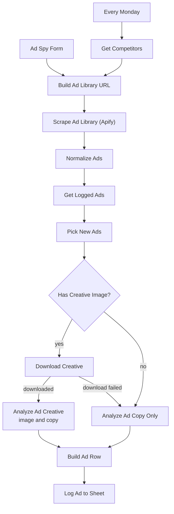

# Facebook Spy Tool | Free AI Facebook Ad Spy Tool with n8n, Apify, and OpenAI

**Workflow file:** [`ai-facebook-ad-spy-tool.json`](../ai-facebook-ad-spy-tool.json)

This n8n workflow is a self-hosted Facebook spy tool. Give it a competitor's Facebook page, a Meta Ad Library link, or a keyword, and it pulls their ads from the Meta Ad Library, has AI break down each ad's hook, angle, offer, and call to action, and logs everything to a Google Sheet. It can also check a list of competitors every week and add only the new ads.

Paid Facebook ad spy tools charge a monthly subscription for the same data. This one is free to run in your own n8n: you pay only for Apify's scraping (charged per ad) and OpenAI's analysis. Apify's Facebook Ads Scraper reads the public Meta Ad Library, so there are no Facebook logins, proxies, or browser automation to maintain.

---

## What it's used for

- **Researching competitors' ads.** See every ad a competitor is running, with the copy, creative, call to action, landing page, and how long each ad has been live.
- **Finding winning ads.** Ads that run for months are usually profitable. New ads are analyzed longest-running first, and each row shows its days running and an AI score.
- **Getting creative ideas.** Each ad comes with three ideas your brand could test, based on what makes the ad work.
- **Tracking competitors over time.** The weekly run adds only ads you haven't seen yet, so the sheet becomes a running swipe file.
- **Researching a market.** Search a keyword such as "protein powder" to see which brands advertise in a niche and how they pitch it.

## At a glance

| | |
|---|---|
| **Triggers** | An n8n form for one search at a time, and a weekly schedule (Mondays at 8:00) that checks every row of a **Competitors** tab |
| **Input** | A Facebook page URL, a Meta Ad Library URL, a Facebook page ID, or a keyword, plus country, maximum ads, and active ads only |
| **Scraping** | Apify's [Facebook Ads Scraper](https://apify.com/apify/facebook-ads-scraper) (`apify/facebook-ads-scraper`), through the synchronous run API |
| **AI** | OpenAI (`gpt-5-mini` by default) through a Basic LLM Chain, with the ad image and copy as input and structured JSON as output |
| **Output** | One row per ad in the **Ads** tab of your Google Sheet: ad details, days running, score, hook, angle, offer, call to action, target audience, emotional triggers, format notes, why it works, three ideas to adapt, and links |
| **Duplicates** | Ads already in the **Ads** tab are skipped. Up to 30 new ads are analyzed per run. |
| **Credentials** | Apify API token (HTTP Header Auth), OpenAI, and Google Sheets |

---

## How it works

The canvas is organized into five labeled sections.

### Step 1: Choose the ads to spy on

| Node | What it does |
|---|---|
| `Ad Spy Form` | A public n8n form for one search. It replies right away that the results are on their way, because a run can take a few minutes. |
| `Every Monday` | Starts the weekly run at 8:00, in the workflow's time zone. |
| `Get Competitors` | Reads every row of the **Competitors** tab. |
| `Build Ad Library URL` | Turns each search into an Apify request, skipping rows with an empty `search`. |

The form fields and the **Competitors** columns are the same:

| Field | Meaning |
|---|---|
| `search` | A Facebook page URL, a Meta Ad Library URL, a Facebook page ID, or a keyword. Required. |
| `label` | Optional. A name for the competitor, shown in the `search` column of the **Ads** tab. Defaults to the search itself. |
| `country` | Optional. A 2-letter country code such as `US` or `GB`, or `ALL`. Defaults to `US`. |
| `max_ads` | Optional. How many ads to pull for this search. Defaults to 20, and is capped at 100. |
| `active_only` | Optional. `yes` to pull only ads that are running now, `no` to include ads that have stopped. Defaults to `yes`. |

Each kind of search is handled differently:

| Search | How it's scraped |
|---|---|
| Meta Ad Library URL (contains `facebook.com/ads/library`) | Used as it is, with the filters already in the URL. Use this for full control: copy the URL from the Ad Library after setting your filters. |
| Facebook page URL, for example `https://www.facebook.com/gymshark` | Passed to Apify as the page. `active_only` is applied, but `country` is not, so all countries are included. |
| Facebook page ID, for example `16453004404` | Turned into an Ad Library search for all of that page's ads in `country`. |
| Anything else | Treated as a keyword and turned into an Ad Library keyword search in `country`. |

### Step 2: Scrape the Meta Ad Library with Apify

| Node | What it does |
|---|---|
| `Scrape Ad Library (Apify)` | Runs Apify's Facebook Ads Scraper for each search with `POST https://api.apify.com/v2/acts/apify~facebook-ads-scraper/run-sync-get-dataset-items`, sending `startUrls`, `resultsLimit` (from `max_ads`), and `activeStatus`. The `maxItems` query parameter caps how many ads Apify charges for. Searches run one at a time, and each waits up to 310 seconds for Apify's response. If a search fails, the others still run. |
| `Normalize Ads` | Turns Apify's output into one clean record per ad: ad ID, page name and URL, start date, days running, active status, platforms, format, number of ads using the same creative, headline, primary text, call to action button, link, and the creative image URL. Ads that share the same creative are kept once. If every search fails, the run stops with the Apify errors. |

How each value is worked out:

- **Days running** is the time from the ad's start date until today for active ads, or until its end date for ads that have stopped.
- **Format** is `image`, `video`, `carousel`, `dynamic` (dynamic creative and catalog ads), or `text`.
- **Creative image** is the ad's image, the video's preview image for video ads, or the first card's image for carousel and dynamic ads.
- **Copy** placeholders in catalog ads, such as `{{product.name}}`, are skipped, and the first card's text is used instead when there is one.

### Step 3: Skip ads you already have

| Node | What it does |
|---|---|
| `Get Logged Ads` | Reads the **Ads** tab once. This is the node where you pick the spreadsheet. The other Sheets nodes use the same spreadsheet automatically. |
| `Pick New Ads` | Removes ads whose ad ID or creative is already in the **Ads** tab, sorts the rest by days running (longest first), and keeps the first 30. |

Ads past the first 30 aren't logged, so they are picked up on a later run. To have an ad analyzed again, delete its row from the **Ads** tab.

### Step 4: Analyze each ad with AI

| Node | What it does |
|---|---|
| `Has Creative Image?` | Sends ads with a creative image to be downloaded, and ads without one to the copy-only analysis. |
| `Download Creative` | Downloads the creative image from Facebook's CDN. If the download fails, the ad goes to the copy-only analysis. |
| `Analyze Ad Creative` | Sends the image and the ad's copy and details to OpenAI with instructions to analyze the ad like a performance marketer. |
| `Analyze Ad Copy Only` | Does the same analysis from the copy and details alone. |
| `OpenAI Chat Model` | The model used by both analysis nodes: `gpt-5-mini` with low reasoning effort. |
| `Ad Analysis Format` | Makes the model return the analysis as JSON with fixed fields. |

The model sees the advertiser, the search that found the ad, format, status, days running, start date, platforms, number of ads using the creative, headline, primary text, call to action button, link, and link description. It returns:

| Field | Meaning |
|---|---|
| `hook` | The opening line or visual that stops the scroll |
| `angle` | The core marketing angle, such as a pain point, social proof, or a transformation |
| `offer` | What is offered, including any price, discount, trial, bonus, or guarantee |
| `call_to_action` | What the ad asks the viewer to do |
| `target_audience` | Who the ad is written for |
| `emotional_triggers` | The emotions or motivations the ad uses |
| `format_notes` | How the creative is built: visual style, text on the image, people, product shots, colors, and layout |
| `why_it_works` | Two or three sentences on why the ad is likely effective, or why it is weak |
| `score` | Overall strength from 1 to 10. The model is told to treat 60 or more days running as a strong signal and under 14 days as unproven. |
| `ideas_to_adapt` | Three ideas another brand could test based on the ad |

Video ads are analyzed from the video's preview image and the copy. The model does not watch the video.

### Step 5: Log to Google Sheets

| Node | What it does |
|---|---|
| `Build Ad Row` | Combines the ad's details with its analysis. If the analysis failed for an ad, the ad is left out so it is tried again on the next run. If it failed for every ad, the run stops with the error. |
| `Log Ad to Sheet` | Appends one row per ad to the **Ads** tab. The header row is created on the first run. |

Each row in the **Ads** tab contains:

| Column | Meaning |
|---|---|
| `analyzed_at` | When the ad was analyzed |
| `search` | The `label` or search that found the ad |
| `page_name` | The advertiser's Facebook page |
| `ad_id` | The ad's Meta Ad Library ID, stored as text so Google Sheets doesn't round it |
| `status`, `days_running`, `start_date` | Whether the ad is active, how long it has run, and when it started |
| `format`, `platforms`, `variants` | The ad format, where it runs, and how many ads use the same creative |
| `score` through `ideas_to_adapt` | The AI analysis described in Step 4. Emotional triggers are separated by semicolons, and the ideas are numbered. |
| `headline`, `body`, `cta`, `link_url` | The ad's copy, call to action button, and landing page |
| `ad_library_url` | A permanent link to the ad in the Meta Ad Library |
| `page_url` | The advertiser's Facebook page |
| `creative_url`, `video_url` | Links to the image and video files. These are temporary Facebook CDN links, so use `ad_library_url` to see the ad later. |
| `analysis_basis` | What the analysis was based on: `image and ad copy`, `video preview image and ad copy`, `first card image and ad copy`, `ad copy only`, or `ad copy only (image download failed)` |
| `collation_id` | The ID Meta uses to group ads with the same creative |

---

## Setup

Plan on about 15 minutes.

### 1. Get an Apify API token

Sign in to [Apify](https://console.apify.com) and copy your API token from **Settings → API & Integrations**. Apify charges the Facebook Ads Scraper per ad returned. See the [actor's page](https://apify.com/apify/facebook-ads-scraper) for current pricing. Apify's free plan includes monthly usage credit, which is enough to try the workflow.

### 2. Create the Google Sheet

Create a Google Sheet with two tabs, named exactly:

- **Competitors**, with these column headers in row 1: `search`, `label`, `country`, `max_ads`, `active_only`. Add one competitor or keyword per row. Only `search` is required.
- **Ads**, left empty. The header row is added on the first run.

Example **Competitors** rows:

| search | label | country | max_ads | active_only |
|---|---|---|---|---|
| https://www.facebook.com/gymshark | Gymshark | | 30 | yes |
| protein powder | Protein powder ads | US | 20 | yes |

### 3. Import the workflow and add the credentials

1. In n8n, go to **Workflows → Import from File** and select `ai-facebook-ad-spy-tool.json`.
2. Create an **HTTP Header Auth** credential named `Apify API`:
   - **Name:** `Authorization`
   - **Value:** `Bearer YOUR_APIFY_TOKEN`, with a space after `Bearer`
3. Add your OpenAI API key as an **OpenAI** credential.
4. Connect your Google Sheets credential.
5. Select the credentials in these nodes:

| Service | Nodes |
|---|---|
| Apify API (HTTP Header Auth) | `Scrape Ad Library (Apify)` |
| OpenAI | `OpenAI Chat Model` |
| Google Sheets | `Get Competitors`, `Get Logged Ads`, `Log Ad to Sheet` |

6. In `Get Logged Ads`, choose your spreadsheet **From list** or **By URL**. Leave the sheet set to `Ads`. `Get Competitors` and `Log Ad to Sheet` use the same spreadsheet automatically.

### 4. Run your first search

1. Open `Ad Spy Form` and click **Execute step** to open the test form.
2. Enter a competitor's Facebook page URL or a keyword, and set **Maximum ads to pull** to 10 for a quick first run.
3. Submit the form, wait for the run to finish, and check the **Ads** tab.
4. Publish the workflow to use the production form URL and to start the weekly run. To run the competitor list right away, click **Execute workflow** on `Every Monday`.

### 5. Make it yours

- **Analyze more or fewer ads per run:** change `MAX_ADS_TO_ANALYZE` (default 30) at the top of `Pick New Ads`.
- **Change the defaults:** change `DEFAULT_COUNTRY`, `DEFAULT_MAX_ADS`, and `MAX_ADS_LIMIT` at the top of `Build Ad Library URL`.
- **Check competitors more often:** change the interval in `Every Monday`, for example to every day.
- **Scrape several competitors at once:** raise **Batch Size** in `Scrape Ad Library (Apify)`. Each Apify run uses memory from your plan, so raise it slowly.
- **Use a different model:** pick another model in `OpenAI Chat Model`, or replace it with another chat model node such as Anthropic or Google Gemini. The model must accept images.
- **Change what the AI looks for:** edit the system message in `Analyze Ad Creative` and `Analyze Ad Copy Only`, and add matching fields to `Ad Analysis Format` and `Build Ad Row`. New columns are added to the **Ads** tab automatically.
- **Get only certain formats or languages:** search with a Meta Ad Library URL that has those filters set.
- **Stop tracking a competitor:** delete its row from the **Competitors** tab.

---

## Troubleshooting

| Symptom | Likely cause |
|---|---|
| `401` from `Scrape Ad Library (Apify)` | The `Apify API` credential is missing, the header name isn't `Authorization`, or the value isn't `Bearer` followed by a space and your token |
| The run stops at `Normalize Ads` with "Apify did not return any ads" | Every Apify request failed. The message includes each error. |
| `408` from `Scrape Ad Library (Apify)` | The Apify run took longer than Apify's 300-second limit for synchronous runs. Lower `max_ads` for that search. The run may keep going in Apify, so check your Apify console. |
| The run ends after `Scrape Ad Library (Apify)` or `Normalize Ads` with no rows added | The search found no ads. Check the search in the [Meta Ad Library](https://www.facebook.com/ads/library/), and try `active_only` set to `no` or `country` set to `ALL`. |
| The run ends after `Pick New Ads` with no rows added | Every ad found is already in the **Ads** tab |
| A keyword search returns unrelated ads | The Ad Library's keyword search matches any ad that contains the words. Search by page URL or page ID, or use an Ad Library URL with the exact-phrase option. |
| A page URL search includes ads from other countries | `country` isn't applied to page URLs. Use the page ID, or an Ad Library URL filtered by country. |
| The run fails with "Parameter Document is required" | No spreadsheet is selected in `Get Logged Ads` |
| The run fails with "Sheet with name Ads not found" or "Sheet with name Competitors not found" | The spreadsheet has no tab with that exact name |
| The run stops at `Build Ad Row` with "The AI analysis failed for every ad" | The OpenAI request failed for every ad. Check the OpenAI credential and your OpenAI account's billing. The message includes the errors. |
| Some ads found aren't in the **Ads** tab after the run | More than 30 new ads were found, or their analysis failed. They are picked up on the next run. |
| `analysis_basis` says `ad copy only (image download failed)` | Facebook's CDN refused the image download. The ad was analyzed from its copy only. Delete the row to try again on the next run. |
| The `creative_url` link stopped working | Facebook CDN links expire. Use `ad_library_url` to see the ad. |
