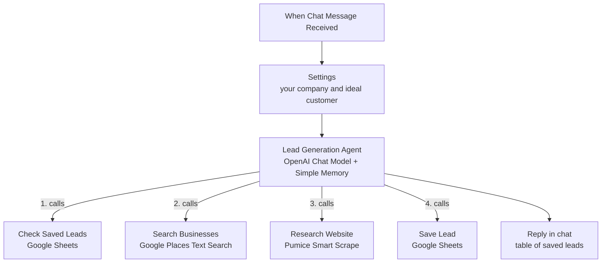

# Lead Generation Agent | Find, Research, and Score Local Business Leads with n8n, Google Maps, and Pumice AI

**Workflow file:** [`ai-lead-generation-agent.json`](../ai-lead-generation-agent.json)

This n8n workflow is an AI lead generation agent you talk to in chat. Tell it who you want to sell to, such as *"dental clinics in Austin with under 4.5 stars"*, and it searches Google Maps for matching businesses, reads each business's website, scores how well each one fits your ideal customer, and saves the good ones to a Google Sheet with their website, phone number, public email, and a suggested opening line for outreach. It skips businesses you've already saved, so you can run it again for new areas without creating duplicates.

Google's Places API finds the businesses. Pumice AI Smart Scrape reads their websites and returns structured facts, such as services, contact details, team size, and how customers buy, so there are no scrapers or HTML selectors to maintain. An OpenAI model runs the agent: it decides what to search, which websites to research, and how to score each lead.

---

## What it's used for

- **Building prospect lists for local businesses.** Find dentists, gyms, law firms, contractors, salons, or any other business type in any city, with the details you need to contact them.
- **Qualifying leads before outreach.** Every lead gets a fit score from 1 to 10 and the reasons for it, based on what's actually on the business's website and Google listing.
- **Personalizing cold emails.** Each saved lead comes with a one-sentence opening line that mentions something specific about that business.
- **Working through a territory.** Follow up in the same chat with *"now try Round Rock"* or *"find 10 more"*, and the agent keeps going while skipping leads that are already saved.
- **Replacing paid list-building tools.** You pay only for the Google Places searches, Pumice requests, and model usage each run makes.

## At a glance

| | |
|---|---|
| **Trigger** | A chat message, sent from n8n's **Open chat** panel |
| **Input** | A plain-English request: a type of business, a location, and any filters, such as a rating limit or how many leads you want |
| **Lead source** | Google Places API (New) Text Search, up to 20 businesses per page |
| **Research** | Pumice AI Smart Scrape reads each business's website |
| **Scoring** | 1 to 10 against your ideal customer. Leads that score 7 or more are saved (you can change this). |
| **Output** | A **Leads** tab in Google Sheets, plus a summary table in the chat |
| **Duplicate protection** | Saved leads are checked by Google place ID before research, and rows are updated by place ID instead of added twice |
| **AI** | An AI Agent with the OpenAI Chat Model (`gpt-5-mini` by default) and Simple Memory |
| **Credentials** | OpenAI, Google Sheets, Header Auth for Pumice, Header Auth for Google Places |

---

## How it works



The canvas is organized into three numbered sections.

### Step 1: Chat and settings

| Node | What it does |
|---|---|
| `When Chat Message Received` | Starts a run each time you send a message in the chat. |
| `Settings` | Adds your company details and limits to the message, and passes the chat message and session ID through to the agent. |

The values to fill in are all in `Settings`:

| Setting | Default | What it is |
|---|---|---|
| `yourCompany` | `Your Company` | Your company name |
| `whatYouSell` | An example for dental software | What you sell and who it helps. The agent scores every lead against this. |
| `idealCustomer` | An example for independent clinics | What your best customers look like, such as size, number of locations, or things they don't have yet |
| `minFitScore` | `7` | The lowest score a business needs to be saved |
| `maxLeadsPerRequest` | `10` | How many leads the agent aims to save when your message doesn't say |

### Step 2: The agent

| Node | What it does |
|---|---|
| `Lead Generation Agent` | Plans the search, calls the tools, scores each business, and writes the reply. It can make up to 60 tool calls per message. |
| `OpenAI Chat Model` | The model that runs the agent, `gpt-5-mini` by default. |
| `Simple Memory` | Remembers the last 10 exchanges in the chat, so follow-up messages like *"now try Round Rock"* keep the same business type and filters. |

For each message, the agent's instructions tell it to:

1. Work out the type of business, the location, any filters, and how many leads you want. If there's no location, it asks for one.
2. Call `Check Saved Leads` once, so it knows which businesses are already saved.
3. Call `Search Businesses` with a query like *"dental clinics in Austin, TX"*. For more results it asks for the next page, or searches nearby areas or other names for the same business type.
4. Skip businesses that aren't operating, are already saved, or don't match your filters.
5. Call `Research Website` for each remaining business that has a website, one at a time. Businesses without a website are scored from their Google listing, and the reasons say so.
6. Score each business from 1 to 10:

| Score | Meaning |
|---|---|
| 9 to 10 | A near perfect fit with clear signs they need what you sell |
| 7 to 8 | A good fit worth contacting |
| 4 to 6 | A possible fit, or important information is missing |
| 1 to 3 | A poor fit |

7. Save every business that scores `minFitScore` or higher with `Save Lead`, including short reasons and a one-sentence opening line for a cold email.
8. Reply with a table of the saved leads (Company, Score, Why it fits, Website, Phone, Email), how many were skipped as already saved, and how many scored too low.

The agent is told never to invent contact details. Phone numbers come only from Google, and emails come only from the business's website. When one isn't found, the cell is left empty.

### Step 3: Tools

| Tool | What it does |
|---|---|
| `Search Businesses` | Sends `POST https://places.googleapis.com/v1/places:searchText` with the agent's `textQuery`, a `pageSize` of up to 20, and a `pageToken` for the next page. The field mask returns each place's ID, name, address, website, phone number, rating, review count, types, business status, Google Maps link, and the `nextPageToken`. |
| `Research Website` | Sends the business's website to Pumice Smart Scrape (`/api/scraper/smart-scrape`) with a prompt asking for the company name, what they do, services, locations, public email and phone, contact page, social links, team size signals, how customers buy, and sales signals, with `null` for anything not on the site. The agent can add anything else to look for that relates to your request. Each request can take up to 2 minutes. |
| `Check Saved Leads` | Reads columns A to C (`place_id`, `company`, `website`) of the Leads tab. Reading only these columns keeps the agent's context small as your list grows. |
| `Save Lead` | Adds a row to the Leads tab, or updates the row with the same `place_id`. It writes to the spreadsheet and tab chosen in `Check Saved Leads`, so there's only one place to pick the sheet. |

Each saved lead fills in these columns:

| Column | Filled from |
|---|---|
| `place_id` | The Google place ID, used to spot duplicates |
| `company` | The business name on Google |
| `website` | The website on Google |
| `phone` | The phone number on Google |
| `email` | A public email found on the website, or empty |
| `address` | The address on Google |
| `rating` | The Google rating, or empty if there is none |
| `review_count` | The number of Google reviews, or empty if there are none |
| `google_maps_url` | The business's Google Maps link |
| `fit_score` | The agent's score from 1 to 10 |
| `reasons` | One or two short reasons for the score |
| `opening_line` | A one-sentence opening line for outreach |
| `search_query` | The search that found the business |
| `saved_at` | When the row was saved |

---

## Setup

Plan on about 20 minutes.

### 1. Create the Google Sheet

Create a spreadsheet with a tab named **Leads**, and put this header row in row 1, in this order:

```
place_id	company	website	phone	email	address	rating	review_count	google_maps_url	fit_score	reasons	opening_line	search_query	saved_at
```

You can paste the line above into cell A1, and it splits into columns. The names must match exactly, and `place_id`, `company`, and `website` must stay in columns A to C, because `Check Saved Leads` reads only those columns.

### 2. Get a Google Places API key

1. In the [Google Cloud console](https://console.cloud.google.com/), create a project or pick one, and make sure billing is turned on.
2. Go to **APIs & Services → Library**, search for **Places API (New)**, and enable it.
3. Go to **APIs & Services → Credentials → Create credentials → API key**. Restricting the key to Places API (New) is a good idea.

Because the search asks for phone numbers, websites, and ratings, each search is billed as a Text Search Enterprise request. Check Google's Places API pricing page for current rates and the monthly free usage.

### 3. Get a Pumice API key

Sign in to [Pumice AI](https://app.pumice.ai) and copy your API key.

### 4. Import the workflow and connect credentials

In n8n, go to **Workflows → Import from File** and select `ai-lead-generation-agent.json`. Then create these credentials:

| Credential | Values | Nodes |
|---|---|---|
| OpenAI | Your OpenAI API key | `OpenAI Chat Model` |
| Google Sheets | Your Google account | `Check Saved Leads`, `Save Lead` |
| Header Auth (Pumice) | Name: `x-api-key`, Value: your Pumice API key | `Research Website` |
| Header Auth (Google Places) | Name: `X-Goog-Api-Key`, Value: your Google API key | `Search Businesses` |

Make sure each Header Auth credential is on the right node, since both tools use the same credential type.

### 5. Pick your sheet

Open `Check Saved Leads` and choose your spreadsheet and the **Leads** tab from the lists. Picking them by URL also works. `Save Lead` uses the same spreadsheet and tab automatically.

### 6. Fill in Settings

Open `Settings` and describe your company, what you sell, and your ideal customer (see **Step 1** above). The more specific these are, the better the scores. For example, *"independent clinics with 1 to 5 locations and no online booking"* gives the agent something it can check on each website.

### 7. Test it

1. Save the workflow, click **Open chat**, and send a small request, such as *"Find 3 dental clinics in Austin, TX with under 4.5 stars"*.
2. The agent replies with a table after it finishes, usually within a few minutes. The saved leads appear in the Leads tab.
3. Send the same request again. The agent should skip the leads that are already saved and look for new ones.

### 8. Make it yours

- **Save more or fewer leads:** change `minFitScore` in `Settings`. Set it to 1 to save every business the agent researches, with its score.
- **Use a different model:** pick another model in `OpenAI Chat Model`, or replace it with another chat model node, such as Anthropic or OpenRouter.
- **Add a column:** add the header to the Leads tab, open `Save Lead`, refresh the column list, and set the new column's value with `$fromAI()`, for example `{{ $fromAI('linkedin_url', 'The company LinkedIn page found on the website', 'string', '') }}`.
- **Narrow the search:** add body fields to `Search Businesses`, such as `includedType` (a single Google place type), `minRating`, or `locationBias`. See Google's Text Search documentation for the formats.
- **Send leads to your CRM:** replace `Save Lead` with a HubSpot, Pipedrive, or Salesforce tool node, and keep `Check Saved Leads` or add a CRM search tool to avoid duplicates.
- **Share the chat with your team:** in `When Chat Message Received`, turn on **Make Chat Publicly Available**, choose **Basic Auth** or **n8n User Auth**, and publish the workflow.

---

## Troubleshooting

| Symptom | Likely cause |
|---|---|
| `Search Businesses` fails with `403` or "API key not valid" | Places API (New) isn't enabled for the key's project, billing is off, the key is restricted to other APIs, or the header name isn't exactly `X-Goog-Api-Key` |
| `Search Businesses` fails with `INVALID_ARGUMENT` on a next page | A page token was reused with a different query. Ask the agent to start a new search. |
| `Research Website` fails with `401` | The Pumice key is wrong, or the header name isn't `x-api-key` |
| A website is reported as unreadable or times out | Some sites block scraping or are very slow. The agent scores those businesses from their Google listing instead. |
| "Column names were updated after the node's setup" | The Leads tab's header row is missing a column or a name doesn't match. Copy the header row from setup step 1. |
| `Save Lead` can't find the sheet | The tab was picked by name in `Check Saved Leads`. Pick it from the list or by URL instead. |
| The same business is saved twice | `place_id` isn't in column A with that exact header, so `Check Saved Leads` can't see it |
| Most emails are empty | Many businesses don't show an email on their site. The agent leaves the cell empty rather than guessing. |
| "Agent stopped due to max iterations" | The request needed more than 60 tool calls. Ask for fewer leads per message, or raise **Max Iterations** in the agent's options. |
| "No session ID found" | **Include Other Input Fields** was turned off in `Settings`, so the chat session ID didn't reach the agent |
| The agent forgets earlier messages after n8n restarts | Simple Memory is kept in n8n's memory. Use the Postgres or Redis chat memory node for memory that lasts. |
