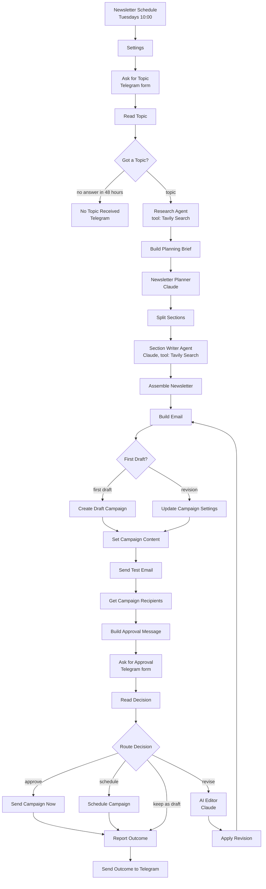

# AI-Powered Restaurant Newsletter Creator with Mailchimp and Telegram Approval | Research, Write, and Send a Newsletter From One Topic

**Workflow file:** [`ai-powered-restaurant-newsletter-creator-mailchimp-telegram-approval.json`](../ai-powered-restaurant-newsletter-creator-mailchimp-telegram-approval.json)

This n8n workflow writes your restaurant's email newsletter from a single topic. On a schedule, a Telegram bot asks what the next issue should be about. An AI research agent searches the web with Tavily for trends, seasonal angles, and local news on that topic. Claude plans the issue and writes each section in your brand voice, using your real menu highlights. The draft is built in Mailchimp, a test email lands in your inbox, and a summary with the sources arrives in Telegram. You approve it, schedule it, or send notes back to an AI editor for a new version.

Writing a newsletter every week or two is the part of restaurant marketing that slips first. This workflow keeps the owner's job to two taps and a sentence: pick the topic, then approve the draft. Every fact from the research comes with a source you can check, the AI can only name dishes you list, and Mailchimp still does the sending, so your audience, unsubscribes, and reports keep working.

---

## What it's used for

- **A newsletter that goes out on time.** The schedule asks for a topic every week (or every other week), so an issue is always on its way.
- **Content that isn't generic.** Each issue starts from fresh research on your topic: what's in season, what diners are talking about, and what's happening in your city, tied back to your restaurant.
- **Promoting what you want to sell.** Tell it what to feature, like a new cocktail, a holiday menu, or a wine night, and add an offer. The feature gets its own section and the offer gets its own box.
- **Your voice, your menu.** Your brand voice, story, and menu highlights live in one Settings node, so you never edit prompts. The AI can't invent dishes, prices, events, or deals.
- **Approval from your phone.** The draft summary, the sources to check, and the approval form all come through Telegram, and the test email shows exactly what guests will get.

## At a glance

| | |
|---|---|
| **Trigger** | A schedule (Tuesdays at 10:00), which asks for the topic in Telegram |
| **AI steps** | Research Agent (OpenAI `gpt-5-mini` with Tavily), Newsletter Planner, Section Writer Agent, and AI Editor (Anthropic Claude Sonnet 5.5) |
| **Research** | Tavily web search, 3 to 6 searches per issue plus occasional searches by the section writers, with a source URL for every fact |
| **Approval** | Telegram forms: approve and send now, schedule, revise with notes (up to 3 versions), or keep as a draft |
| **Sending** | A Mailchimp regular campaign to your audience, or to one saved segment, with a test email before approval |
| **Community nodes** | None. Tavily is called with the HTTP Request tool, so it runs on n8n Cloud and self-hosted n8n. |
| **API** | Mailchimp Marketing API 3.0, Tavily Search API |
| **Credentials** | Telegram, OpenAI, Anthropic, Tavily, Mailchimp |

---

## How it works

The canvas is organized into five labeled sections.

### Step 1: Ask for a topic in Telegram

| Node | What it does |
|---|---|
| `Newsletter Schedule` | Starts an issue every Tuesday at 10:00, in the workflow's time zone. |
| `Settings` | Your restaurant details, used by every AI step and the email (see Setup). |
| `Ask for Topic` | Sends you a Telegram message with a **Choose the topic** button. It opens a short form and waits up to 48 hours. |
| `Read Topic` | Reads the answers and adds today's date for the research. |
| `Got a Topic?` | Continues with the research, or, if no answer came in, sends **No Topic Received** to Telegram and ends the run. |

The topic form has four fields:

| Field | Use |
|---|---|
| **Newsletter topic** (required) | The theme of the issue, for example "our new fall cocktail menu", "weekend brunch", or "healthy eating" |
| **Anything to feature** | New dishes, specials, events, or news to include, with dates and prices. This is the only place, besides Settings, the AI gets restaurant facts from. |
| **Offer to include** | A deal to show in its own box, for example "Half-price bottles of wine on Wednesdays in November". Leave empty for no offer. |
| **Notes for the writer** | Tone, who the issue is for, or anything to avoid |

### Step 2: Research the topic

| Node | What it does |
|---|---|
| `Research Agent` | Searches the web 3 to 6 times with different angles: food and dining trends around the topic, the season, local events or news in your city, and what diners care about. It keeps only facts stated in the results and returns 4 to 8 findings, each with why it matters to your guests and its source, plus angles and seasonal or local hooks. |
| `OpenAI Chat Model` | `gpt-5-mini`, used by the Research Agent. |
| `Tavily Search` | A tool that calls Tavily's search API (`POST https://api.tavily.com/search`) with the agent's query, as a `news` or `general` search. It returns a short answer and up to 5 results with their text and URL. |
| `Research Format` | Makes the agent return the findings as JSON. |
| `Build Planning Brief` | Numbers the findings and writes the planner's brief: the topic, the feature, the offer, the notes, and the research. |

### Step 3: Plan the issue and write each section

| Node | What it does |
|---|---|
| `Newsletter Planner` | Plans the issue: the subject line and 2 alternatives, preview text, headline, intro, closing, the button, and the sections (4 by default). Each section gets a title, its angle, key points, the numbered findings it should use, and the menu items it may mention. The feature, if you gave one, gets its own section. |
| `Claude Chat Model` | Claude Sonnet 5.5, shared by the planner, the section writer, and the editor. |
| `Plan Format` | Makes the planner return the plan as JSON. |
| `Split Sections` | Makes one item per section with its plan, its findings, and the list of the other sections so they don't repeat each other. |
| `Section Writer Agent` | Writes each section in 80 to 140 words, in your brand voice. It can search Tavily once or twice for one more detail, and returns the sources it used. |
| `Section Format` | Makes the writer return the title, paragraphs, and sources as JSON. |
| `Assemble Newsletter` | Puts the plan and the sections together and collects the sources. If a section fails, it is left out and the Telegram summary says so. The run stops only if every section failed. |

Every AI step follows the same rules: facts about the world come only from the research, facts about the restaurant come only from Settings and your topic form, and nothing is invented. The menu highlights in Settings are the only dishes and drinks the AI may name, besides what you ask it to feature.

### Step 4: Build the draft in Mailchimp

| Node | What it does |
|---|---|
| `Build Email` | Cleans the copy (no HTML or Mailchimp merge tags from the AI) and builds the email: your logo or name, the headline, a "Hi {first name}" greeting, the intro, the offer box, each section, the closing, a button to reserve, order, or visit your site, a sign-off, and a footer with your address and unsubscribe link. |
| `First Draft?` | Creates a campaign for the first draft, or updates the same campaign for a revision. |
| `Create Draft Campaign` | Creates a regular campaign for your audience, or for the saved segment in `mailchimp_segment_id`, with your sender, the subject, and the preview text. It is not sent. |
| `Update Campaign Settings` | For a revision, updates the subject, preview text, and title of the same campaign. |
| `Set Campaign Content` | Puts the HTML into the campaign. |
| `Send Test Email` | Sends a test to `approver_email`. |
| `Get Campaign Recipients` | Counts how many subscribers will receive it. |
| `Build Approval Message` | Writes the Telegram summary: the subject and the alternatives, the preview text, the headline and intro, each section's title and opening lines, the button, the offer, what changed (for a revision), up to 5 sources to check, and the audience size. It is shortened to fit Telegram's message limit. |

### Step 5: Approve in Telegram

| Node | What it does |
|---|---|
| `Ask for Approval` | Sends the summary with a **Review the newsletter** button and waits up to 72 hours. |
| `Read Decision` | Reads the answer. A send time must be in the format `2026-11-12 11:00`, in your `timezone`, and at least 15 minutes away. Mailchimp only schedules on the quarter hour, so other times move to the next `:00`, `:15`, `:30`, or `:45`. |
| `Route Decision` | Sends the campaign, schedules it, revises it, or keeps it as a draft. |
| `Send Campaign Now` / `Schedule Campaign` | Sends the campaign in Mailchimp, or schedules it. |
| `AI Editor` | Rewrites the newsletter to follow your notes, keeping everything you didn't ask to change, and says what it changed. It sees the research findings, so it can use them too. |
| `Edited Newsletter Format` | Makes the editor return the whole newsletter as JSON. |
| `Apply Revision` | Sends the new version back to `Build Email`. The same Mailchimp campaign is updated, and you get a new test email and Telegram summary. |
| `Report Outcome` / `Send Outcome to Telegram` | Confirms in Telegram what happened: sending, scheduled, kept as a draft (with the reason), or Mailchimp's error. |

The approval form has three fields:

| Field | Use |
|---|---|
| **What should we do?** | Approve and send now, Schedule for the time below, Revise with my notes, or Keep as a draft in Mailchimp |
| **Send time** | For scheduling, for example `2026-11-12 11:00` |
| **Notes for the editor** | For revising, for example "Shorter intro, and lead with the cocktail section" |

A newsletter can have up to `max_revisions` versions (3 by default). After that, a revise request keeps the draft. No answer within 72 hours also keeps the draft.

---

## Setup

Plan on about 20 minutes.

### 1. Create the credentials

| Credential | How to create it | Nodes |
|---|---|---|
| **Telegram Bot** | In Telegram, message **@BotFather**, send `/newbot`, and follow the steps. Copy the bot token into n8n's **Telegram API** credential. Then open your new bot and send it `/start`, so it is allowed to message you. | `Ask for Topic`, `Ask for Approval`, `No Topic Received`, `Send Outcome to Telegram` |
| **OpenAI** | An OpenAI API key. | `OpenAI Chat Model` |
| **Anthropic** | An API key from the Anthropic Console. | `Claude Chat Model` |
| **Tavily API** (HTTP Header Auth) | Sign up at tavily.com and copy your API key. In n8n, set **Name** to `Authorization` and **Value** to `Bearer ` followed by your key, for example `Bearer tvly-abc123`. | `Tavily Search` |
| **Mailchimp API** | In Mailchimp, go to **Profile → Extras → API keys** and create a key. Paste it into n8n's **Mailchimp API** credential. | Every Mailchimp node |

### 2. Fill in Settings

| Field | Meaning |
|---|---|
| `restaurant_name`, `cuisine`, `city` | Who you are and where. The city focuses the local research. |
| `website_url`, `reservation_url`, `order_online_url` | Where the email button can go. Leave `reservation_url` or `order_online_url` empty if you don't have one. |
| `about_restaurant` | A few sentences on your story and what makes you different. The AI uses it for restaurant details. |
| `menu_highlights` | Your signature dishes, drinks, and recurring events, separated by semicolons. These are the only items the AI may name, besides what you feature in the topic form. |
| `brand_voice` | How your newsletter should sound |
| `timezone` | Your restaurant's time zone, for dates and scheduling, for example `America/New_York` |
| `section_count` | Sections per issue, 2 to 6 (default 4) |
| `telegram_chat_id` | Your Telegram chat ID. Message **@get_id_bot** (or another ID bot) to get it. For a group, add your bot to the group and use the group's ID. |
| `mailchimp_server` | The part of your Mailchimp API key after the dash, for example `us21` |
| `mailchimp_list_id` | Your audience ID. In Mailchimp, go to **Audience → All contacts → Settings → Audience name and defaults**. |
| `mailchimp_segment_id` | Optional. The ID of a saved segment or tag to send to instead of the whole audience. You can list them with Mailchimp's API (`GET /lists/{list_id}/segments`). |
| `from_name`, `reply_to` | The sender. Use an email on a domain you have verified in Mailchimp. |
| `approver_email` | Where test emails go |
| `logo_url`, `brand_color` | Your logo image URL (optional) and the button and accent color |
| `max_revisions` | Versions allowed per issue (default 3) |

### 3. Publish and test

1. Publish the workflow. Your n8n instance must be reachable at a public URL, because the Telegram buttons open n8n forms in the browser.
2. To test without waiting for Tuesday, open the workflow and run it from the `Newsletter Schedule` trigger. The topic message arrives in Telegram.
3. Give it a topic, and within a few minutes check Telegram for the summary and your inbox for the test email.
4. Pick **Keep as a draft in Mailchimp** for your first run, and look at the campaign in Mailchimp under **Campaigns**.

---

## Make it yours

- **Change the schedule:** set the day and time in `Newsletter Schedule`, for example every other week. The topic form waits 48 hours, so ask a day or two before you want to send.
- **Change the voice and the menu:** edit `brand_voice`, `about_restaurant`, and `menu_highlights` in `Settings`. Every AI step reads them.
- **Change the length:** change `section_count`, or the word counts in the `Section Writer Agent` system message.
- **Use different models:** pick another model in `OpenAI Chat Model` or `Claude Chat Model`, or connect the Claude model to the Research Agent too and remove OpenAI.
- **Research deeper:** in `Tavily Search`, change `search_depth` from `basic` to `advanced` (2 credits a search) or raise `max_results`.
- **Send to part of your list:** set `mailchimp_segment_id` to a saved segment or tag, such as regulars or locals.
- **Change the design:** the HTML is built in `Build Email`. The colors come from `brand_color`, and the logo from `logo_url`.
- **Approve somewhere else:** replace the two Telegram **Send and Wait for Response** nodes with Slack or Gmail versions using the same form fields. If you use Slack or Gmail, give each field a custom field name and update the labels at the top of `Read Topic` and `Read Decision`.

---

## Troubleshooting

| Symptom | Likely cause |
|---|---|
| No Telegram message arrives | You haven't sent `/start` to your bot, `telegram_chat_id` is wrong, or the bot token is wrong |
| The Telegram button doesn't open the form | n8n isn't reachable at a public URL. Check your instance's webhook URL. |
| `Ask for Topic` or `Ask for Approval` fails with "can't parse entities" | A setting with Markdown characters (`_`, `*`, `` ` ``, `[`) broke Telegram's formatting. The workflow escapes AI text, but check custom text you added to the messages. |
| "No newsletter topic came in" | Nobody filled in the topic form within 48 hours. The next scheduled run asks again. |
| `Tavily Search` returns `401` or `432` | The Tavily key is wrong, the header value doesn't start with `Bearer `, or your plan's credits are used up |
| The research has few findings | The topic is narrow or very local. Add details in **Anything to feature**, or broaden the topic. |
| A section is missing and the summary says "Left out" | The writer failed for that section, for example because the model was busy. Revise with a note asking for it, or run the workflow again. |
| `Split Sections` stops with "no sections" | The planner returned an empty plan. Run the workflow again. |
| `Build Approval Message` stops with "Mailchimp did not create the draft campaign" | The Mailchimp API key, `mailchimp_server`, or `mailchimp_list_id` is wrong, or `mailchimp_segment_id` isn't a saved segment in that audience. The message includes Mailchimp's error. |
| No test email arrives | Check spam, and that `approver_email` is right. The Telegram summary says when the test failed. |
| The outcome says "Your Campaign is not ready to send" | Mailchimp found a problem with the campaign, often the sender. Use a `reply_to` on a domain you have verified in Mailchimp, and open the draft in Mailchimp to see what it needs. |
| Scheduling kept the draft | The send time wasn't in the format `2026-11-12 11:00`, or it was less than 15 minutes away |
| Claude errors about the model | Pick a model from the list in `Claude Chat Model`; the list comes from your Anthropic account |
