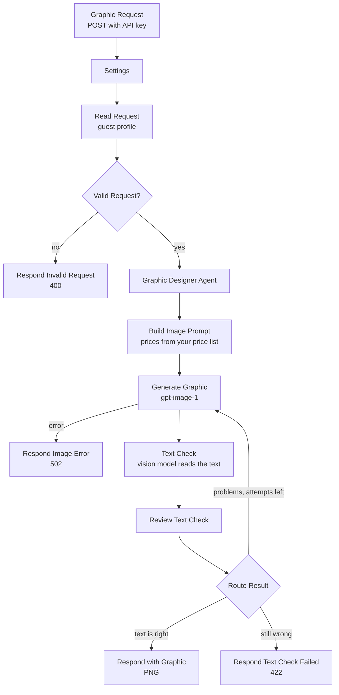

# AI Restaurant Email Graphic Generator API | Personalized Email Images From Purchase History, Prices, and Sign-Ins

**Workflow file:** [`ai-restaurant-email-graphic-generator-api.json`](../ai-restaurant-email-graphic-generator-api.json)

This n8n workflow is an API that makes a personalized email graphic for one restaurant guest. You send it the guest's purchase history, your menu prices, and the guest's sign-in history. An AI agent reads the data and picks the message most likely to bring that guest back: their favorite dish at today's price, something new they haven't tried, or a thank you. OpenAI's image model makes the graphic, a vision model reads the text back to check every word and price, and the API returns the finished PNG.

Most email graphics are made once and sent to everyone. This one is made for the person receiving it, from what they actually order, when they order, and whether they have been signing in without ordering. Prices always come from your price list, never from the AI, and an image with a wrong price or a misspelled dish is made again before it can reach a guest.

---

## What it's used for

- **Win-back emails that show the right dish.** A guest who ordered the short rib every Thursday and stopped 7 weeks ago gets a graphic of the short rib with "Maria, your short rib awaits" and today's price.
- **Turning browsers into orders.** Guests who keep signing in to your app or site but don't order are marked `lapsed_but_browsing`, and the agent gives them an easy yes: a favorite or a new item and a clear button.
- **Suggesting something new.** Regulars can get a graphic of an item they haven't tried, from the categories they already order from, or a new item on your menu.
- **One graphic per guest, from any system.** Your app, CRM, loyalty platform, or email tool calls the API for each guest and gets back an image plus a subject line, preview text, and alt text to send with it.
- **Text you can trust.** Image models sometimes misspell words or change numbers. The text check reads every word and price in the image and compares them with what should be there.

## At a glance

| | |
|---|---|
| **Trigger** | `POST /webhook/restaurant-email-graphic`, protected by an API key header |
| **Input** | The guest's purchases, your price list, the guest's sign-ins, and an optional goal, offer, and shape |
| **AI steps** | Graphic Designer Agent (OpenAI `gpt-5-mini`), image generation (OpenAI `gpt-image-1`), and a vision text check (`gpt-5-mini`) |
| **Output** | The PNG, with the email subject, preview text, alt text, headline, segment, and text check result in response headers |
| **Text check** | Every word and price is read back from the image. Up to 3 attempts, then a `422` error or the image with a warning (your choice). |
| **Shapes** | Landscape 1536x1024 (default), square 1024x1024, portrait 1024x1536 |
| **Credentials** | OpenAI, and a Header Auth credential for the API key |

---

## How it works



The canvas is organized into four labeled sections.

### Step 1: Receive the guest's data

| Node | What it does |
|---|---|
| `Graphic Request` | Receives a POST at `/webhook/restaurant-email-graphic`. It checks the API key header and waits to respond until the graphic is ready. |
| `Settings` | Your brand: restaurant name, cuisine, voice, photo style, colors, fonts, currency, and the text check settings (see Setup). |
| `Read Request` | Checks the request and builds the guest's profile (see below). |
| `Valid Request?` | Continues, or returns a `400` with the list of problems, such as a missing price list. |

`Read Request` turns the raw data into a profile for the agent:

- **Orders:** how many, the first and last, days since the last order, how often they usually order again, their usual meal (breakfast, lunch, dinner, or late night) and days, dine-in or takeout, and their average order
- **Favorites:** their top 5 items, how many orders included each, today's price from your price list, and the price they last paid
- **Sign-ins:** sign-ins in the last 30 and 90 days, the last sign-in, sign-ins since their last order, and their channels (app, web, and so on)
- **Suggestions:** up to 8 items they haven't tried, from the categories they order from, with new items first
- **Price list:** up to 60 available items for the agent, favorites and suggestions first. Items sent with `"available": false` are left out.

It also sorts the guest into a segment:

| Segment | Meaning |
|---|---|
| `new_guest` | No orders and no sign-ins |
| `signed_up_never_ordered` | Signs in, but has never ordered |
| `first_visit_recent` | One order, in the last 30 days |
| `regular` | 4 or more orders, and not overdue |
| `occasional` | Fewer than 4 orders, and not overdue |
| `lapsed` | No order for at least `lapsed_after_days` (45) or twice their usual time between orders, whichever is longer, and not signing in |
| `lapsed_but_browsing` | Lapsed, but has signed in 2 or more times since their last order |

### Step 2: The agent designs the graphic

| Node | What it does |
|---|---|
| `Graphic Designer Agent` | Reads the profile and picks one message for this guest. It chooses 1 to 3 items from your price list, writes a headline of 2 to 6 words, an optional short subline and offer badge, and the button text, and describes the photo and layout. It also writes the email subject, preview text, alt text, and a sentence on the data behind its choice. It keeps the text short, because image models misspell long text. |
| `OpenAI Chat Model` | `gpt-5-mini`, shared by the agent and the text check. |
| `Design Brief Format` | Makes the agent return its design as JSON. |
| `Build Image Prompt` | Keeps only items that are on your price list (a shorter label may only use words from the menu name), adds each price from the price list in your currency, and writes the image prompt: the scene, layout, your style, colors, and fonts, and a numbered list of the only text allowed in the image. An offer badge appears only if the request has an offer. |

### Step 3: Make the graphic and check its text

| Node | What it does |
|---|---|
| `Generate Graphic` | Makes the image with OpenAI's `gpt-image-1` at your `image_quality` and the requested shape. If OpenAI refuses or fails, `Respond Image Error` returns a `502` with the reason. |
| `Text Check` | Sends the image to a vision model, which reads every piece of text exactly as it appears, including small text on plates or signs in the scene, and lists any problems. |
| `Text Check Format` | Makes the text check return the text it found and the problems as JSON. |
| `Review Text Check` | Compares what was read with what should be there. Case, quotes, and punctuation don't count; every word must match, and any price in the image must be one of the featured items' prices. |
| `Route Result` | Returns the image if the text is right. If not, it makes the image again with each problem called out, up to `max_attempts` (3). After the last attempt it returns a `422`, or the image with a warning if `on_failed_check` is `return_image`. |

### Step 4: Respond

`Respond with Graphic` returns the PNG with these headers. Text headers are URL-encoded, so decode them before use.

| Header | Contents |
|---|---|
| `Content-Type` | `image/png` |
| `Content-Disposition` | `inline; filename="email-graphic-{guest id}.png"` |
| `X-Email-Subject` | A subject line for the email, under 50 characters |
| `X-Preview-Text` | Preview text for the email, under 90 characters |
| `X-Alt-Text` | Alt text for the image tag |
| `X-Headline` | The headline in the graphic |
| `X-Segment` | The guest's segment |
| `X-Text-Check` | `passed`, or `unverified` if the image is returned after a failed check |
| `X-Attempts` | How many images were made |

---

## API reference

### Request

```bash
curl -X POST "https://your-n8n-domain/webhook/restaurant-email-graphic" \
  -H "X-API-Key: your-api-key" \
  -H "Content-Type: application/json" \
  -d @guest.json \
  --max-time 300 \
  -D headers.txt -o email-graphic.png
```

```json
{
  "guest": { "id": "G-1042", "first_name": "Maria" },
  "purchases": [
    {
      "date": "2026-09-17T19:20:00-04:00",
      "order_type": "dine-in",
      "total": 82.5,
      "items": [
        { "name": "Braised Short Rib", "quantity": 1, "price": 32 },
        { "name": "House Salad", "quantity": 1, "price": 12 }
      ]
    }
  ],
  "prices": [
    { "name": "Braised Short Rib", "price": 34, "category": "Entrees" },
    { "name": "House Salad", "price": 12, "category": "Starters" },
    { "name": "Wild Mushroom Tagliatelle", "price": 26.5, "category": "Entrees", "is_new": true },
    { "name": "Tiramisu", "price": 11, "category": "Desserts" }
  ],
  "sign_ins": [
    { "date": "2026-11-06T12:04:00-05:00", "channel": "app" },
    { "date": "2026-11-02T20:41:00-05:00", "channel": "web" }
  ],
  "campaign": { "goal": "", "offer": "Free dessert with any entree through Sunday", "size": "landscape" }
}
```

| Field | Required | Contents |
|---|---|---|
| `guest.id` | No | Your ID for the guest, used in the file name |
| `guest.first_name` | No | The agent may start the headline with it |
| `purchases` | Yes (can be `[]`) | Each order: `date` (ISO 8601; `purchased_at` or `created_at` also work), `items` with `name`, `quantity`, and `price`, plus `total` and `order_type` (optional) |
| `prices` | Yes | Your current menu: `name` and `price` (a number or text like `"$12.00"`), plus `category`, `description`, `is_new`, and `available` (optional; `false` hides the item) |
| `sign_ins` | No | Each sign-in: `date` (or `at` or `signed_in_at`) and `channel`. Plain ISO date strings work too. |
| `campaign.goal` | No | What this email should do, for example "promote the new pasta". Empty lets the agent decide. |
| `campaign.offer` | No | An offer to show as a badge. Without one, the graphic has no offer. |
| `campaign.size` | No | `landscape` (default), `square`, or `portrait` |

Item names in `purchases` are matched to `prices` by name, ignoring case, so use the same names in both.

### Responses

| Status | Body |
|---|---|
| `200` | The PNG, with the headers above |
| `400` | `{"error": "Invalid request", "details": [...]}` |
| `403` | The API key header is missing or wrong |
| `422` | `{"error": "...", "problems": [...], "attempts": 3}` when the text couldn't be verified |
| `502` | `{"error": "The image could not be generated", "details": "..."}` |

Each image takes a while to make, and the API may make up to 3, so allow up to about 4 minutes before your client times out. Most requests pass on the first attempt.

---

## Setup

Plan on about 10 minutes.

### 1. Create the credentials

| Credential | How to create it | Nodes |
|---|---|---|
| **OpenAI** | An OpenAI API key. Image generation with `gpt-image-1` may require a verified OpenAI organization. | `OpenAI Chat Model`, `Generate Graphic` |
| **Graphic API Key** (Header Auth) | Pick a header name, such as `X-API-Key`, and a long random value. Callers send the same header. | `Graphic Request` |

### 2. Fill in Settings

| Field | Meaning |
|---|---|
| `restaurant_name`, `cuisine` | Used in the agent's prompt and the image prompt |
| `brand_voice` | How the headline and email copy should sound |
| `brand_style` | The look of the photo, for example "warm editorial food photography with soft natural light" |
| `brand_colors` | Your colors, by name and hex code |
| `font_style` | The kind of lettering, for example "an elegant serif headline and a bold sans serif for prices" |
| `currency`, `locale` | How prices are written, for example `USD` and `en-US` gives `$34` and `$26.50` |
| `timezone` | Your time zone, for reading order times |
| `lapsed_after_days` | The fewest days without an order before a guest counts as lapsed (default 45) |
| `image_quality` | `low`, `medium` (default), or `high`. Higher quality renders text better and costs more. |
| `max_attempts` | Images to try before giving up on the text check, 1 to 5 (default 3) |
| `on_failed_check` | `error` (default) returns a `422`. `return_image` returns the last image with `X-Text-Check: unverified`. |

### 3. Publish and call it

Publish the workflow and send a request like the one above. Open the PNG and the headers file to see the result.

To put the graphic in an email, upload the PNG to your email platform's file manager or your own storage, and use `X-Email-Subject`, `X-Preview-Text`, and `X-Alt-Text` for the subject, preview text, and the image's alt text.

---

## Make it yours

- **Use a newer image model:** pick another model in `Generate Graphic`. The list comes from your OpenAI account.
- **Change the look:** edit `brand_style`, `brand_colors`, and `font_style` in `Settings`, or the layout rules in `Build Image Prompt`.
- **Change the messages:** edit how the agent handles each segment in the `Graphic Designer Agent` system message, or change the segment rules in `Read Request`.
- **Stricter checks:** use a larger vision model in `OpenAI Chat Model` for the text check, or raise `image_quality`.
- **Faster responses:** lower `max_attempts`, or set `image_quality` to `low` for drafts.
- **Store the image:** add an S3, Cloudinary, or Google Drive node after `Review Text Check` to keep a copy before the response.

---

## Troubleshooting

| Symptom | Likely cause |
|---|---|
| `403` | The API key header name or value doesn't match the **Graphic API Key** credential |
| `400` with details | The request is missing `prices`, `purchases` isn't an array, or an order has no valid date. The details list each problem. |
| `502` "The image could not be generated" | OpenAI refused the prompt, the account isn't allowed to use `gpt-image-1`, or the request hit a rate limit. The details have OpenAI's message. |
| `422` after 3 attempts | The image model kept getting some text wrong. Shorten the item names in your price list, ask for fewer words with `campaign.goal`, raise `image_quality`, or set `on_failed_check` to `return_image` and review the image yourself. |
| The request times out | Your client gave up before the image was ready. Raise its timeout to about 4 minutes, or lower `max_attempts`. |
| The graphic shows the wrong dish | The item names in `purchases` don't match the names in `prices`, so favorites couldn't be priced. Use the same names in both. |
| No first name in the graphic | `guest.first_name` was empty, or the agent chose a headline without it |
| Header text looks like `Your%20short%20rib` | Headers are URL-encoded. Decode them before use. |
