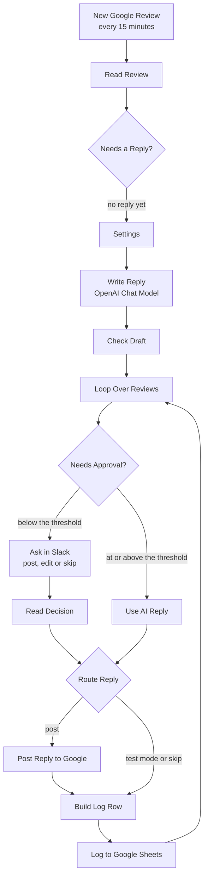

# How to Automate Google Reviews with n8n | AI Replies to Google Business Profile Reviews with Slack Approval and Sheets Logging

**Workflow file:** [`automate-google-reviews-ai-replies.json`](../automate-google-reviews-ai-replies.json)

This n8n workflow replies to your Google reviews for you. Every 15 minutes it checks your Google Business Profile location for new reviews, and AI writes a short, personal reply in your brand's voice that mentions what the reviewer actually said. Positive reviews (4 and 5 stars by default) get their reply posted automatically. Lower ratings go to Slack first, where a manager can post the AI reply, edit it, or skip it. Every review is logged to Google Sheets with the draft, the final reply, who decided, and whether it was posted.

It automates replying to reviews, not collecting them. It doesn't send review requests to customers.

---

## What it's used for

- **Replying to every review, fast.** New reviews get a reply within minutes instead of whenever someone remembers to check the profile.
- **Keeping a human on the hard ones.** Negative and mixed reviews wait for approval in Slack, with the AI draft already written, so a manager only has to read, edit, and click.
- **Sounding like your business.** Your business name, tone, sign-off, and contact line are set once and used in every reply.
- **Staying within Google's rules.** Replies never offer discounts, refunds, or gifts for reviews, and never include private details.
- **Keeping a record.** The log shows every review, the AI draft, the reply that went out, and any errors from Google.

## At a glance

| | |
|---|---|
| **Trigger** | Google Business Profile Trigger, checking one location for new reviews every 15 minutes |
| **Posted automatically** | Reviews rated at or above `auto_post_min_rating` (4 stars by default) |
| **Sent for approval** | Lower ratings, in Slack, with a form to post the reply, edit it first, or skip it |
| **AI** | OpenAI `gpt-5-mini` through the OpenAI Chat Model node. Any chat model n8n supports can be swapped in. |
| **Log** | Google Sheets, one row per review, matched on `review_id` |
| **Safety** | `test_mode` is on by default, so nothing is posted to Google until you turn it off |
| **Credentials** | Google Business Profile, OpenAI, Slack, Google Sheets |

---

## How it works

The canvas is organized into four numbered sections.

### Step 1: Catch new reviews

| Node | What it does |
|---|---|
| `New Google Review` | Polls one Business Profile location every 15 minutes. It starts the workflow when the location's total review count goes up, and passes on that many of the most recently updated reviews. The first poll after you publish only records the count, so existing reviews are left alone. |
| `Read Review` | Turns each review into clean fields: the star rating as a number (Google sends `ONE` to `FIVE`), the reviewer's name and first name, the review text, and the account and location IDs taken from the review's resource name. Anonymous reviewers are shown as "A Google user". |
| `Needs a Reply?` | Drops reviews that already have a reply or have no star rating. |
| `Settings` | Adds your business details and options to each review. |

The values to fill in are all in `Settings`:

| Setting | Default | What it is |
|---|---|---|
| `business_name` | `Your Business Name` | Used in the AI instructions and the Slack message |
| `tone` | `warm, friendly and professional` | The voice the replies are written in |
| `sign_off` | `The Your Business Name Team` | Added on its own line at the end of every reply |
| `unhappy_contact` | An email and phone placeholder | The line offered to unhappy customers so the conversation can continue offline |
| `extra_instructions` | empty | Any extra rule for the AI, such as "Never mention prices" or "Mention our weekend hours when relevant" |
| `auto_post_min_rating` | `4` | Reviews with at least this many stars are posted without approval. Set it to `6` to approve every reply in Slack, or `1` to post everything automatically. |
| `test_mode` | `true` | While on, replies are drafted, approvals still go to Slack, and rows are logged with the status **test mode**, but nothing is posted to Google |

### Step 2: Draft the reply with AI

| Node | What it does |
|---|---|
| `Write Reply` | Sends the reviewer's first name, the star rating, and the review text to the model with your settings as instructions. |
| `OpenAI Chat Model` | `gpt-5-mini` with low reasoning effort, which is plenty for a short reply. |
| `Check Draft` | Removes quotes the model may wrap around the reply, trims it to 4,096 characters (Google's reply limit is 4,096 bytes), decides which reviews need approval, and builds the Slack message. Reviews that don't need approval are moved to the front, so they never wait behind one that does. |

The AI follows these rules:

- Reply in the same language as the review, in 2 to 4 sentences and under 90 words.
- Thank the reviewer, using their first name only if one is given.
- Mention one specific thing they said, so the reply doesn't read like a template. Rating-only reviews get a 1 or 2 sentence thank-you.
- For 1 to 3 stars, apologize without arguing, making excuses, or admitting fault, and offer your `unhappy_contact` line.
- For 4 and 5 stars, be warm and invite them back.
- Never offer anything in exchange for a review, never include private details, and never promise specific results.
- No hashtags, emojis, or links (unless your contact line has one), and end with your `sign_off`.

### Step 3: Approve low ratings in Slack

| Node | What it does |
|---|---|
| `Loop Over Reviews` | Handles one review at a time, because a Slack approval can only wait on one message. |
| `Needs Approval?` | Sends reviews below `auto_post_min_rating`, and any review where the AI returned nothing, to Slack. The rest go to `Use AI Reply`. |
| `Ask in Slack` | Posts the review, its stars, and the suggested reply to your channel with a **Review reply** button. The button opens a form with the AI reply already filled in. The manager can edit it and choose **Post this reply** or **Don't reply**. The workflow waits up to 24 hours for an answer. |
| `Read Decision` | Reads the answer. The decision is **approved** if the reply was posted as written, **edited** if it was changed, **skipped** for **Don't reply**, or **no response** if 24 hours passed without an answer. Nothing is posted in the last two cases. |
| `Use AI Reply` | For reviews that don't need approval, uses the AI reply as is, with the decision **auto**. |

### Step 4: Post the reply and log it

| Node | What it does |
|---|---|
| `Route Reply` | Sends the reply to Google, or straight to the log when `test_mode` is on or the manager chose not to reply. |
| `Post Reply to Google` | Posts the reply with the Google Business Profile node's **Review → Reply** operation, which calls `PUT /v4/accounts/{account}/locations/{location}/reviews/{review}/reply`. If Google rejects it, the error goes to the log instead of stopping the workflow. |
| `Build Log Row` | Builds the log row and works out the status: **posted**, **test mode**, **not posted**, or **error**. |
| `Log to Google Sheets` | Adds a row, or updates the existing row for the same `review_id`, then returns to the loop for the next review. |

The log has these columns. On a blank tab, the headers are added on the first run.

| Column | What it holds |
|---|---|
| `review_id` | Google's ID for the review |
| `location` | The location ID, such as `locations/1234567890` |
| `reviewer` | The reviewer's display name, or "A Google user" |
| `rating` | 1 to 5 |
| `review_text` | The review as written. Empty for rating-only reviews. |
| `review_created` | When the review was written |
| `ai_draft` | The reply the AI wrote |
| `final_reply` | The reply that was posted, or would have been posted in test mode |
| `decision` | auto, approved, edited, skipped, or no response |
| `status` | posted, test mode, not posted, or error |
| `posted_at` | When Google saved the reply |
| `error` | Google's error message, if posting failed |
| `logged_at` | When the row was written |

---

## Setup

Plan on 30 minutes once Google has approved your API access. Approval itself can take several days, so start with step 1.

### 1. Request Google Business Profile API access

Google has to approve your Google Cloud project before it can use the Business Profile APIs. Until then, the project's quota is 0 requests per minute and every call fails.

1. Make sure you manage a Business Profile that is verified, has been active for at least 60 days, and lists the business's website.
2. Create a Google Cloud project, or pick an existing one, and note its project number.
3. Submit Google's [Business Profile API contact form](https://support.google.com/business/contact/api_default), choose **Application for Basic API Access**, and use an email address that is an owner or manager of the profile. Include the project number.
4. To check the result, open **APIs & Services** in the Google Cloud Console and look at the Business Profile API quotas. 300 requests per minute means you're approved.

See Google's [prerequisites page](https://developers.google.com/my-business/content/prereqs) for details.

### 2. Enable the APIs and create an OAuth client

1. In the same Google Cloud project, enable these three APIs:
   - **Google My Business API**, used to read and reply to reviews
   - **My Business Account Management API**, used to list your accounts in n8n
   - **My Business Business Information API**, used to list your locations in n8n
2. Set up the **OAuth consent screen**. If it's an External app, publish it instead of leaving it in testing, because Google expires refresh tokens for apps in testing after 7 days.
3. Create an **OAuth client ID** of type **Web application**. Add the **OAuth Redirect URL** shown in n8n's Google Business Profile credential as an authorized redirect URI, then copy the client ID and client secret.

### 3. Import the workflow and connect credentials

In n8n, go to **Workflows → Import from File** and select `automate-google-reviews-ai-replies.json`. Then create these credentials:

| Credential | Values | Nodes |
|---|---|---|
| Google Business Profile OAuth2 API | The client ID and secret from step 2. The scope `https://www.googleapis.com/auth/business.manage` is set by default. Click **Sign in with Google** using an owner or manager of the profile. | `New Google Review`, `Post Reply to Google` |
| OpenAI | Your OpenAI API key | `OpenAI Chat Model` |
| Slack | A Slack app bot token with the `chat:write` scope | `Ask in Slack` |
| Google Sheets | Your Google Sheets connection | `Log to Google Sheets` |

### 4. Pick your location, channel, and log sheet

1. In `New Google Review`, choose the **Account** and the **Location** to watch.
2. In `Ask in Slack`, choose the channel for approvals, and invite your Slack app to that channel.
3. In `Log to Google Sheets`, choose the spreadsheet and the tab for the log. A blank tab is fine.

The **Review reply** button in Slack links to your n8n instance, so n8n must be reachable from the browsers of the people approving replies. On a self-hosted instance, make sure the `WEBHOOK_URL` environment variable is set to your public n8n address.

### 5. Fill in Settings

Open `Settings` and enter your values (see **Step 1** above). Leave `test_mode` on for now.

### 6. Test it

1. Open `New Google Review` and click **Fetch Test Event**. In a manual run, the trigger returns your location's most recently updated review.
2. If that review already has a reply, `Needs a Reply?` stops the run there. Wait for a review without a reply, or pin test data on the trigger with a review that has no `reviewReply`.
3. Run the workflow. Check the draft in `Write Reply`, the Slack message if the rating is below your threshold, and the new row in your sheet with the status **test mode**.

Nothing is posted to Google while `test_mode` is on.

### 7. Go live

1. In `Settings`, set `test_mode` to `false`.
2. Publish the workflow.

The first poll after publishing records the current review count. From then on, every new review is answered or sent to Slack.

### 8. Make it yours

- **Change how often it checks:** open `New Google Review` and change the poll time. Every 15 minutes is quick without using much of Google's quota.
- **Approve everything, or nothing:** set `auto_post_min_rating` to `6` to send every reply to Slack, or to `1` to post every reply automatically.
- **Wait longer for approvals:** change **Limit Wait Time** in the options of `Ask in Slack`. While one approval is waiting, other reviews from the same check wait behind it, but reviews from later checks run on their own.
- **Use a different AI model:** replace `OpenAI Chat Model` with another chat model node, such as Anthropic, Gemini, or OpenRouter.
- **Watch more than one location:** duplicate the workflow and pick a different location in each copy. Replies always go to the location the review came from.
- **Send approvals somewhere else:** replace `Ask in Slack` with the send-and-wait operation of the Microsoft Teams, Gmail, or Telegram node. Then update `Read Decision` to read that node's answer fields.

---

## Troubleshooting

| Symptom | Likely cause |
|---|---|
| Every Google call fails with a quota or `429` error | Your project hasn't been approved for Business Profile API access yet. Its quota is still 0 requests per minute. See setup step 1. |
| The account or location list in n8n is empty, or fails with `403` | The My Business Account Management API or My Business Business Information API isn't enabled, or you signed in with an account that doesn't manage the profile |
| The Google credential stops working after about a week | The OAuth consent screen is an External app in testing. Publish it and reconnect the credential. |
| Nothing happens when a review comes in | The workflow isn't published, or this was the first poll after publishing, which only records the count. Also check `Needs a Reply?`: reviews that already have a reply are skipped. |
| A new review was missed | The trigger compares the total review count. If a review is deleted between checks, a new review may not change the count. If a reviewer edits an older review at the same time, the edited review can take the new one's place. Reply to the missed review by hand. |
| Replies show in the log as **test mode** | `test_mode` is still on in `Settings` |
| The Slack button opens a page that won't load | n8n isn't reachable from that browser. Set `WEBHOOK_URL` to your public n8n address. |
| `Ask in Slack` fails with `not_in_channel` | Invite your Slack app to the approval channel |
| Every reply is logged with the status **error** | The location isn't verified, or the Google account you signed in with doesn't manage it. Google only accepts replies for verified locations. |
| A posted reply doesn't appear on Google right away | Google can hold replies for review before showing them, and can reject replies that break its policies |
| The reply is in the wrong language or tone | Adjust `tone` or add a rule in `extra_instructions` |
