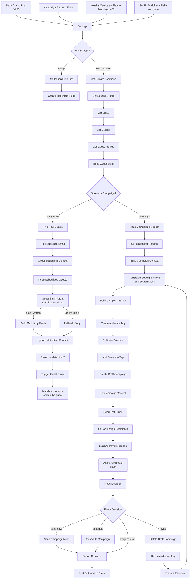

# How to Automate Restaurant Email Marketing | AI Agents That Email Your Square Guests Through Mailchimp

**Workflow file:** [`automate-restaurant-email-marketing-square-mailchimp.json`](../automate-restaurant-email-marketing-square-mailchimp.json)

This n8n workflow automates email marketing for a restaurant that uses Square for its point of sale and Mailchimp for email. It has two AI agents. The **Guest Email Agent** runs every morning and writes personal emails to the right guests: a birthday note, a thank you after a first visit, a "we miss you" to a regular who hasn't been in, and a welcome to new sign-ups. The **Campaign Strategist Agent** plans your marketing campaigns from your Square sales: it finds the slow shifts to fill and the dishes to feature, picks the guests most likely to come in, builds the campaign in Mailchimp, and asks you to approve it in Slack.

Most restaurant email marketing is a monthly newsletter sent to everyone, plus a birthday automation with the same text for every guest. Here every email is written from what the guest actually ordered and when they come in, campaigns are aimed at the shifts that need covers, dishes and prices come from your live Square menu, and Mailchimp still does the sending, so your audience, unsubscribes, and reports keep working.

---

## What it's used for

- **Emails that sound like a host who remembers you.** A regular who comes for Tuesday dinner and always orders the short rib gets an email that mentions the short rib and something new they haven't tried. A takeout guest gets a button to order online, not to book a table.
- **Bringing back regulars before they're gone.** The workflow learns each guest's usual gap between visits and writes to them when they are overdue (twice their usual gap, and at least 30 days), not on a fixed calendar.
- **More Google reviews.** First-time guests get a thank you the next morning with a link to your Google review page.
- **Filling slow shifts.** The campaign agent sees your sales by weekday lunch and dinner for the last 8 weeks and plans campaigns for the shifts that need it, sent to the guests who usually come at that time.
- **Featuring the right dishes.** It sees your best sellers, the dishes that are selling more each week, and new dishes, and checks every dish against your Square menu. Emails show real prices, and the AI can't invent a dish, a special, or a discount.
- **Keeping you in charge of campaigns.** Every campaign arrives in Slack as a draft with a test email in your inbox. Send it, schedule it, keep it as a draft, or send it back with notes for a new version.

## At a glance

| | |
|---|---|
| **Triggers** | Daily guest scan (10:00), a campaign request form, a weekly schedule (Mondays at 9:00), and a one-time setup run |
| **AI agents** | Guest Email Agent and Campaign Strategist Agent (n8n AI Agent with OpenAI `gpt-5-mini`) |
| **Agent tool** | Search Menu (Square catalog search) |
| **Square data used** | Completed orders from the last 120 days, the menu with prices, customer profiles (name, email, birthday), and new customers |
| **Mailchimp data used** | Contact status and AI fields, and open and click rates of campaigns from the last 180 days |
| **Guest emails** | Birthday, thank you for your first visit, we miss you, and welcome. Written into Mailchimp contact fields and sent by one Mailchimp journey. |
| **Campaigns** | Built in Mailchimp as a draft, sent to a tag of the chosen Square guests, with a test email and Slack approval |
| **Approval options** | Send now, schedule (filled in with the agent's suggested time), revise with notes (up to 3 versions), or keep as a draft |
| **APIs** | Square API version `2026-09-16`, Mailchimp Marketing API 3.0 |
| **Optional** | A mock call to Width.ai's machine learning system that predicts the best day and hour to email each guest. It isn't connected. |
| **Credentials** | Square access token, Mailchimp API key, OpenAI, Slack |

---

## How it works



The canvas is organized into six labeled sections and a one-time setup section, plus an optional Width.ai section that isn't connected.

### Step 1: Triggers and settings

| Node | What it does |
|---|---|
| `Daily Guest Scan` | Runs every day at 10:00, in the workflow's time zone, and sends the guest emails. |
| `Campaign Request Form` | A form at `/form/restaurant-email-campaign` where you describe a campaign: what it should do, dishes to feature, who should get it, and an offer. It answers right away; the draft arrives in Slack a few minutes later. |
| `Weekly Campaign Planner` | Plans a campaign every Monday at 9:00 using the weekly brief in `Settings`. |
| `Set Up Mailchimp Fields` | A manual trigger you run once to create the Mailchimp fields the guest emails use. |
| `Settings` | Your restaurant details, links, offers, and limits, used by both agents (see Setup). |
| `Which Path?` | Sends the setup run to the Mailchimp field setup, and every other run to Square. |

### Step 2: Read Square: orders, menu, and guests

Every run except setup starts by reading Square, so both agents work from the same picture of your restaurant.

| Node | What it does |
|---|---|
| `Get Square Locations` | Lists your Square locations with their time zones. |
| `Get Square Orders` | Pulls completed orders closed in the last `history_days` (120 by default) at your active locations, or only the ones in `square_location_ids`. It follows Square's pages of results, up to 50 pages of 1,000 orders. |
| `Get Menu` | Reads every item in your Square catalog that isn't archived, with its description and price. |
| `List Guests` | Collects the Square customer id from every order that has one, in batches of 100. |
| `Get Guest Profiles` | Reads each guest's name, email, birthday, and Square email preference (`POST /v2/customers/bulk-retrieve`). |
| `Build Guest Stats` | Turns the orders into visits (several orders on one day count as one visit) and builds a profile for each guest (see below). |
| `Guests or Campaign?` | Sends the daily scan to the guest emails, and form and weekly runs to the Campaign Strategist. |

`Build Guest Stats` gives each guest:

- Visit count, first and last visit, and their usual gap between visits
- Their usual time (breakfast before 11:00, lunch 11:00 to 16:00, dinner 16:00 to 22:00, or late night) and their usual two weekdays
- Dine-in, takeout (Square pickup orders), or delivery (Square delivery orders, or orders from DoorDash, Uber Eats, Grubhub, or Postmates)
- Their top 3 dishes, average check, and total spent
- How many of their visits are weeknight dinners, weekends, lunches, and takeout or delivery

Times are read in each location's time zone. Orders without a customer still count toward your shift and dish sales for campaigns.

### Step 3: Guest emails: pick, write, and send through Mailchimp

| Node | What it does |
|---|---|
| `Find New Guests` | Finds Square customers created in the last 24 hours. |
| `Pick Guests to Email` | Holds the guest email playbook and picks who gets which email (see below). Each guest gets at most one email per run. |
| `Check Mailchimp Contact` | Looks up each guest in your Mailchimp audience by email. |
| `Keep Subscribed Guests` | Keeps only guests whose Mailchimp status is `subscribed` and who are past the cooldown, up to `max_emails_per_run` (40 by default). |
| `Guest Email Agent` | Writes the email for this guest in your brand voice. It calls `Search Menu` to check dishes and find something new for them, and returns a subject, preview text, headline, two short paragraphs, up to 3 dishes, button text, and one sentence on the data it used. |
| `OpenAI Chat Model` | `gpt-5-mini`, shared by both agents. |
| `Search Menu` | A tool that searches your Square catalog by dish name, ingredient, or category and returns up to 10 items with their prices. |
| `Guest Email Format` | Makes the agent return those fields as JSON. |
| `Build Mailchimp Fields` | Strips HTML and Mailchimp merge tags from the copy, keeps only dishes that are on your Square menu with their real price, for example `Braised Short Rib ($34.00) · Pumpkin Ravioli ($24.00)`, and adds the button link and offer from the playbook. |
| `Fallback Copy` | If the agent fails, fills the same fields with simple copy for that email type, so the guest still gets a friendly email. |
| `Update Mailchimp Contact` | Saves the email to the guest's Mailchimp fields. |
| `Saved in Mailchimp?` | Continues only for contacts that were saved. |
| `Trigger Guest Email` | Sends the `ai_guest_email` event to the contact, which starts your Mailchimp journey. The journey's email reads the fields you just saved. |

The playbook comes with these emails, in this order of priority:

| Email | Who gets it | Button | Offer |
|---|---|---|---|
| `birthday` | Guests whose Square birthday is in the next 7 days | Reservations for dine-in guests, online ordering for takeout and delivery guests | `birthday_offer` |
| `thank_you` | Guests whose first visit was yesterday and whose Square profile is less than 30 days old | Your Google review page | None |
| `we_miss_you` | Guests with 3 or more visits whose last visit was at least twice their usual gap ago, and at least `lapsed_after_days` (30) | Reservations for dine-in guests, online ordering for takeout and delivery guests | `we_miss_you_offer` |
| `welcome` | New Square customers from the last 24 hours who haven't ordered yet | Reservations | None |

Guests with a higher total spend go first within each email type. Edit the goal and instructions for each email at the top of the code in `Pick Guests to Email`.

`Keep Subscribed Guests` also stops repeats, using the `AI_SENT` and `AI_TYPE` fields on the Mailchimp contact:

- One AI email per guest every `cooldown_days` (14 by default)
- One birthday email a year
- A second "we miss you" only after the guest has come back since the last one

The agent never mentions how much a guest spent, exact visit counts, or that visits are tracked. It writes "your usual Friday dinner", not "you have visited 7 times".

The workflow saves each email to these Mailchimp fields, which your journey email uses:

| Field | Contents |
|---|---|
| `AI_SUBJECT`, `AI_PREVIEW` | The subject line and preview text |
| `AI_HEAD` | The headline |
| `AI_BODY1`, `AI_BODY2` | The two paragraphs. `AI_BODY2` can be empty. |
| `AI_DISHES` | Up to 3 dishes with their prices, or empty |
| `AI_CTA`, `AI_LINK` | The button text and link |
| `AI_OFFER` | The offer, or empty |
| `AI_TYPE` | `birthday`, `thank_you`, `we_miss_you`, or `welcome` |
| `AI_SENT` | The date the email was written, `YYYY-MM-DD` |

### Step 4: Campaigns: the Campaign Strategist plans from your data

| Node | What it does |
|---|---|
| `Read Campaign Request` | Takes the form answers, or the `weekly_brief` from `Settings` for the weekly run. |
| `Get Mailchimp Reports` | Pulls the open and click rates of your regular campaigns sent in the last 180 days. |
| `Build Campaign Context` | Builds the agent's brief from Square and Mailchimp (see below). |
| `Campaign Strategist Agent` | Picks the opportunity, the audience, and 2 to 4 dishes, checks the dishes with `Search Menu`, and writes the campaign: name, subject, preview text, headline, intro, up to 2 sections, button, offer (only one from the request), a suggested send time, and 2 or 3 sentences on the data behind its choices. |
| `Campaign Format` | Makes the agent return those fields as JSON. |

The brief in `Build Campaign Context` has:

- **Shifts:** average orders and sales for each weekday lunch and dinner over the last 8 weeks. It lists the 4 slowest shifts you are open and the 3 busiest. Shifts with under 10% of the busiest shift's orders are treated as closed.
- **Dishes:** the top 10 dishes of the last 4 weeks, rising dishes (selling at least 30% more than the 4 weeks before), and new dishes (first sold in the last 4 weeks), each with its menu price.
- **Guest groups:** 9 groups built from Square visit history, with how many guests in each have an email:

| Key | Guests |
|---|---|
| `all_guests` | Every guest with an email from the history window |
| `regulars` | 3 or more visits, and visited in the last 30 days |
| `lapsed` | 2 or more visits, but none in the last 45 days |
| `weeknight_diners` | At least half their visits are Monday to Thursday dinner |
| `weekend_guests` | At least half their visits are Friday to Sunday |
| `lunch_guests` | At least half their visits are at lunch |
| `takeout_guests` | At least half their orders are takeout or delivery |
| `new_guests` | First visit in the last 30 days |
| `big_spenders` | The top 20% by average check, with 2 or more visits |

- **Past campaigns:** the last 10 campaigns sent to your audience, newest first, with subject, send day and time, emails sent, open rate, and click rate.

### Step 5: Build the draft campaign in Mailchimp

| Node | What it does |
|---|---|
| `Build Campaign Email` | Checks that the audience is one of the guest groups and has guests, keeps only dishes on your Square menu, and builds the email HTML: your logo or name, headline, a "Hi {first name}" greeting, intro, offer box, sections, the dishes with descriptions and prices, a button, and a footer with your address and an unsubscribe link. It also moves the suggested send time to the next quarter hour. |
| `Create Audience Tag` | Creates a Mailchimp tag named after the campaign, such as `AI campaign: Weeknight fall dinners (AI 2026-11-06)`. |
| `Split Into Batches` / `Add Guests to Tag` | Adds the group's guests to the tag by email, 500 at a time. Only contacts already in your audience are added. |
| `Create Draft Campaign` | Creates a regular campaign sent to that tag, with your sender, subject, and preview text. It is not sent. |
| `Set Campaign Content` | Puts the HTML into the campaign. |
| `Send Test Email` | Sends a test to `approver_email`. |
| `Get Campaign Recipients` | Counts how many subscribed contacts will receive it. |
| `Build Approval Message` | Writes the Slack message: campaign, audience (guests in the Square group, found in Mailchimp, and subscribed), subject, preview text, headline, offer, dishes, suggested send time, and the agent's reasoning. |

### Step 6: Approve in Slack

| Node | What it does |
|---|---|
| `Ask for Approval` | Posts the draft to your Slack channel with a **Review campaign** button, and waits up to 72 hours for an answer. |
| `Read Decision` | Reads the answer. A send time must be in the format `2026-11-12 10:00`, in your `timezone`, and at least 15 minutes away. Mailchimp only schedules on the quarter hour, so other times move to the next `:00`, `:15`, `:30`, or `:45`. |
| `Route Decision` | Sends the campaign, schedules it, revises it, or keeps it as a draft. |
| `Send Campaign Now` | Sends the campaign in Mailchimp. |
| `Schedule Campaign` | Schedules it for the time in the form. |
| `Delete Draft Campaign` / `Delete Audience Tag` | For a revision, removes the old draft and its tag from Mailchimp. |
| `Prepare Revision` | Sends your notes and the previous draft back to the agent, which writes a new version. You get a new test email and Slack message. |
| `Report Outcome` / `Post Outcome to Slack` | Confirms in Slack what happened: sending, scheduled, kept as a draft (with the reason), or Mailchimp's error. |

The form in Slack has three fields:

| Field | Use |
|---|---|
| **What should we do?** | Send now, Schedule for the time below (selected by default), Revise with my notes, or Keep as a draft in Mailchimp |
| **Send time** | Filled in with the agent's suggested time, for example `2026-11-10 09:15`. Change it if you like. |
| **Notes for the AI** | For revising, for example "Make it about the new pasta instead, and send it to lunch guests" |

A campaign can have up to `max_revisions` versions (3 by default). After that, a revise request keeps the draft. No answer within 72 hours also keeps the draft.

### Optional: Width.ai send-time prediction (not connected)

The workflow includes a mock call to Width.ai's machine learning system for email timing, in its own section to the right of the guest emails. The node isn't connected to anything, so it never runs until you set it up.

The system predicts when to email each guest, from their visit history and email clicks:

| Prediction | Meaning |
|---|---|
| `regular_guest` | Whether the guest visits on a regular cycle. The model times emails for these guests. |
| `ltv_segment` | The guest's lifetime value group |
| `next_visit_date` | When the guest is likely to visit next |
| `best_send_date`, `best_send_hour` | The best day and hour to email them, based on the days they visit and the hours they click |

It uses a regression model (XGBoost) to predict the days until the next purchase, then picks the send day and hour from the customer's buying and clicking patterns. In Width.ai's test, click-through rates rose 12 to 17% and conversion rates up to 12.5% compared with standard send times. The full write-up is [Optimal Date & Time Prediction for Personalized Email Marketing](https://www.width.ai/post/optimize-email-marketing-with-machine-learning).

| Node | What it does |
|---|---|
| `Width.ai Send Time Prediction` | A POST to a placeholder endpoint (`https://YOUR_WIDTH_AI_ENDPOINT/v1/send-time-prediction`) with the guest's Square customer id, email, your time zone, the email type, and their visits (date, weekday, time of day, dine-in or takeout, and check total) from `Keep Subscribed Guests`. |

The request body looks like this:

```json
{
  "customer_id": "JDKYHBWT1D4F8MFH63DBMEN8Y4",
  "email": "maria@example.com",
  "timezone": "America/New_York",
  "visits": [
    { "date": "2026-09-10", "weekday": "Thursday", "daypart": "dinner", "type": "dine-in", "total": 82 },
    { "date": "2026-09-17", "weekday": "Thursday", "daypart": "dinner", "type": "dine-in", "total": 78.5 }
  ],
  "email_type": "we_miss_you",
  "predictions": ["regular_guest", "ltv_segment", "next_visit_date", "best_send_date", "best_send_hour"]
}
```

And an example response:

```json
{
  "customer_id": "JDKYHBWT1D4F8MFH63DBMEN8Y4",
  "regular_guest": true,
  "ltv_segment": "high",
  "next_visit_date": "2026-11-20",
  "best_send_date": "2026-11-18",
  "best_send_hour": 16
}
```

To use it, Width.ai deploys the model for your restaurant and gives you an endpoint and an API key. Put the endpoint in the node's URL, add the key to the **Width.ai API** credential (HTTP Header Auth), and connect the node after `Keep Subscribed Guests`. Then use the predictions to time your emails, for example by saving `best_send_hour` to a Mailchimp field and adding a delay in your journey, or by sending campaigns to each guest group on its best day.

---

## Setup

Plan on about 40 minutes, most of it in Mailchimp.

### 1. Create the credentials

| Credential | How to create it | Nodes |
|---|---|---|
| **Square API** (HTTP Header Auth) | In the Square Developer Console, open your application (or create one), switch to **Production**, and copy the **Access token** from **Credentials**. In n8n, set **Name** to `Authorization` and **Value** to `Bearer ` followed by your token, for example `Bearer EAAAl...`. The workflow only reads from Square. | Every Square node and the `Search Menu` tool |
| **Mailchimp API** | In Mailchimp, go to **Profile → Extras → API keys** and create a key. Paste it into n8n's **Mailchimp API** credential. | Every Mailchimp node |
| **OpenAI** | An OpenAI API key. | `OpenAI Chat Model` |
| **Slack** | A Slack app with a bot token that can post to your channel. Invite the bot to the channel. | `Ask for Approval`, `Post Outcome to Slack` |

### 2. Fill in Settings

| Field | Meaning |
|---|---|
| `restaurant_name`, `cuisine` | Your restaurant's name and style of food, used in prompts and the campaign header |
| `website_url`, `reservation_url`, `order_online_url` | Where email buttons go. Leave `reservation_url` or `order_online_url` empty if you don't have one; the button falls back to your website. |
| `google_review_url` | Your Google review link, for the thank-you email. In your Google Business Profile, choose **Ask for reviews** to copy it. |
| `brand_voice` | How your emails should sound. Both agents follow it. |
| `timezone` | Your restaurant's time zone, for example `America/New_York` |
| `square_location_ids` | Leave empty to use all active locations, or enter location ids separated by commas (up to 10) |
| `history_days` | How many days of Square orders to read (default 120) |
| `mailchimp_server` | The part of your Mailchimp API key after the dash, for example `us21` |
| `mailchimp_list_id` | Your audience ID. In Mailchimp, go to **Audience → All contacts → Settings → Audience name and defaults**. |
| `mailchimp_event_name` | The event that starts the guest email journey. Default `ai_guest_email`. |
| `from_name`, `reply_to` | The sender for campaigns. Use an email on a domain you have verified in Mailchimp. |
| `approver_email` | Where campaign test emails go |
| `slack_channel_id` | The Slack channel for approvals. In Slack, open the channel details; the ID is at the bottom, for example `C0123456789`. |
| `logo_url`, `brand_color` | Your logo image URL (optional) and button color for campaign emails |
| `lapsed_after_days` | The fewest days since a regular's last visit before they get a "we miss you" email (default 30) |
| `birthday_offer`, `we_miss_you_offer` | The offer shown in those emails, or empty for none. The AI never invents an offer. |
| `max_emails_per_run` | The most guest emails per day (default 40) |
| `cooldown_days` | The fewest days between AI emails to the same guest (default 14) |
| `max_revisions` | Campaign versions allowed in Slack (default 3) |
| `weekly_brief` | What the weekly run should plan |

### 3. Get guests into Mailchimp

The workflow never adds anyone to your Mailchimp audience. Mailchimp decides who can get marketing email, and Square supplies the visit history. A guest gets guest emails and campaigns only when:

- They are in your Square customer directory with an email, and have visited (or just joined, for the welcome email)
- The same email is a **subscribed** contact in your Mailchimp audience

Grow your audience with guests who agreed to hear from you: your website signup form, your reservation platform's Mailchimp integration, Wi-Fi sign-in, or an import of guests who opted in. Square's own email unsubscribe is respected too.

### 4. Create the Mailchimp fields

In the editor, hover over the `Set Up Mailchimp Fields` trigger and click its **Execute workflow** button. It creates the 11 AI fields in your audience. If you run it again, fields that already exist return an error that is ignored. Mailchimp limits how many fields an audience can have, depending on your plan, so check that you have room for 11 more.

### 5. Create the guest email journey in Mailchimp

This one journey sends every guest email the agent writes. Customer Journeys need a paid Mailchimp plan; this one has a single step.

1. In Mailchimp, go to **Automations → All journeys → Build from scratch**. Name it `AI guest emails` and click **Start building**.
2. Click **Choose a starting point**, then **API & Integrations → Event API**.
3. Set **Event name** to `ai_guest_email` (the same as `mailchimp_event_name`). Select **Contact repeats journey**, so a guest can get a birthday email one month and a "we miss you" email later.
4. Add a **Send email** step. Set the subject line to `*|AI_SUBJECT|*` and the preview text to `*|AI_PREVIEW|*`.
5. Design the email: choose **Code your own → Paste in code** and use the template below. Replace `Your Restaurant` and the colors with your own.
6. Click **Turn on**.

```html
<!DOCTYPE html>
<html><head><meta charset="utf-8"><meta name="viewport" content="width=device-width, initial-scale=1"><title>*|AI_SUBJECT|*</title></head>
<body style="margin:0;padding:0;background:#f5f5f4;">
<table role="presentation" width="100%" cellpadding="0" cellspacing="0" style="background:#f5f5f4;"><tr><td align="center" style="padding:24px 12px;">
<table role="presentation" width="600" cellpadding="0" cellspacing="0" style="width:100%;max-width:600px;background:#ffffff;border-radius:6px;">
<tr><td style="padding:28px 32px 0;font-family:Georgia,'Times New Roman',serif;font-size:24px;text-align:center;color:#7c2d12;">Your Restaurant</td></tr>
<tr><td style="padding:16px 32px 0;font-family:Arial,Helvetica,sans-serif;font-size:16px;line-height:1.6;color:#44403c;">
  <h1 style="font-family:Georgia,'Times New Roman',serif;font-size:28px;line-height:1.2;font-weight:normal;color:#1c1917;text-align:center;margin:0 0 18px;">*|AI_HEAD|*</h1>
  <p style="margin:0 0 12px;">*|IF:FNAME|*Hi *|FNAME|*,*|ELSE:|*Hi there,*|END:IF|*</p>
  <p style="margin:0 0 12px;">*|AI_BODY1|*</p>
  *|IF:AI_BODY2|*<p style="margin:0 0 12px;">*|AI_BODY2|*</p>*|END:IF|*
  *|IF:AI_DISHES|*<p style="margin:16px 0;padding:12px 16px;background:#fafaf9;border-left:3px solid #7c2d12;font-family:Georgia,'Times New Roman',serif;color:#1c1917;">*|AI_DISHES|*</p>*|END:IF|*
  *|IF:AI_OFFER|*<div style="margin:18px 0;padding:14px;border:2px solid #7c2d12;border-radius:4px;text-align:center;font-weight:bold;color:#7c2d12;">*|AI_OFFER|*</div>*|END:IF|*
</td></tr>
<tr><td align="center" style="padding:8px 32px 28px;"><a href="*|AI_LINK|*" style="display:inline-block;padding:14px 30px;background:#7c2d12;border-radius:4px;font-family:Arial,Helvetica,sans-serif;font-size:16px;font-weight:bold;color:#ffffff;text-decoration:none;">*|AI_CTA|*</a></td></tr>
<tr><td style="padding:20px 32px 28px;border-top:1px solid #e7e5e4;font-family:Arial,Helvetica,sans-serif;font-size:12px;line-height:1.6;color:#78716c;text-align:center;">*|LIST:COMPANY|*<br>*|HTML:LIST_ADDRESS_HTML|*<br><a href="*|UNSUB|*" style="color:#78716c;">Unsubscribe</a></td></tr>
</table>
</td></tr></table>
</body></html>
```

The `*|IF:...|*` blocks hide the second paragraph, the dishes, and the offer box when they are empty. Your audience's contact name (`*|FNAME|*`) is used for the greeting.

### 6. Turn it on and test

1. Publish the workflow.
2. To test a guest email, add yourself to Square as a customer with your email and a birthday in the next few days, place an order linked to that customer, and make sure you are a subscribed contact in Mailchimp. Run the workflow from the `Daily Guest Scan` trigger. Your contact's AI fields should fill in and the journey should email you.
3. To test a campaign, open the **Campaign Request Form** URL (shown in the trigger node) and describe one. Check Slack for the draft and your inbox for the test email, then pick **Keep as a draft in Mailchimp** for your first run.

### 7. Make it yours

- **Change the guest emails:** edit the goal and instructions for each email in the playbook at the top of `Pick Guests to Email`, or change when guests qualify in the same node.
- **Add an offer:** fill in `birthday_offer` or `we_miss_you_offer`. The AI mentions it in a few words, and the email shows it in a box.
- **Change the voice:** edit `brand_voice` in `Settings`. Both agents follow it.
- **Change the weekly run:** edit `weekly_brief`, or change the day and time in `Weekly Campaign Planner`. Turn the trigger off to plan campaigns only from the form.
- **Change the guest groups:** edit the `GROUPS` list in `Build Campaign Context`, for example to add brunch guests.
- **Change the campaign design:** the HTML is built in `Build Campaign Email`. The colors come from `brand_color`, and the logo from `logo_url`.
- **Use a different model:** change the model in `OpenAI Chat Model`, or replace it with another chat model node, such as Anthropic or Google Gemini.
- **Time each email with machine learning:** set up the optional `Width.ai Send Time Prediction` node to predict each guest's next visit and best send time.
- **Approve in email instead of Slack:** replace `Ask for Approval` with Gmail's **Send and Wait for Response** using the same three form fields.

---

## Troubleshooting

| Symptom | Likely cause |
|---|---|
| `401` from a Square node | The access token is wrong or from the Sandbox, or the header value doesn't start with `Bearer ` |
| `Build Guest Stats` finds few guests | Most orders have no Square customer attached, or the guests have no email in Square. Guests are only known when the order is linked to a customer, for example through a receipt by email, loyalty, or online ordering. |
| No guest emails on a day | No guest matched the playbook, or none of the matching guests are subscribed in Mailchimp. Check the output of `Pick Guests to Email` and `Keep Subscribed Guests`. |
| A guest was skipped who is in Mailchimp | Their Square email is different from their Mailchimp email, they are unsubscribed or pending, or they got an AI email in the last `cooldown_days` |
| The AI fields update but no email arrives | The journey isn't on, its event name doesn't match `mailchimp_event_name`, or **Contact repeats journey** is off and the contact already went through it. Check the contact's activity in Mailchimp for the event. |
| `Update Mailchimp Contact` returns an error about a merge field | The AI fields don't exist yet. Run `Set Up Mailchimp Fields`. |
| An email used the fallback copy | The agent failed for that guest, and `ai_reasoning` has the error. Check the OpenAI credential and the agent's output. |
| Dishes are missing from an email | The agent named a dish that isn't on your Square menu with that exact name, so it was left out |
| `Build Campaign Email` stops with an audience error | The agent chose a group that isn't in the list, or the group has no guests with an email. Run the form again, or name the audience in the form. |
| `Split Into Batches` stops with "Mailchimp did not create the audience tag" | The Mailchimp API key, `mailchimp_server`, or `mailchimp_list_id` is wrong. The message includes Mailchimp's error. |
| The Slack message says 0 subscribed | None of the group's guests are subscribed contacts in Mailchimp |
| `Report Outcome` says "Your Campaign is not ready to send" | Mailchimp found a problem with the campaign, often the sender. Use a `reply_to` on a domain you have verified in Mailchimp. Open the draft in Mailchimp to see what it needs. |
| Scheduling kept the draft | The send time wasn't in the format `2026-11-12 10:00`, or it was less than 15 minutes away |
| No test email arrives | Check spam, and that `approver_email` is right. The Slack message says when the test failed. |
| No Slack message | The bot isn't in the channel, or `slack_channel_id` is wrong |
