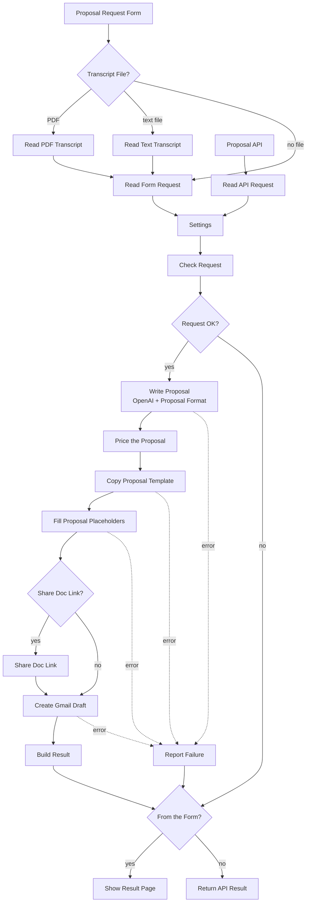

# Automate Sales Proposals with n8n | Turn Sales Call Transcripts into Google Doc Proposals and Gmail Drafts with AI

**Workflow file:** [`automate-sales-proposals-from-call-transcripts.json`](../automate-sales-proposals-from-call-transcripts.json)

This n8n workflow turns a sales call into a proposal your rep only has to review. Paste the call transcript into a form, upload it as a file, or send it to the workflow's API from your call recorder or CRM. AI reads the call and writes the proposal: an executive summary, the client's goals and challenges, the proposed solution, scope, deliverables, timeline, assumptions, and next steps. The workflow then copies your Google Doc proposal template, fills in every placeholder, and creates a Gmail draft to the client with a short follow-up email and the link to the doc.

Prices never come from the AI. The AI only picks services from your pricing catalog and sets quantities, and the workflow looks up each price and adds up the total itself. That makes these automated sales proposals safe to send after a quick review, with no invented discounts or made-up numbers.

---

## What it's used for

- **Sending proposals the same day as the call.** The proposal and follow-up email are ready a few minutes after the rep submits the transcript, while the conversation is still fresh for the client.
- **Keeping proposals consistent.** Every proposal uses your template, your sections, and your catalog prices, no matter which rep wrote it.
- **Saving rep time.** Reps review and adjust a finished draft instead of writing from a blank page and copying prices from a spreadsheet.
- **Quoting from what the client actually said.** Goals, challenges, and scope come from the transcript, in the client's own terms, and anything not discussed is listed as an assumption instead of being made up.
- **Automating proposals from your call recorder or CRM.** Tools that produce transcripts can call the API after each sales call, so a proposal draft is waiting without anyone filling in a form.

## At a glance

| | |
|---|---|
| **Triggers** | A form (`/form/sales-proposal-form`) and an API call (`POST /webhook/sales-proposal`) |
| **Input** | Client contact name, company, and email, the rep's name and email, the call transcript, and optional notes for the proposal |
| **Transcript formats** | Pasted text, or a `.txt`, `.vtt`, `.srt`, or text-based `.pdf` file. Caption timestamps are removed automatically. |
| **AI** | OpenAI `gpt-5-mini` through a Basic LLM Chain with a Structured Output Parser |
| **Pricing** | Only from the pricing catalog in `Settings`. The AI picks items and quantities, and the workflow calculates line totals and the total. |
| **Output** | A Google Doc named `Proposal - <Company> - <date>`, copied from your template, and a Gmail draft to the client with the doc link |
| **Sharing** | Off by default. Optionally, anyone with the link can view or comment. |
| **Response** | A completion page with the doc link for the form, and JSON for the API |
| **Credentials** | OpenAI, Google Drive OAuth2, Google Docs OAuth2, Gmail OAuth2, and Header Auth for the API |

---

## How it works



The canvas is organized into five numbered sections.

### Step 1: Get the call transcript

| Node | What it does |
|---|---|
| `Proposal Request Form` | A form with the client contact name, client company, client email, the rep's name and email, a box to paste the transcript, a transcript file upload, and optional notes for the proposal. |
| `Transcript File?` | Sends PDF uploads to `Read PDF Transcript`, other uploads to `Read Text Transcript`, and submissions without a file straight to `Read Form Request`. |
| `Read PDF Transcript` | Extracts the text from a PDF, joining all pages. |
| `Read Text Transcript` | Reads a `.txt`, `.vtt`, or `.srt` file as text. |
| `Read Form Request` | Combines the pasted text and the file text into one transcript. For caption files, it removes cue numbers and timestamps and keeps speaker names from WebVTT voice tags, such as `Jordan Lee: We need help with support.` |
| `Proposal API` | Accepts a `POST` with the same fields as JSON. It requires an API key header and replies through `Return API Result`. |
| `Read API Request` | Reads the JSON body into the same fields the form produces. |

### Step 2: Settings and checks

| Node | What it does |
|---|---|
| `Settings` | Holds the template Doc ID, the Drive folder, your company name, currency, locale, proposal validity, link sharing, and the pricing catalog. |
| `Check Request` | Checks that every required field is filled in, that both emails are valid, that the transcript has at least 100 characters, and that the settings and pricing catalog are valid. It also accepts a full Google Docs or Drive folder link in `Settings` and pulls out the ID. Transcripts longer than 150,000 characters are cut to that length, with a warning. Then it builds the prompt with the client details, the rep's notes, the catalog, and the transcript. |
| `Request OK?` | Sends valid requests to the AI. Anything else goes straight back to the form page or the API caller with a list of what to fix. |

The values to fill in are all in `Settings`:

| Setting | Default | What it is |
|---|---|---|
| `templateDocId` | empty | The ID of your proposal template Google Doc, the long string between `/d/` and `/edit` in its URL. You can paste the whole URL. Required. |
| `driveFolderId` | empty | The Drive folder for new proposals, the string after `/folders/` in the folder's URL. Empty saves proposals to the root of My Drive. |
| `companyName` | `Your Company` | Your company name, used in the prompt, the `{{company_name}}` placeholder, and the email signature. |
| `currency` | `USD` | The currency code for all prices, such as `USD`, `EUR`, or `GBP`. |
| `locale` | `en-US` | How prices and dates are written, such as `en-US` for `$8,500.00` and `November 4, 2026`, or `en-GB` and `de-DE`. |
| `proposalValidityDays` | `30` | How many days the proposal is valid. Used for `{{valid_until}}`. |
| `linkSharingRole` | empty | Empty keeps the doc private. `reader` or `commenter` lets anyone with the link view or comment, so the client can open the link in the email. |
| `pricingCatalog` | 5 sample services | A JSON list of the services you sell, with their prices. See setup step 4. |

### Step 3: Write the proposal with AI

| Node | What it does |
|---|---|
| `Write Proposal` | A Basic LLM Chain that turns the transcript into the proposal sections and a follow-up email. Its instructions tell it to use only facts from the call and the rep's notes, to list anything not discussed as an assumption, to choose pricing only from catalog IDs, and never to write prices, totals, or discounts. It writes in the language of the transcript. |
| `OpenAI Chat Model` | `gpt-5-mini`, with a 3-minute timeout and 2 retries. |
| `Proposal Format` | A Structured Output Parser with a JSON schema, so the AI always returns the same fields: `proposal_title`, `executive_summary`, `client_goals`, `current_challenges`, `proposed_solution`, `scope_items`, `deliverables`, `timeline`, `pricing_lines`, `assumptions`, `next_steps`, `email_subject`, and `email_body`. |
| `Price the Proposal` | Looks up each catalog ID the AI chose, multiplies the catalog price by the quantity, and adds up the total. IDs that aren't in the catalog are left out and listed as a warning. It also writes the text for every placeholder, the doc name, and the dates. |

### Step 4: Create the Google Doc and Gmail draft

| Node | What it does |
|---|---|
| `Copy Proposal Template` | Copies your template into `driveFolderId` as `Proposal - <Company> - <date>`, for example `Proposal - Acme Inc. - 2026-11-04`. |
| `Fill Proposal Placeholders` | Replaces all 20 placeholders in the copy in one Google Docs request. Placeholders are case-sensitive. |
| `Share Doc Link?` | Checks whether `linkSharingRole` is set. |
| `Share Doc Link` | Gives anyone with the link `reader` or `commenter` access, without sending any notification email. If your Google Workspace blocks link sharing, the doc stays private, the workflow continues, and the result shows a warning. |
| `Create Gmail Draft` | Creates a draft to the client with the AI's subject and email, followed by "You can review the full proposal here:", the doc link, and the rep's name and your company name. Nothing is sent until someone opens the draft and sends it. |

### Step 5: Show the result

| Node | What it does |
|---|---|
| `Build Result` | Builds the success page and JSON: the doc link, total, Gmail draft ID, and warnings, such as catalog items that were left out or placeholders that weren't found in your template. |
| `Report Failure` | Runs when the AI, Drive copy, Docs update, or Gmail step fails. It names the step and Google's or OpenAI's error message, and includes the doc link if the copy was already made. |
| `From the Form?` | Sends form runs to the completion page and API runs to the JSON response. |
| `Show Result Page` | The form's last page, with the doc link and anything to check before sending, or the list of problems to fix. |
| `Return API Result` | Returns the JSON with status `200`, `400` (missing fields or invalid settings), or `502` (the AI, Google, or Gmail step failed). |

---

## Setup

### 1. Create the Google Doc template

Create a Google Doc with your branding, layout, and any fixed text, such as your terms, case studies, or a signature block. Then add the placeholders below where the generated text should go. Type each one exactly as shown, with two curly braces on each side and no spaces. You can copy this outline as a starting point:

```text
{{proposal_title}}

Prepared for {{client_name}}, {{client_company}} ({{client_email}})
Prepared by {{rep_name}}, {{company_name}} ({{rep_email}})
Date: {{proposal_date}}
Valid until: {{valid_until}}

Executive summary
{{executive_summary}}

Your goals
{{client_goals}}

Current challenges
{{current_challenges}}

Proposed solution
{{proposed_solution}}

Scope of work
{{scope_items}}

Deliverables
{{deliverables}}

Timeline
{{timeline}}

Investment
{{pricing_lines}}
Total: {{total_price}}

Assumptions
{{assumptions}}

Next steps
{{next_steps}}

Questions? Contact {{rep_name}} at {{rep_email}}.
```

What each placeholder becomes:

| Placeholder | Filled with |
|---|---|
| `{{proposal_title}}` | A short title from the AI, such as "Customer Support Automation for Acme Inc." |
| `{{proposal_date}}`, `{{valid_until}}` | Today's date and the date `proposalValidityDays` from now, written for your `locale` |
| `{{client_name}}`, `{{client_company}}`, `{{client_email}}` | The client details from the form or API |
| `{{rep_name}}`, `{{rep_email}}` | The rep's details from the form or API |
| `{{company_name}}` | `companyName` from `Settings` |
| `{{executive_summary}}`, `{{proposed_solution}}` | Paragraphs from the AI |
| `{{client_goals}}`, `{{current_challenges}}`, `{{scope_items}}`, `{{deliverables}}`, `{{assumptions}}`, `{{next_steps}}` | Lists from the AI, one item per line |
| `{{timeline}}` | One phase per line, such as `Discovery (2 weeks): Map current support workflows` |
| `{{pricing_lines}}` | One line per catalog item, such as `Implementation: 40 x $150.00 per hour = $6,000.00` |
| `{{total_price}}` | The total of all pricing lines, such as `$8,500.00` |

The list placeholders put each item on its own line, so give each one its own line in the template. To show them as bullets, format that line as a bulleted list. Headings and fonts come from the template, so style the lines around the placeholders however you like.

Copy the Doc ID from the template's URL, the part between `/d/` and `/edit`.

### 2. Import the workflow and connect credentials

Import `automate-sales-proposals-from-call-transcripts.json` into n8n, then connect a credential in each of these nodes:

| Node | Credential |
|---|---|
| `OpenAI Chat Model` | OpenAI, with an API key from platform.openai.com |
| `Copy Proposal Template` and `Share Doc Link` | Google Drive OAuth2 |
| `Fill Proposal Placeholders` | Google Docs OAuth2 |
| `Create Gmail Draft` | Gmail OAuth2 |
| `Proposal API` | Header Auth, only if you use the API (step 6) |

If you create your own Google OAuth client, enable the Google Drive API, Google Docs API, and Gmail API in that Google Cloud project. The Google account you connect must be able to open the template and add files to the folder. Gmail drafts are created in the connected Gmail account, so each rep can connect their own account in their own copy of the workflow, or a shared sales account can hold the drafts.

### 3. Fill in Settings

Open `Settings` and set at least `templateDocId`, `companyName`, `currency`, and `locale`. Add a `driveFolderId` if you want proposals in a specific folder. Leave `linkSharingRole` empty if reps should share each doc themselves after reviewing it, or set it to `reader` or `commenter` so the link in the email works for the client right away.

### 4. Add your pricing catalog

Replace the sample services in `pricingCatalog` with what you sell. Each service needs an `id`, a `name`, and a `unit_price`. The `unit` and `description` are optional, but they help the AI choose the right items and quantities.

```json
[
  {
    "id": "discovery",
    "name": "Discovery and planning workshop",
    "description": "Two working sessions to map requirements, systems, and success metrics.",
    "unit_price": 2500,
    "unit": "workshop"
  },
  {
    "id": "implementation",
    "name": "Implementation",
    "description": "Build, configure, and test the agreed solution.",
    "unit_price": 150,
    "unit": "hour"
  }
]
```

Keep the IDs short and unique. Prices are numbers without currency symbols, in the currency set in `currency`. If the client needs something that isn't in the catalog, the AI lists it in the assumptions as "To be quoted separately" instead of pricing it.

### 5. Test it with the form

1. Publish the workflow and open the production URL of `Proposal Request Form`.
2. Fill in the client and rep details, paste a real call transcript or upload one, and add any notes, such as "lead with the CRM integration, they want to start in March". Your notes take priority over the transcript.
3. Submit the form. After a minute or two, the completion page shows the total and a link to the new Google Doc, with anything to check before sending.
4. Open the doc and check every section and the pricing, then open Gmail Drafts, review the email, and send it.

### 6. Connect the API (optional)

To send transcripts from a call recorder, CRM, or script, create a Header Auth credential in `Proposal API`, for example with **Name** `X-API-Key` and a long random **Value**. Then send a `POST` to the production URL:

```bash
curl -X POST https://your-n8n.example.com/webhook/sales-proposal \
  -H "X-API-Key: your-secret-key" \
  -H "Content-Type: application/json" \
  -d '{
    "client_name": "Jordan Lee",
    "client_company": "Acme Inc.",
    "client_email": "jordan@acme.com",
    "rep_name": "Sam Rivera",
    "rep_email": "sam@yourcompany.com",
    "transcript": "Sam: Thanks for joining, Jordan...",
    "notes": "Optional notes for the proposal"
  }'
```

A successful call returns status `200`:

```json
{
  "ok": true,
  "client_company": "Acme Inc.",
  "doc_id": "1AbCdEfGhIjKlMnOpQrStUvWxYz0123456789",
  "doc_url": "https://docs.google.com/document/d/1AbCdEfGhIjKlMnOpQrStUvWxYz0123456789/edit",
  "doc_name": "Proposal - Acme Inc. - 2026-11-04",
  "gmail_draft_id": "r-1234567890123456789",
  "gmail_message_id": "18c2f0a1b2c3d4e5",
  "link_shared": false,
  "total": 8500,
  "total_formatted": "$8,500.00",
  "currency": "USD",
  "pricing_lines": [
    {
      "catalog_id": "discovery",
      "name": "Discovery and planning workshop",
      "description": "Two working sessions to map requirements, systems, and success metrics.",
      "quantity": 1,
      "unit": "workshop",
      "unit_price": 2500,
      "line_total": 2500,
      "note": ""
    },
    {
      "catalog_id": "implementation",
      "name": "Implementation",
      "description": "Build, configure, and test the agreed solution.",
      "quantity": 40,
      "unit": "hour",
      "unit_price": 150,
      "line_total": 6000,
      "note": "Build and test the help desk automations"
    }
  ],
  "dropped_items": [],
  "warnings": []
}
```

Missing fields or invalid settings return `400` with `{"ok": false, "errors": [...]}`. A failed AI, Drive, Docs, or Gmail step returns `502` with `failed_step`, `error`, and `doc_url` (the doc link if the copy was already made, otherwise `null`). The AI step can take a minute or more on long calls, so give your HTTP client a timeout of a few minutes.

### 7. Make it yours

- **Use a different model:** pick another model in `OpenAI Chat Model`, or replace it with any chat model node n8n supports, such as Anthropic or Google Gemini.
- **Change the proposal style:** edit the instructions in `Write Proposal`. To add a section, add a field to the schema in `Proposal Format`, add it to the `placeholders` list in `Price the Proposal`, add a matching row in `Fill Proposal Placeholders`, and put the new placeholder in your template.
- **Leave a placeholder out of your template:** delete its row in `Fill Proposal Placeholders` and remove it from `placeholders` in `Price the Proposal`, so it isn't reported as missing.
- **Change the email wording:** the line before the doc link and the signature are in the **Message** field of `Create Gmail Draft`. If your transcripts aren't in English, translate that line, since the AI writes the rest of the email in the transcript's language.
- **Send the email automatically:** change `Create Gmail Draft` to the Gmail **Send** operation. Only do this once you trust the output, because the client sees it right away.
- **Notify the rep:** add a Slack or email node after `Build Result` with the doc link, for teams where drafts are created in a shared Gmail account.
- **Keep the catalog in a sheet:** read your price list from Google Sheets and pass it to `Check Request` in place of `pricingCatalog`, using the same fields.

---

## Troubleshooting

| Symptom | Likely cause |
|---|---|
| "Settings: add the ID of your proposal template Google Doc to templateDocId." | `templateDocId` in `Settings` is empty |
| "Settings: pricingCatalog is not valid JSON" | A missing comma, quote, or bracket in `pricingCatalog`. Paste it into a JSON validator to find it. |
| "The file ... has no readable text" | The PDF is a scanned image. Run it through OCR first, or paste the transcript instead. |
| A Word file can't be uploaded | The form accepts `.txt`, `.vtt`, `.srt`, and `.pdf`. Save the transcript as PDF or plain text, or paste it. |
| `Copy Proposal Template` fails with "File not found" | The template ID is wrong, or the connected Google account can't open the template. Share the template with that account. |
| `Copy Proposal Template` fails with a folder error | `driveFolderId` is wrong, or the connected account can't add files to that folder |
| "Not found in your template, so not filled in: ..." | Those placeholders aren't in your template, or are typed differently. They must match exactly, including lowercase letters and underscores. |
| A placeholder is still visible in the doc | It's typed differently from the list in setup step 1, for example with a space inside the braces or a capital letter |
| List items aren't bullets | Format the placeholder's line in the template as a bulleted list |
| `Write Proposal` fails with a parsing error | The model didn't return valid JSON for the schema, which can happen with very long transcripts. Try again, shorten the transcript, or choose a larger model. |
| `Write Proposal` fails with a timeout | Long transcripts can take longer than 3 minutes. Raise **Timeout** in the options of `OpenAI Chat Model`. |
| "Not in the pricing catalog, so left out of the price: ..." | The AI chose an ID that isn't in your catalog. Check the pricing in the doc, and add the service to the catalog if you sell it. |
| "Link sharing failed, so the doc is still private" | Your Google Workspace admin blocks sharing outside your organization. Share the doc with the client's email address instead. |
| The client can't open the link in the email | `linkSharingRole` is empty, so the doc is private. Share it with the client before you send the draft. |
| The draft isn't in the rep's Gmail | Drafts are created in the Gmail account connected to `Create Gmail Draft` |
| The API returns `401` or `403` | The API key header name or value doesn't match the Header Auth credential in `Proposal API` |
| The API call times out | The AI step is still running. Raise your HTTP client's timeout to a few minutes. |
