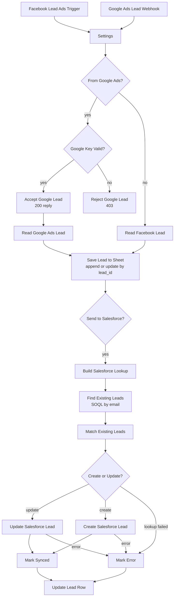

# Connect Facebook Lead Ads to Google Sheets and Salesforce with n8n | Sync Facebook and Google Ads Leads Automatically

**Workflow file:** [`connect-facebook-lead-ads-google-sheets-salesforce.json`](../connect-facebook-lead-ads-google-sheets-salesforce.json)

This n8n workflow connects Facebook Lead Ads and Google Ads lead forms to Google Sheets and Salesforce. Every lead is saved to a Google Sheet a few seconds after the form is submitted, then sent to Salesforce as a Lead. If Salesforce already has an unconverted Lead with the same email, that Lead is updated instead of duplicated. The Salesforce ID and the result of the sync are written back to the lead's row, so the sheet doubles as a log of every lead and what happened to it.

Both ad platforms land in the same sheet with the same columns, so you can compare Facebook and Google Ads leads side by side. Test leads from either platform are saved to the sheet but kept out of Salesforce by default.

---

## What it's used for

- **Getting leads to sales faster.** Leads reach Salesforce within seconds instead of waiting for someone to download a CSV from Meta or Google Ads.
- **Keeping one list of every ad lead.** Facebook, Instagram, and Google Ads leads go into one Google Sheet with the form, campaign, and ad they came from.
- **Avoiding duplicate Leads.** Someone who fills in a second form updates their existing Salesforce Lead instead of creating another one.
- **Never losing a lead.** Leads are saved to the sheet before Salesforce is called, and Salesforce errors are logged on the row with the reason.
- **Replacing paid connectors.** It does the job of a lead sync tool such as LeadsBridge or Zapier with a workflow you run yourself.

## At a glance

| | |
|---|---|
| **Triggers** | A Facebook Lead Ads trigger for new leads, and a webhook for Google Ads lead forms (`POST /webhook/google-ads-leads`) |
| **Lead sources** | Facebook and Instagram lead ads (one page and form), and any Google Ads lead form that uses the webhook |
| **Google Sheet** | One row per lead, added or updated by `lead_id`, with the Salesforce result written back |
| **Salesforce** | Creates a Lead, or updates the newest unconverted Lead with the same email |
| **Lead Source** | `Facebook Lead Ads` or `Google Ads`, set in `Settings` |
| **Test leads** | Saved to the sheet, not sent to Salesforce unless you turn it on |
| **Security** | Google Ads leads must carry your webhook key. Facebook requests are checked with your app secret by the trigger. |
| **AI** | None |
| **Credentials** | Facebook Lead Ads OAuth2, Google Sheets OAuth2, Salesforce OAuth2 |

---

## How it works



The canvas is organized into a start section and four numbered sections.

### Triggers and settings

| Node | What it does |
|---|---|
| `Facebook Lead Ads Trigger` | Fires when someone submits the Facebook or Instagram lead form you pick. When the workflow is activated, n8n subscribes your Meta app to the page's lead events. It fetches each lead's answers, form, ad, and ad set from Meta. |
| `Google Ads Lead Webhook` | Receives leads from Google Ads lead forms. It waits for `Accept Google Lead` or `Reject Google Lead` to reply. |
| `Settings` | Holds the values below. |
| `From Google Ads?` | Sends webhook requests (Google Ads leads) to the key check and Facebook leads straight to `Read Facebook Lead`. |

| Setting | Default | What it is |
|---|---|---|
| `google_ads_webhook_key` | empty | The key you enter in Google Ads. Google sends it with every lead as `google_key`. While it's empty, every Google Ads lead is rejected. |
| `facebook_lead_source` | `Facebook Lead Ads` | The Salesforce Lead Source for Facebook leads |
| `google_lead_source` | `Google Ads` | The Salesforce Lead Source for Google Ads leads |
| `default_company` | `Not provided` | Used for new Leads when the form has no company answer, because Salesforce requires a company on every Lead |
| `send_test_leads_to_salesforce` | `false` | Set to `true` to send test leads to Salesforce too |

### Step 1: Check and read the lead

| Node | What it does |
|---|---|
| `Google Key Valid?` | Checks that `google_ads_webhook_key` is set and matches the `google_key` in the request. |
| `Accept Google Lead` | Replies `200` with `{}`, the response Google expects for a delivered lead. |
| `Reject Google Lead` | Replies `403` with `{"message": "Invalid google_key"}`. Google treats 4XX replies as final and doesn't retry, and the lead goes no further. |
| `Read Google Ads Lead` | Reads Google's `user_column_data` list into the lead record. |
| `Read Facebook Lead` | Reads the trigger's answers into the same lead record. |

Both Read nodes produce these fields, which become the sheet's columns:

| Column | Facebook Lead Ads | Google Ads |
|---|---|---|
| `lead_id` | Meta's lead ID | `lead_id` |
| `source` | `Facebook Lead Ads` | `Google Ads` |
| `created_time` | When the form was submitted | `lead_submit_time` |
| `full_name`, `first_name`, `last_name` | `full_name`, `first_name`, `last_name` | `FULL_NAME`, `FIRST_NAME`, `LAST_NAME` |
| `email` | `email`, or `work_email` | `EMAIL`, or `WORK_EMAIL` |
| `phone` | `phone_number`, or `work_phone_number` | `PHONE_NUMBER`, or `WORK_PHONE` |
| `company` | `company_name` | `COMPANY_NAME` |
| `job_title` | `job_title` | `JOB_TITLE` |
| `city` | `city` | `CITY` |
| `postal_code` | `zip_code` or `post_code` | `POSTAL_CODE` |
| `other_answers` | Every other answer, as JSON | Every other answer, as JSON, keyed by its label |
| `form` | The form name | `form_id` |
| `campaign` | The ad set name | `campaign_id` |
| `ad` | The ad name | The ad group or asset group ID, when Google sends one |
| `gclid` | Empty | `gcl_id`, the Google click ID |
| `is_test` | `true` for leads made with Meta's Lead Ads Testing Tool, whose answers start with `<test lead` | `true` when Google sends `is_test: true` |
| `sync_status` | `pending`, or `test lead, not sent to Salesforce` | Same |

When a form only asks for a full name, it's split into first and last name. Emails are stored in lowercase.

### Step 2: Save to Google Sheets

| Node | What it does |
|---|---|
| `Save Lead to Sheet` | Adds the lead to your sheet, or updates its row if the `lead_id` is already there, so a lead delivered twice is still one row. Values are written as is, so phone numbers keep their `+`. |
| `Send to Salesforce?` | Continues for leads whose `sync_status` is `pending`. Test leads stop here unless `send_test_leads_to_salesforce` is `true`. |

### Step 3: Find or create the Salesforce Lead

| Node | What it does |
|---|---|
| `Build Salesforce Lookup` | Builds one SOQL query for all the emails in the run, with quotes and backslashes escaped: `SELECT Id, Email, FirstName, LastName, Company, Phone, Title, City, PostalCode FROM Lead WHERE IsConverted = false AND Email IN ('…') ORDER BY CreatedDate DESC` |
| `Find Existing Leads` | Runs the query once. If it fails, the error is passed on instead of stopping the run. |
| `Match Existing Leads` | Pairs each lead with the newest unconverted Lead that has the same email, and prepares the Salesforce values. Leads without an email are always created. |
| `Create or Update?` | Sends each lead to `Update Salesforce Lead`, `Create Salesforce Lead`, or, when the lookup failed, `Mark Error`. |
| `Update Salesforce Lead` | Updates first name, last name, company, phone, title, city, and postal code. A field the new form left blank keeps the value Salesforce already has. Lead Source, email, and description aren't changed. |
| `Create Salesforce Lead` | Creates the Lead with the values below. |

New Leads are filled in like this:

| Salesforce field | Value |
|---|---|
| Last Name | `last_name`, or the full name, or `Unknown` |
| First Name | `first_name` |
| Company | `company`, or `default_company` |
| Email, Phone, Title, City, Postal Code | From the lead |
| Lead Source | `facebook_lead_source` or `google_lead_source` |
| Description | The source, form, campaign, ad, GCLID, lead ID, and every answer in `other_answers` |

Values longer than Salesforce's standard field lengths are trimmed, so a long answer can't fail the sync.

### Step 4: Write the result back

| Node | What it does |
|---|---|
| `Mark Synced` | Sets `sync_status` to `synced`, `salesforce_action` to `created` or `updated`, the Salesforce Lead ID, and `synced_at`. |
| `Mark Error` | Sets `sync_status` to `error`, `salesforce_action` to `create failed`, `update failed`, or `lookup failed`, and Salesforce's message in `sync_error`. |
| `Update Lead Row` | Writes those columns to the lead's row, found by `lead_id`, in the same sheet and tab as `Save Lead to Sheet`. |

---

## Setup

Plan on about 30 minutes. Your n8n instance needs a public HTTPS address so Meta and Google can reach it.

### 1. Create the Google Sheet

Create a spreadsheet with a tab named **Leads** and this header row in row 1:

```
lead_id, source, created_time, full_name, first_name, last_name, email, phone, company, job_title, city, postal_code, other_answers, form, campaign, ad, gclid, is_test, sync_status, salesforce_action, salesforce_id, synced_at, sync_error
```

Each name goes in its own column. If a column is missing, n8n adds it to the end of the header row.

### 2. Import the workflow and connect credentials

In n8n, go to **Workflows → Import from File** and select `connect-facebook-lead-ads-google-sheets-salesforce.json`. Then connect these credentials:

| Credential | Nodes |
|---|---|
| Facebook Lead Ads OAuth2 API | `Facebook Lead Ads Trigger` |
| Google Sheets OAuth2 API | `Save Lead to Sheet`, `Update Lead Row` |
| Salesforce OAuth2 API | `Find Existing Leads`, `Update Salesforce Lead`, `Create Salesforce Lead` |

- **Facebook:** create an app in Meta for Developers and use its App ID and App Secret as the credential's client ID and secret. The credential asks for `leads_retrieval`, `pages_show_list`, `pages_manage_metadata`, `pages_manage_ads`, `business_management`, and `pages_read_engagement`. Sign in as someone who can manage the page and its leads.
- **Salesforce:** create a connected app with OAuth turned on, the `full` and `refresh_token` scopes, and n8n's OAuth Redirect URL as the callback URL. Use its consumer key and secret in the credential, and choose **Production** or **Sandbox**. The Salesforce user needs permission to read, create, and edit Leads.

### 3. Pick the sheet and the form

1. In `Save Lead to Sheet`, choose your spreadsheet and the **Leads** tab **From list**. `Update Lead Row` uses the same sheet automatically.
2. In `Facebook Lead Ads Trigger`, choose your Facebook page and lead form.

### 4. Fill in Settings

Open `Settings` and set `google_ads_webhook_key` to a long random string, such as a password from a password manager. Change the Lead Source values if your Salesforce org uses different ones.

### 5. Activate the workflow

Activate (publish) the workflow. n8n registers the Facebook webhook with your Meta app at this point.

### 6. Connect Google Ads

1. Copy the **Production URL** from `Google Ads Lead Webhook`.
2. In Google Ads, edit your lead form and open its webhook integration, in the section for exporting or delivering leads.
3. Paste the URL as the **Webhook URL** and your `google_ads_webhook_key` as the **Key**.
4. Click **Send test data**. A row with `source` `Google Ads`, `is_test` `true`, and `sync_status` `test lead, not sent to Salesforce` should appear in the sheet.

Repeat steps 2 and 3 for each Google Ads lead form. They can all use the same URL and key.

### 7. Test it

1. Open Meta's **Lead Ads Testing Tool**, pick your page and form, and create a test lead. A Facebook row with `is_test` `true` should appear in the sheet. The tool keeps one test lead per form, so delete the old one there before creating another.
2. To test Salesforce, send a lead that isn't marked as a test. Replace the URL and key, then run:

   ```bash
   curl -X POST "YOUR_PRODUCTION_URL" -H "Content-Type: application/json" -d '{
     "lead_id": "n8n-test-001",
     "user_column_data": [
       {"column_id": "FULL_NAME", "string_value": "Test Lead"},
       {"column_id": "EMAIL", "string_value": "test.lead@example.com"},
       {"column_id": "COMPANY_NAME", "string_value": "Example Inc"}
     ],
     "form_id": 1,
     "campaign_id": 1,
     "google_key": "YOUR_KEY",
     "is_test": false
   }'
   ```

   The reply should be `{}`. The row should change to `synced` with a Salesforce ID, and the Lead should appear in Salesforce.
3. Run it again with `"lead_id": "n8n-test-002"`. The new row's `salesforce_action` should be `updated`, and Salesforce should still have one Lead for that email.
4. Delete the test Lead from Salesforce and the test rows from the sheet.

### 8. Make it yours

- **Using only one ad platform:** delete the other trigger. The rest of the workflow works as is.
- **Map custom questions to Salesforce fields:** in `Match Existing Leads`, read the answer from `JSON.parse(lead.other_answers)` and add it to the returned fields, then add it under **Custom Fields** in `Create Salesforce Lead`.
- **Assign an owner:** set **Owner** in `Create Salesforce Lead`'s additional fields to a user or queue.
- **Add Leads to a campaign:** add a Salesforce node after `Mark Synced` with the **Lead → Add Lead To Campaign** operation and the Salesforce ID from the row.
- **Alert sales:** add a Slack or email node after `Mark Synced` with the lead's name, email, and form.
- **Use Zoho CRM instead of Salesforce:** n8n's Zoho CRM node has a **Lead → Create or Update** operation that matches on email, so one Zoho CRM node can replace everything from `Build Salesforce Lookup` to `Create Salesforce Lead`. Connect it to `Mark Synced` and `Mark Error`, and change their `lead_id` and `salesforce_id` values to read from it.

---

## Troubleshooting

| Symptom | Likely cause |
|---|---|
| The workflow won't activate: "The Facebook App ID … already has a webhook subscription" | Another workflow or tool already uses this Meta app's lead webhook. Meta allows one per app. Delete that subscription in the app's **Webhooks** settings, or use another app. |
| Facebook leads don't arrive | The workflow isn't active, the lead came from a different page or form than the one picked in the trigger (leads from other forms are ignored), or the person who connected the credential can't access the page's leads |
| Google's **Send test data** fails | The workflow isn't active, the Google Ads webhook points to the test URL, or the key in Google Ads doesn't match `google_ads_webhook_key`. A mismatched key gets a `403` reply. |
| Google Ads leads are rejected with `403` | `google_ads_webhook_key` is empty or different from the key in Google Ads |
| Leads stop at the sheet with `test lead, not sent to Salesforce` | The lead is a test lead. Set `send_test_leads_to_salesforce` to `true` while testing. |
| `sync_error` mentions `bad value for restricted picklist field` | Your Lead Source picklist is restricted. Set `facebook_lead_source` and `google_lead_source` to values that exist in it. |
| `sync_error` mentions `DUPLICATES_DETECTED` | A Salesforce duplicate rule blocked the new Lead, for example because a Contact has the same email. Change the rule to allow and report, or update the existing record by hand. |
| `sync_error` mentions `INVALID_EMAIL_ADDRESS` | The lead typed an email Salesforce doesn't accept. Fix it on the row and create the Lead by hand. |
| `sync_error` mentions `INVALID_SESSION_ID` or the lookup failed | The Salesforce credential needs to be reconnected |
| Rows stay `pending` and `Update Lead Row` fails | The tab in `Save Lead to Sheet` was chosen by name. Choose it **From list** or by URL. Also check that the sheet has a `lead_id` column. |
| A lead appears twice in the sheet | The two rows have different `lead_id` values, so they're two separate form submissions |
