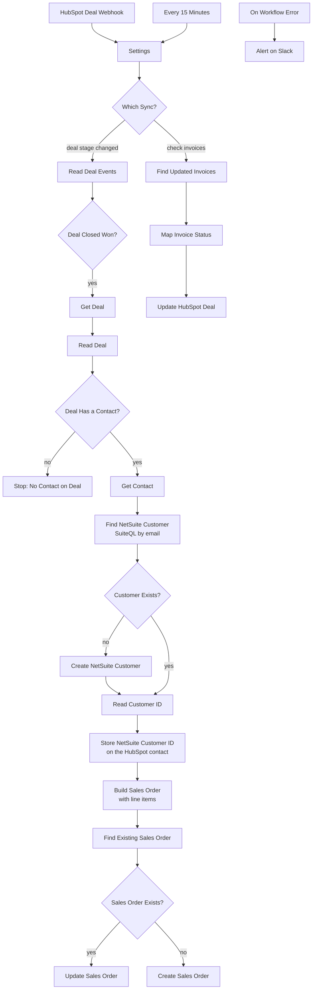

# HubSpot NetSuite Integration with n8n | Sync Closed Won Deals to Sales Orders and Invoice Status Back to HubSpot

**Workflow file:** [`hubspot-to-netsuite-sales-order-and-invoice-sync.json`](../hubspot-to-netsuite-sales-order-and-invoice-sync.json)

This n8n workflow connects HubSpot and NetSuite in both directions. When a deal moves to Closed Won in HubSpot, it finds or creates the customer in NetSuite and creates the sales order, with the deal's line items, close date, and currency. Every 15 minutes, it checks NetSuite for invoices that changed and updates each deal's **Invoice Status** in HubSpot, so sales can see whether a deal has been invoiced, partially paid, or paid in full without logging in to NetSuite. Any failure is posted to Slack with the deal, NetSuite's error message, and a link to the run.

---

## What it's used for

- **Removing double entry.** Sales orders are created from Closed Won deals automatically instead of being retyped by finance.
- **Keeping customers in one place.** Customers are matched by email, so each HubSpot contact maps to one NetSuite customer, and the NetSuite customer ID is saved on the contact.
- **Avoiding duplicate orders.** Each sales order stores its HubSpot deal ID. If a deal is moved out of Closed Won and back, the existing order is updated instead of a second one being created.
- **Showing payment status to sales.** Reps see Invoiced, Partially Paid, or Paid in Full on the deal, which helps with renewals, upsells, and collections.
- **Catching sync problems early.** Errors such as an invalid item or a currency that isn't set up for the subsidiary are posted to Slack with everything needed to fix them.

## At a glance

| | |
|---|---|
| **Triggers** | A HubSpot webhook when a deal's stage changes, a schedule every 15 minutes for invoices, and an error trigger for alerts |
| **HubSpot → NetSuite** | Closed Won deals become sales orders, and new customers are created when needed |
| **NetSuite → HubSpot** | Invoice payment status is written to the deal's `invoice_status` property |
| **Customer matching** | By the deal contact's email address, using SuiteQL |
| **Duplicate protection** | A `custbody_hubspot_deal_id` field on the sales order |
| **Line items** | Each HubSpot line item maps to a NetSuite item through a `netsuite_item_id` property, with a fallback item for anything unmapped |
| **Alerts** | Slack |
| **AI** | None |
| **Credentials** | HubSpot Service Key (private app access token), OAuth2 API (NetSuite), Slack |

---

## How it works

The canvas is organized into a start section and five numbered sections.

### Triggers and settings

| Node | What it does |
|---|---|
| `HubSpot Deal Webhook` | Receives deal stage changes from your HubSpot private app. It replies right away, so HubSpot's 5-second timeout is never hit. |
| `Every 15 Minutes` | Starts the invoice check. |
| `Settings` | Holds your NetSuite account details and ID mappings. |
| `Which Sync?` | Sends webhook runs to the sales order flow and scheduled runs to the invoice flow. |

The values to fill in are all in `Settings`:

| Setting | Default | What it is |
|---|---|---|
| `netsuiteAccountId` | `YOUR_ACCOUNT_ID` | Your NetSuite account ID, for example `1234567`, or `1234567_SB1` for a sandbox. It's converted to the URL form (`1234567-sb1`) automatically. |
| `netsuiteTimeZone` | `America/Los_Angeles` | The time zone set in the integration user's NetSuite preferences. Used for the invoice check. |
| `closedWonStages` | `closedwon` | The internal ID of the Closed Won stage. Separate several with commas if you use more than one pipeline. |
| `genericItemId` | empty | The internal ID of a NetSuite item, such as "Services", used for line items without a `netsuite_item_id` and for deals with no line items |
| `subsidiaryId` | empty | The subsidiary for new customers. Required for NetSuite OneWorld accounts. |
| `currencyMap` | `{"USD": "1"}` | HubSpot currency codes mapped to NetSuite currency internal IDs. Unmapped currencies use the customer's default currency. |
| `invoiceLookbackMinutes` | `60` | How far back each invoice check looks. It's longer than the 15-minute schedule on purpose, so a slow or missed run doesn't skip invoices. |

### Step 1: HubSpot deal moves to Closed Won

| Node | What it does |
|---|---|
| `Read Deal Events` | HubSpot sends webhook events in batches of up to 100. This keeps the latest `dealstage` change for each deal. |
| `Deal Closed Won?` | Continues for deals whose new stage is listed in `closedWonStages`. |
| `Get Deal` | Reads the deal's name, amount, close date, currency, stage, and pipeline, plus its associated contacts and line items, from HubSpot's CRM API. |
| `Read Deal` | Prepares the deal details and a link to the deal in HubSpot. |
| `Deal Has a Contact?` | Continues if the deal has an associated contact. |
| `Stop: No Contact on Deal` | Stops with an error naming the deal, which is posted to Slack. |

### Step 2: Match or create the NetSuite customer

| Node | What it does |
|---|---|
| `Get Contact` | Reads the contact's email, name, company, and phone. |
| `Read Contact` | Stops with an error if the contact has no email. Otherwise it prepares the customer record: a company customer when the contact has a company, or an individual when it doesn't. |
| `Find NetSuite Customer` | Searches NetSuite with SuiteQL: `SELECT id, entityid, email FROM customer WHERE LOWER(email) = '…'` |
| `Customer Exists?` | Uses the matching customer, or creates one. |
| `Create NetSuite Customer` | Creates the customer with `POST /record/v1/customer`. |
| `Read Customer ID` | Takes the customer's internal ID from the search result, or from the `Location` header NetSuite returns after creating a record. |
| `Store NetSuite Customer ID` | Saves the ID on the HubSpot contact as `netsuite_customer_id`. |

### Step 3: Create or update the sales order

| Node | What it does |
|---|---|
| `Has Line Items?` | Checks whether the deal has line items. |
| `Get Line Items` | Reads each line item's name, quantity, price, amount, SKU, and `netsuite_item_id`. |
| `Build Sales Order` | Builds the sales order. Each line item uses its `netsuite_item_id`, or `genericItemId` when it has none. A deal with no line items becomes one line for the deal amount. |
| `Find Existing Sales Order` | Looks for a sales order for this deal: `SELECT id FROM transaction WHERE type = 'SalesOrd' AND custbody_hubspot_deal_id = '…'` |
| `Sales Order Exists?` | Updates the existing order, or creates a new one. |
| `Update Sales Order` | Updates the order with `PATCH /record/v1/salesOrder/{id}?replace=item`, which replaces its lines with the deal's current line items. |
| `Create Sales Order` | Creates the order with `POST /record/v1/salesOrder`. |
| `Report NetSuite Error` | If any NetSuite request fails, stops the run with the deal ID, deal name, NetSuite's error message, and the deal link. The Slack alert shows all of these. |

The sales order is filled in like this:

| NetSuite field | Value |
|---|---|
| `entity` | The matched or new customer |
| `tranDate` | The deal's close date |
| `memo` | The deal name |
| `custbody_hubspot_deal_id` | The HubSpot deal ID |
| `currency` | The deal currency, through `currencyMap` |
| `item.items` | One line per HubSpot line item, with the item, quantity, rate (the unit price), and the line item name as the description |

### Step 4: Sync invoice status back to HubSpot

| Node | What it does |
|---|---|
| `Build Invoice Query` | Builds a SuiteQL query for invoices modified in the last `invoiceLookbackMinutes` that have a HubSpot deal ID. The cutoff time is calculated in `netsuiteTimeZone`. |
| `Find Updated Invoices` | Runs the query. Invoices are stored in NetSuite's `transaction` table with type `CustInvc`. |
| `Map Invoice Status` | Works out each deal's status from the invoice total and unpaid amount. If a deal has several changed invoices, the most recently modified one is used. |
| `Update HubSpot Deal` | Sets the deal's `invoice_status` property. |

| Invoice | `invoice_status` |
|---|---|
| Nothing left to pay | Paid in Full |
| Part of the total paid | Partially Paid |
| Nothing paid yet | Invoiced |

### Step 5: Slack alert when anything fails

| Node | What it does |
|---|---|
| `On Workflow Error` | Runs when any part of this workflow fails, once the workflow is set as its own error workflow. |
| `Alert on Slack` | Posts the step that failed, the error message, and a link to the failed run. Sales order errors include the deal ID, NetSuite's error, and the deal link. |

---

## Setup

Plan on about an hour, most of it in NetSuite.

### 1. Create a HubSpot private app

1. In HubSpot, go to **Settings → Integrations → Private Apps** and create an app.
2. Give it these scopes:
   - `crm.objects.deals.read`, `crm.objects.deals.write`
   - `crm.objects.contacts.read`, `crm.objects.contacts.write`
   - `crm.objects.line_items.read`
3. Copy the app's access token.

### 2. Create the HubSpot properties

| Object | Property | Type |
|---|---|---|
| Contact | `netsuite_customer_id` | Single-line text |
| Deal | `invoice_status` | Dropdown with the options `Invoiced`, `Partially Paid`, and `Paid in Full` |
| Product and line item | `netsuite_item_id` (optional) | Single-line text, holding the NetSuite item's internal ID |

The dropdown options' internal values must match these labels exactly.

### 3. Set up NetSuite

1. Go to **Setup → Company → Enable Features → SuiteCloud** and turn on **REST Web Services** and **OAuth 2.0**.
2. Create a transaction body field (**Customization → Lists, Records & Fields → Transaction Body Fields → New**):
   - **ID:** `_hubspot_deal_id`. NetSuite adds the `custbody` prefix, giving `custbody_hubspot_deal_id`.
   - **Type:** Free-Form Text
   - **Applies To:** sales orders and invoices, so the deal ID carries over when an order is billed
3. Create an integration record (**Setup → Integration → Manage Integrations → New**):
   - Turn on **Authorization Code Grant** and the **REST Web Services** scope.
   - Set the redirect URI to the **OAuth Redirect URL** shown in n8n's OAuth2 credential (step 4).
   - Copy the client ID and client secret.
4. Make sure the role you sign in with can use REST web services and OAuth 2.0, create and view customers and sales orders, view invoices and items, and run SuiteQL queries.

### 4. Import the workflow and connect credentials

In n8n, go to **Workflows → Import from File** and select `hubspot-to-netsuite-sales-order-and-invoice-sync.json`. Then create these credentials:

| Credential | Values | Nodes |
|---|---|---|
| HubSpot Service Key | Your private app's access token | `Get Deal`, `Get Contact`, `Store NetSuite Customer ID`, `Get Line Items`, `Update HubSpot Deal` |
| OAuth2 API (NetSuite) | See below | `Find NetSuite Customer`, `Create NetSuite Customer`, `Find Existing Sales Order`, `Update Sales Order`, `Create Sales Order`, `Find Updated Invoices` |
| Slack | Your Slack connection | `Alert on Slack` |

For the NetSuite OAuth2 API credential, replace `ACCOUNT_ID` with your account ID in URL form, such as `1234567` or `1234567-sb1`:

| Field | Value |
|---|---|
| Grant Type | Authorization Code |
| Authorization URL | `https://ACCOUNT_ID.app.netsuite.com/app/login/oauth2/authorize.nl` |
| Access Token URL | `https://ACCOUNT_ID.suitetalk.api.netsuite.com/services/rest/auth/oauth2/v1/token` |
| Client ID / Client Secret | From the integration record |
| Scope | `rest_webservices` |
| Authentication | Header |

Click **Connect** and sign in to NetSuite to finish.

NetSuite's authorization code tokens expire after 7 days and can't be refreshed, so you'll need to reconnect the credential every week. If that doesn't work for you, NetSuite's token-based authentication avoids it.

### 5. Fill in Settings

Open `Settings` and enter your values (see **Triggers and settings** above). To find the Closed Won stage ID, open **Settings → Objects → Deals → Pipelines** in HubSpot. The default pipeline's Closed Won stage is `closedwon`. Stages in other pipelines have numeric IDs.

### 6. Set up Slack alerts

1. In `Alert on Slack`, choose the channel for alerts.
2. Open the workflow's **Settings** and set **Error workflow** to this workflow.

### 7. Connect the HubSpot webhook

1. Publish the workflow and copy the **Production URL** from `HubSpot Deal Webhook`.
2. In your HubSpot private app, open the **Webhooks** tab and set the target URL to that address.
3. Create a subscription for **Deals**, **property change**, on the `dealstage` property, and make sure it's active.

### 8. Test it

1. Move a test deal with a contact to Closed Won. A sales order should appear in NetSuite within a few seconds, and the contact should get a `netsuite_customer_id`.
2. Move the deal out of Closed Won and back. The same sales order should be updated, not duplicated.
3. Bill the sales order in NetSuite. Within 15 minutes, the deal's **Invoice Status** should change to Invoiced. Record a payment to see it change again.

### 9. Make it yours

- **Add more fields to the sales order:** add HubSpot properties to the `properties` list in `Get Deal`, then set them in `Build Sales Order`. For example, a PO number property can go in NetSuite's `otherRefNum` field.
- **Check invoices more or less often:** change `Every 15 Minutes`, and keep `invoiceLookbackMinutes` longer than the interval.
- **Show more invoice details in HubSpot:** `Map Invoice Status` also returns the invoice number and unpaid amount. Add them to the body of `Update HubSpot Deal` with matching deal properties.
- **Send alerts somewhere else:** replace `Alert on Slack` with an email or Microsoft Teams node.
- **Map products by SKU instead:** in `Build Sales Order`, look up NetSuite item IDs from `hs_sku` using a table in the code.

---

## Troubleshooting

| Symptom | Likely cause |
|---|---|
| Nothing happens when a deal is closed | The workflow isn't published, the HubSpot webhook subscription is inactive or points to the test URL, or the stage ID isn't in `closedWonStages` |
| NetSuite requests fail with `401` | The NetSuite token expired after 7 days. Reconnect the OAuth2 credential. Also check `netsuiteAccountId`. |
| NetSuite requests fail with `403` | The role you signed in with is missing a permission listed in setup step 3 |
| HubSpot requests fail with `403` | The private app is missing one of the scopes in setup step 1 |
| "Please enter value(s) for: Subsidiary" | Your account uses OneWorld. Set `subsidiaryId` in `Settings`. |
| "Invalid item reference key" | A `netsuite_item_id` or `genericItemId` isn't the internal ID of an active NetSuite item |
| A currency error on the sales order | The currency in `currencyMap` isn't enabled for the customer or subsidiary, or the ID is wrong |
| An error mentioning `custbody_hubspot_deal_id` | The custom field doesn't exist, or doesn't apply to sales orders and invoices |
| "…has no line items, and no genericItemId is set" | Set `genericItemId`, or add products to the deal |
| "…has no associated contact" or "…has no email address" | Associate a contact with an email address to the deal, then move it to Closed Won again |
| Invoice status never updates | The invoice doesn't carry `custbody_hubspot_deal_id`, which happens when it wasn't created from the sales order. Also check `netsuiteTimeZone` and that the `invoice_status` options match exactly. |
| No Slack alerts | The workflow isn't set as its own error workflow, or no channel is selected in `Alert on Slack` |
