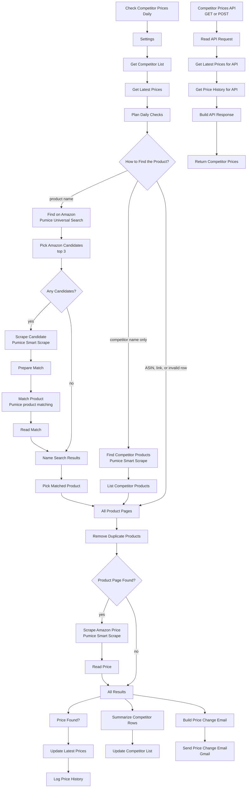

# Amazon Competitor Price Tracking API | Track Competitor Prices on Amazon Every Day with n8n and Pumice AI

**Workflow file:** [`pumice-amazon-competitor-price-tracking-api-workflow-n8n.json`](../pumice-amazon-competitor-price-tracking-api-workflow-n8n.json)

This n8n workflow gives you your own Amazon competitor price tracking API. You keep a list of competitors in Google Sheets: their ASINs, Amazon product URLs, product names, or just the competitor's name. Every morning the workflow reads the live price of each product, saves the latest prices and a full price history to the same spreadsheet, and emails you one summary of every competitor price change and stock change. Your apps, dashboards, and repricing scripts read the stored prices from an API endpoint, filtered by competitor or ASIN, with price history included.

Pumice AI does the finding, checking, and scraping. When you list a product by name, Universal Search finds candidate Amazon pages, Smart Scrape reads each one, and Pumice product matching confirms the page is the same product as your row before it is tracked. When you list only a competitor's name, Smart Scrape reads Amazon's search results to find their products. Smart Scrape then reads each product page for the Buy Box price, stock status, and seller. Proxies, CAPTCHAs, and Amazon's page changes are handled inside Pumice, so there are no HTML selectors to maintain.

The API returns the prices stored by the daily run, so calls are fast and use no Pumice credits. If you need a live price for any single product on demand, use the [Amazon price tracker API workflow](pumice-amazon-price-tracker-api-workflow-n8n.md) instead.

---

## What it's used for

- **Watching competitor pricing on Amazon.** See every price change your competitors make, product by product, with the previous price, the change in percent, and the lowest price so far.
- **Feeding pricing decisions.** Call the API from a repricer, spreadsheet, BI tool, or internal app to get current competitor prices by competitor or ASIN.
- **Tracking the right product from just a name.** Type a product name instead of an ASIN. Product matching checks the Amazon page against your row, so a similar model, a different size, or another brand's product isn't tracked by mistake.
- **Tracking a competitor's catalog without looking up ASINs.** List only a competitor's name, and their top products on Amazon are found and tracked for you.
- **Spotting stock-outs.** Get an email when a competitor's product goes out of stock, loses its Buy Box price, or comes back in stock.
- **Building a price history.** Every check is logged with price, list price, stock, seller, rating, and review count, ready for charts or analysis.

## At a glance

| | |
|---|---|
| **Triggers** | A daily schedule at 8:00 that checks the competitor list, and an API call (`GET` or `POST` to `/webhook/amazon-competitor-prices`) that reads the stored prices |
| **Competitor list** | A **Competitors** tab in Google Sheets. Each row has a competitor name, a product (ASIN, Amazon URL, or product name), or both. |
| **Competitor-only rows** | The competitor's products are found from an Amazon search for their name. Up to `max_products` are tracked (default 5, at most 20). |
| **Marketplaces** | Any Amazon marketplace, such as `amazon.com`, `amazon.co.uk`, `amazon.de`, or `amazon.co.jp` (default `amazon.com`) |
| **Stored data** | A **Latest Prices** tab with one row per product, and a **Price History** tab with one row per check |
| **API returns** | Each product's latest price, previous price, change, lowest price, list price, stock status, seller, rating, and review count, a summary per competitor, and price history |
| **Alerts** | One Gmail email per run with every price change of at least 5% (adjustable) and every stock change |
| **Match check** | Product name rows: the top 3 Amazon results are scraped and checked with Pumice product matching (`answer: "yes"` or `"no"`), and the highest-ranked match is used. The matched ASIN is saved to the row, so later runs skip the search. |
| **Pumice usage** | Per product per day: one Smart Scrape request. Plus one Smart Scrape request per competitor-only row. A product name row's first run also uses one Universal Search request and up to 3 Smart Scrape and 3 product matching requests, repeated each day until a match is found. API calls use none. |
| **AI** | Pumice AI (Universal Search, Smart Scrape, and product matching) |
| **Credentials** | Pumice API key (HTTP Header Auth), Google Sheets, Gmail |

---

## How it works



The canvas is organized into five labeled sections. Sections 1 to 4 are the daily run. Section 5 is the API.

### Step 1: Read the competitor list

| Node | What it does |
|---|---|
| `Check Competitor Prices Daily` | Starts the run every day at 8:00, in the workflow's time zone. |
| `Settings` | Holds `default_max_products` (5), the number of products to track for a competitor-only row with no `max_products`, and `alert_change_percent` (5), the smallest price change in percent that goes in the email. |
| `Get Competitor List` | Reads every row of your **Competitors** tab. |
| `Get Latest Prices` | Reads the **Latest Prices** tab once, so each new price can be compared with the last saved one. |
| `Plan Daily Checks` | Skips empty rows and turns each row into a check. Amazon links are reduced to a clean `/dp/ASIN` URL, and the marketplace is taken from the link. Short links (`amzn.to`, `a.co`) are passed on as they are. Links to other stores and marketplaces that aren't Amazon sites are marked invalid. A product name is searched together with the competitor name, unless the product name already includes it. A product name row that already has a `matched_asin` from an earlier run is priced by that ASIN, with no new search or match. A competitor-only row that repeats an earlier one for the same marketplace is skipped. |
| `How to Find the Product?` | Sends product names to Universal Search and competitor-only rows to the competitor search. ASINs, Amazon links, and invalid rows go straight on. |

The **Competitors** tab has these columns:

| Column | Meaning |
|---|---|
| `competitor` | The competitor's name, for example `Acme`. It labels the product in the sheet, the email, and the API, and it is searched on Amazon when the row has no product. |
| `product` | Optional. An ASIN (`B0BXYCS74H`), an Amazon product URL, or a product name. |
| `marketplace` | Optional. The Amazon site to check, for example `amazon.co.uk`. Defaults to `amazon.com`, or to the site in the URL. |
| `max_products` | Optional, for competitor-only rows. How many of the competitor's products to track, from 1 to 20. Defaults to `default_max_products` in `Settings`. |

### Step 2: Find each product page

| Node | What it does |
|---|---|
| `Find on Amazon` | Searches for the product name and marketplace with Pumice Universal Search (`/api/scraper/universal`). |
| `Pick Amazon Candidates` | Takes the top 3 product pages in the results that are on the row's Amazon site, in search-result order. If there are none, the row gets an error. |
| `Any Candidates?` | Sends rows with candidates on to be checked, and rows without any straight to `Name Search Results`. |
| `Scrape Candidate` | Reads each candidate page with Pumice Smart Scrape: title, ASIN, brand, model number, and feature bullets. |
| `Prepare Match` | Builds the two product records to compare (see below). |
| `Match Product` | Sends both records to Pumice product matching (`/v1/merchandising-api/product_matching`). |
| `Read Match` | Reads the answer for each candidate: `yes`, `no`, or `error` if the request failed. |
| `Name Search Results` | Waits for every candidate and every row without candidates. |
| `Pick Matched Product` | For each row, keeps the highest-ranked candidate that matched. If none matched, the row gets an error listing the ASINs and titles it checked, and no product is tracked for it. If every match request failed, the row is tried again on the next run. |
| `Find Competitor Products` | Sends the Amazon search results page for the competitor's name (for example `https://www.amazon.com/s?k=Acme`) to Pumice Smart Scrape (`/api/scraper/smart-scrape`), asking for the products made or sold by that competitor, in the order shown, skipping other brands and their sponsored products. |
| `List Competitor Products` | Reads the ASINs from Pumice's answer and outputs one check per product, up to the row's `max_products`. If none are found, the row gets an error. |
| `All Product Pages` | Waits for all three paths and combines them into one list. |
| `Remove Duplicate Products` | Keeps one check per product and marketplace. A product listed by ASIN or URL wins over a product name search, and a product name search wins over a competitor search. Skipped duplicates are noted on their row. |
| `Product Page Found?` | Sends products with a product page to the scrape, and errors straight to the results. |

**What's compared in `Match Product`**

| Record | Fields |
|---|---|
| `product_1` (your row) | `title`: the row's `product`, `brand`: the row's `competitor` |
| `product_2` (the Amazon page) | `title`, `brand`, `mpn` (the model number), and `description` (the feature bullets) from `Scrape Candidate` |

Both are sent as JSON strings, as the product matching endpoint expects. `customer_rules`, `fields`, and `examples` are sent empty. The matched page is scraped again in Step 3 for its price, so the first run of a product name row uses one more Smart Scrape request than later runs.

### Step 3: Scrape the live Amazon price

| Node | What it does |
|---|---|
| `Scrape Amazon Price` | Sends each product page to Pumice Smart Scrape with a plain-English prompt asking for the title, ASIN, Buy Box price, currency, list price, availability, stock status, seller, rating, review count, and main image. Requests are spaced one second apart, and the node is retried once after 5 seconds if Pumice returns an error. |
| `Read Price` | Cleans up the values. Prices such as `$1,299.99` and `1.299,99 €` become numbers, and the currency falls back to the marketplace's currency if Pumice doesn't return one. It compares the price and stock status with the product's row in **Latest Prices**, works out the change, the change in percent, and the lowest price so far, and decides what goes in the email (see below). A page with a title but no price is saved with an empty price and `in_stock` set to `no`. A page with no title and no price is an error. |
| `All Results` | Waits for every price and every error from the run and combines them, so the sheet updates and the email cover the whole run. |

A product goes in the email when:

- its price changed by at least `alert_change_percent` since the last check, up or down (a drop to the lowest price so far is noted),
- it had a price last time and has no Buy Box price now,
- it went out of stock, or
- it came back in stock.

### Step 4: Save prices and send one email

| Node | What it does |
|---|---|
| `Price Found?` | Keeps the products that were priced. |
| `Build Latest Price Row` / `Update Latest Prices` | Adds or updates the product's row in **Latest Prices**, matched on `product_key` (the marketplace and ASIN, such as `amazon.com:B0BXYCS74H`). Columns are created on the first run. |
| `Build History Row` / `Log Price History` | Adds one row per check to **Price History**. Columns are created on the first run. |
| `Summarize Competitor Rows` / `Update Competitor List` | Writes a status back to each row of your **Competitors** tab. |
| `Build Price Change Email` / `Send Price Change Email` | Sends one email, grouped by competitor, with each changed product's link, the change, the price, the previous price, stock status, and seller. If nothing changed, no email is sent. |

After a daily run, each row of the **Competitors** tab also has:

| Column | Meaning |
|---|---|
| `status` | `ok`, `partial` (some of the row's products failed), or `error` |
| `products_tracked` | How many products from this row were priced |
| `note` | Errors, or duplicates that were skipped, for example `B0BXYCS74H is already tracked from row 2.` |
| `last_checked` | When the row was last checked |
| `matched_asin`, `matched_title` | Product name rows only: the ASIN and Amazon title of the product that matched. Later runs price this ASIN without searching again. Clear `matched_asin` to search and match again. |

The **Latest Prices** tab has one row per product:

| Column | Meaning |
|---|---|
| `product_key` | The marketplace and ASIN, used to match the row |
| `competitor`, `asin`, `marketplace` | Which product this is, and whose |
| `title`, `url` | The product title and a clean Amazon link |
| `price`, `currency` | The latest Buy Box price. Empty when there is no Buy Box price. |
| `previous_price`, `price_change`, `change_percent` | The price at the previous check, and the change since then |
| `lowest_price` | The lowest price seen so far |
| `list_price`, `discount_percent` | The crossed-out list price, and the discount from it |
| `in_stock`, `seller` | `yes` or `no`, and the Buy Box seller |
| `rating`, `review_count` | The star rating and number of ratings |
| `found_by` | `list` (ASIN or URL), `product search`, or `competitor search` |
| `alert` | What went in the email for this product on the latest check, if anything |
| `last_checked` | When the product was last priced |

The **Price History** tab has one row per check, with `checked_at`, `competitor`, `asin`, `marketplace`, `title`, `price`, `currency`, `list_price`, `in_stock`, `seller`, `rating`, `review_count`, and `url`.

### Step 5: Competitor price API

| Node | What it does |
|---|---|
| `Competitor Prices API` | Receives API calls at `/webhook/amazon-competitor-prices`. It accepts `GET` with query parameters and `POST` with a JSON body. |
| `Read API Request` | Reads and checks the filters. |
| `Get Latest Prices for API` | Reads the **Latest Prices** tab. |
| `Get Price History for API` | Reads the **Price History** tab once. |
| `Build API Response` | Filters the products, adds each product's price history, builds the summary per competitor, and picks the HTTP status code. |
| `Return Competitor Prices` | Sends the response to the caller. |

All filters are optional. With none, every tracked product is returned.

| Filter | Meaning |
|---|---|
| `competitor` | One competitor, or several separated by commas (an array also works in a `POST` body). Not case sensitive. |
| `asin` | One ASIN, or several separated by commas (or an array) |
| `marketplace` | Only products on this Amazon site, for example `amazon.de` |
| `history_days` | How many days of price history to include for each product. Default 30, at most 365, and `0` for none. |

A successful call returns status `200`:

```json
{
  "ok": true,
  "count": 2,
  "as_of": "2026-11-05 08:03",
  "competitors": [
    {
      "competitor": "Acme",
      "products": 2,
      "in_stock": 2,
      "currency": "USD",
      "lowest_price": 24.99,
      "highest_price": 89.99,
      "average_price": 57.49
    }
  ],
  "products": [
    {
      "competitor": "Acme",
      "asin": "B0EXAMPLE1",
      "marketplace": "amazon.com",
      "title": "Acme Wireless Charger",
      "url": "https://www.amazon.com/dp/B0EXAMPLE1",
      "price": 24.99,
      "currency": "USD",
      "previous_price": 29.99,
      "price_change": -5,
      "change_percent": -16.7,
      "lowest_price": 24.99,
      "list_price": 39.99,
      "discount_percent": 38,
      "in_stock": true,
      "seller": "Acme Direct",
      "rating": 4.5,
      "review_count": 2140,
      "found_by": "competitor search",
      "alert": "Price dropped 16.7% from $29.99, lowest price so far",
      "last_checked": "2026-11-05 08:02",
      "history": [
        { "checked_at": "2026-11-04 08:02", "price": 29.99, "in_stock": true },
        { "checked_at": "2026-11-05 08:02", "price": 24.99, "in_stock": true }
      ]
    }
  ]
}
```

Only one of the two products is shown here. Numbers that weren't found on the page are `null`. Times are in the workflow's time zone. A competitor's price range is `null` when its products are priced in more than one currency. `history` is left out when `history_days` is `0`.

Errors return `ok: false` with a `code` and a readable `error`:

| Status | `code` | Meaning |
|---|---|---|
| `400` | `invalid_request` | An `asin` isn't a valid ASIN, the `marketplace` isn't an Amazon site, or `history_days` isn't a whole number of 0 or more |
| `404` | `no_data` | Nothing is stored yet. Run the daily check once. |
| `404` | `not_found` | No tracked product matches the filters. The response lists the tracked competitors in `tracked_competitors`. |
| `500` | `sheet_error` | The **Latest Prices** tab couldn't be read |

---

## Setup

Plan on about 15 minutes.

### 1. Get a Pumice API key

Sign in to [Pumice](https://app.pumice.ai) and copy your API key.

### 2. Import the workflow and add the credential

1. In n8n, go to **Workflows → Import from File** and select `pumice-amazon-competitor-price-tracking-api-workflow-n8n.json`.
2. Create an **HTTP Header Auth** credential named `Pumice API`:
   - **Name:** `x-api-key`
   - **Value:** your Pumice API key
3. Select that credential in each Pumice node:

| Service | Nodes |
|---|---|
| Pumice API (HTTP Header Auth) | `Find on Amazon`, `Scrape Candidate`, `Match Product`, `Find Competitor Products`, `Scrape Amazon Price` |

### 3. Create the spreadsheet

1. Create a Google Sheet with a tab for your competitor list (for example **Competitors**) and this header row: `competitor`, `product`, `marketplace`, `max_products`.
2. Add one row per product, or one row per competitor to track their top products:

| competitor | product | marketplace | max_products |
|---|---|---|---|
| Acme | B0EXAMPLE1 | | |
| Acme | https://www.amazon.com/dp/B0EXAMPLE2 | | |
| Globex | Globex 3-in-1 Charging Stand | | |
| Initech | | | 10 |
| Initech | | amazon.co.uk | |

3. Add two empty tabs named exactly `Latest Prices` and `Price History`.

### 4. Connect Google Sheets and Gmail

1. Connect your Google Sheets credential in the seven Sheets nodes:

| Service | Nodes |
|---|---|
| Google Sheets | `Get Competitor List`, `Get Latest Prices`, `Update Latest Prices`, `Log Price History`, `Update Competitor List`, `Get Latest Prices for API`, `Get Price History for API` |
| Gmail | `Send Price Change Email` |

2. In `Get Competitor List`, choose your spreadsheet and competitor tab **From list** or **By URL**. All the other Sheets nodes use the same spreadsheet automatically.
3. In `Send Price Change Email`, replace `you@example.com` with your address.

### 5. Run the first check

1. Click **Execute workflow** on `Check Competitor Prices Daily`.
2. Check the **Latest Prices** tab, and the `status` and `note` columns of your competitor list. For product name rows, check that `matched_title` is the product you meant.
3. The first run only saves prices. Emails start from the second run, when there is a previous price to compare with.
4. Publish the workflow so it runs every day.

### 6. Call the API

Once the workflow is published, call the production URL:

```bash
curl "https://your-n8n-domain/webhook/amazon-competitor-prices?competitor=Acme"

curl "https://your-n8n-domain/webhook/amazon-competitor-prices?asin=B0BXYCS74H&history_days=90"

curl -X POST "https://your-n8n-domain/webhook/amazon-competitor-prices" \
  -H "Content-Type: application/json" \
  -d '{"competitor": ["Acme", "Globex"], "marketplace": "amazon.com", "history_days": 0}'
```

To test before publishing, open `Competitor Prices API`, click **Listen for test event**, and use the test URL (`/webhook-test/amazon-competitor-prices`). Anyone with the production URL can read your competitor data, so see **Make it yours** to require an API key.

### 7. Make it yours

- **Require an API key:** in `Competitor Prices API`, set **Authentication** to **Header Auth** and create a credential with the header name and key your callers should send.
- **Alert on every price change:** set `alert_change_percent` in `Settings` to `0`.
- **Change what counts as a match:** add rules to `customer_rules` in `Match Product`, for example to treat different colors or pack sizes of the same model as a match.
- **Check more search results:** change `MAX_CANDIDATES` at the top of `Pick Amazon Candidates`. Each extra candidate costs one Smart Scrape and one product matching request on a row's first run.
- **Re-match a product name:** clear `matched_asin` on the row, for example after you change the product name. The next run searches and matches again.
- **Track more of a competitor's products:** set `max_products` on the row, or `default_max_products` in `Settings`, up to 20.
- **Check more often:** change the interval in `Check Competitor Prices Daily`, for example every 6 hours. Price changes are measured from the previous check.
- **Compare with your own prices:** add your own products as rows, with your brand as the `competitor`. They are tracked, stored, and returned by the API alongside your competitors.
- **Send the email somewhere else:** replace `Send Price Change Email` with another email node, such as Microsoft Outlook or Send Email (SMTP), using the same `subject` and `html` fields.
- **Pull more data from the page:** add fields to the `prompt` in `Scrape Amazon Price`, such as coupon, deal badge, or delivery date, then add them to the output of `Read Price` and to `Build Latest Price Row`.
- **Stop tracking a product:** delete its row in your competitor list. Its row in **Latest Prices** stays until you delete it too.

---

## Troubleshooting

| Symptom | Likely cause |
|---|---|
| `401` or `403` from a Pumice node | The `Pumice API` credential is missing, or the header name isn't exactly `x-api-key` |
| The daily run fails with "Parameter Document is required" | No spreadsheet or tab is selected in `Get Competitor List` |
| The daily run fails with "Sheet with name Latest Prices not found" | The spreadsheet has no tab named exactly `Latest Prices` (or `Price History`) |
| `Update Competitor List` fails with "Sheet with ID … not found" | The tab in `Get Competitor List` was chosen **By Name**. Choose it **From list** or **By URL** instead. |
| The API returns `500` with `sheet_error` | No spreadsheet is selected in `Get Competitor List`, the **Latest Prices** tab is missing, or the Google Sheets credential isn't selected in `Get Latest Prices for API` |
| The API returns `404` with `no_data` | The daily check hasn't run yet. Run it once from `Check Competitor Prices Daily`. |
| The API returns "The requested webhook … is not registered" | The workflow isn't published, or you called the test URL without clicking **Listen for test event** first |
| A competitor-only row says "No products from … were found" | Pumice found none of the competitor's products in the Amazon search. Check that the name matches the brand name on Amazon, or add their ASINs as rows. |
| A competitor-only row tracks other brands' products | The competitor's name is a common word, so the search mixes in other products. Use a more specific name, or list their ASINs instead. |
| A competitor-only row tracks different products from day to day | Amazon's search order changes. Products that drop out of the top results are no longer checked, but their last row stays in **Latest Prices**. List the products that matter most by ASIN. |
| A row's `note` says a product "is already tracked from row …" | The same product is listed twice, or a competitor search found a product you already list. It is priced once, under the earlier row. |
| A product shows an empty price and `in_stock` as `no` | The page had no Buy Box price, usually because the product is unavailable. It is checked again on the next run. |
| A product name row says "None of the top 3 Amazon results matched" | Product matching rejected every candidate, so nothing is tracked for that row. The note lists what was checked. Make the product name more specific (add the model number), check the `competitor` name, or use the ASIN or product URL. |
| A product name row says "Pumice product matching failed" | The product matching request failed for every candidate. Check the `Match Product` output and the `Pumice API` credential. The row is tried again on the next run. |
| A product name row tracks the wrong product | Check `matched_title` on the row. Clear `matched_asin` and make the product name more specific, or put the ASIN in `product`. |
| Obvious matches are rejected | The row has too little to compare, for example only a model name. Put the brand in `competitor` and more of the product title in `product`, or add a rule to `customer_rules` in `Match Product`. Also check the output of `Match Product` for errors. |
| The currency is wrong | Pumice didn't return a currency, so the marketplace's currency was used. Check that `marketplace` matches the product's Amazon site. |
| No email arrives | Nothing changed by at least `alert_change_percent`, or it was the first run. Also check the Gmail credential and the recipient in `Send Price Change Email`. |
| Large lists take a long time | Each product takes about a second plus Pumice's scrape time. Lower **Batch Interval** in `Scrape Amazon Price`, or split the list across several workflows. |
