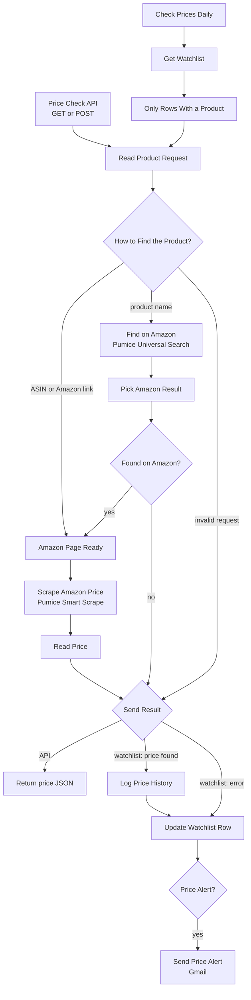

# Amazon Price Tracker API | Track Amazon Prices, Price History, and Price Drop Alerts with n8n and Pumice AI

**Workflow file:** [`pumice-amazon-price-tracker-api-workflow-n8n.json`](../pumice-amazon-price-tracker-api-workflow-n8n.json)

This n8n workflow gives you your own Amazon price tracker API. Call it with an ASIN, an Amazon product URL, or a product name, and it returns the product's live price, list price, discount, stock status, Buy Box seller, rating, and review count as JSON. The same workflow can also track a watchlist in Google Sheets every day, log each price to a history tab, and email you when a price reaches your target or drops to a new low.

Pumice AI does the hard part. Universal Search finds the Amazon product page when you only have a name, and Smart Scrape reads the price from the page and returns it as structured data, with proxies, CAPTCHAs, and Amazon's page changes handled inside Pumice. There are no HTML selectors to maintain.

---

## What it's used for

- **Adding Amazon prices to your own apps.** Call one endpoint from a script, spreadsheet, dashboard, or internal tool to get a product's current price.
- **Monitoring competitor pricing.** Track the products you compete with on Amazon and see every price change in a history tab.
- **Watching MAP and reseller pricing.** Check what your products sell for on Amazon each day and spot sellers pricing below your minimum.
- **Buying at the right time.** Set a target price for products you plan to buy and get an email when the price drops to it.
- **Building a price history.** Every daily check is logged with the price, list price, seller, stock status, and rating, ready for charts or analysis.

## At a glance

| | |
|---|---|
| **Triggers** | An API call (`GET` or `POST` to `/webhook/amazon-price-tracker`), and a daily schedule at 8:00 for the watchlist |
| **Input** | An ASIN, an Amazon product URL, or a product name, plus an optional `marketplace` and `target_price` |
| **Marketplaces** | Any Amazon marketplace, such as `amazon.com`, `amazon.co.uk`, `amazon.de`, or `amazon.co.jp` (default `amazon.com`) |
| **Returns** | Price, currency, list price, discount, stock status, availability, Buy Box seller, rating, review count, title, product URL, and check time |
| **Watchlist** | A Google Sheet, updated in place, plus a **Price History** tab with one row per check |
| **Alerts** | Gmail, when a price first reaches your target or drops below its lowest price so far |
| **Pumice usage** | One Smart Scrape request per price check, plus one Universal Search request when looking up by name |
| **AI** | Pumice AI (Universal Search and Smart Scrape) |
| **Credentials** | Pumice API key (HTTP Header Auth). Google Sheets and Gmail for the watchlist only. |

---

## How it works



The canvas is organized into four labeled sections.

### Step 1: Get the product: API call or daily watchlist

| Node | What it does |
|---|---|
| `Price Check API` | Receives API calls at `/webhook/amazon-price-tracker`. It accepts `GET` with query parameters and `POST` with a JSON body. |
| `Check Prices Daily` | Starts the watchlist run every day at 8:00, in the workflow's time zone. |
| `Get Watchlist` | Reads every row of your watchlist sheet. |
| `Only Rows With a Product` | Skips rows with an empty `product` cell. |
| `Read Product Request` | Works out what to look up: an ASIN, an Amazon link, or a product name to search for. Amazon links are reduced to a clean `/dp/ASIN` URL, and the marketplace is taken from the link. Short links (`amzn.to`, `a.co`) are passed on as they are. Links to other stores are rejected. |
| `How to Find the Product?` | Sends ASINs and Amazon links straight to the product page, sends names to search, and sends invalid requests to the error response. |

The API accepts these fields, as query parameters or in a JSON body:

| Field | Meaning |
|---|---|
| `asin` | A 10-character ASIN, for example `B0BXYCS74H` |
| `url` | An Amazon product URL. Tracking parameters are fine. |
| `product` (or `query`) | A product name to search for, for example `Sonos Era 100` |
| `marketplace` | Optional. The Amazon site to check, for example `amazon.co.uk`. Defaults to `amazon.com`, or to the site in the URL. |
| `target_price` | Optional. Adds `target_price` and `below_target` to the response. |

### Step 2: Find the Amazon product page

| Node | What it does |
|---|---|
| `Find on Amazon` | Searches for the product name and marketplace with Pumice Universal Search (`/api/scraper/universal`). |
| `Pick Amazon Result` | Takes the first Amazon product page in the results, preferring the requested marketplace, and builds its `/dp/ASIN` URL. |
| `Found on Amazon?` | Continues if a product page was found. Otherwise the request ends with a "not found" error. |
| `Amazon Page Ready` | Brings ASIN lookups, Amazon links, and search results back together before scraping. |

Searching by name uses the first matching Amazon result, so for exact tracking, use the ASIN or the product URL.

### Step 3: Scrape the live Amazon price with Pumice

| Node | What it does |
|---|---|
| `Scrape Amazon Price` | Sends the product page to Pumice Smart Scrape (`/api/scraper/smart-scrape`) with a plain-English prompt asking for the title, ASIN, Buy Box price, currency, list price, availability, stock status, seller, rating, review count, and main image. Requests are spaced one second apart, and a failed request is retried once after 5 seconds. |
| `Read Price` | Cleans up the values. Prices such as `$1,299.99` and `1.299,99 €` become numbers, the currency falls back to the marketplace's currency if Pumice doesn't return one, and stock status is read from the availability text when needed. For watchlist rows, it also compares the price with the row's previous and lowest prices and decides whether to send an alert. |

An alert is sent when either of these is true:

- **The price reaches your target.** The price is at or below `target_price`, and the previous check was above it or there wasn't one. You get one alert when the price crosses your target, not one every day it stays there.
- **The price hits a new low.** The price is lower than the row's `lowest_price`. The first check of a new row sets the starting lowest price, so it can't trigger a new-low alert.

### Step 4: Return the price or update the watchlist

| Node | What it does |
|---|---|
| `Send Result` | Routes API calls to the response, and watchlist rows to the sheet, separating found prices from errors. |
| `Build API Response` | Shapes the JSON response and picks the HTTP status code. |
| `Return Price JSON` | Sends the response to the caller. |
| `Build History Row` / `Log Price History` | Appends the check to the **Price History** tab in the same spreadsheet. Columns are created on the first run. |
| `Build Watchlist Row` / `Build Error Row` | Prepare the row update, with the latest price or the error. |
| `Update Watchlist Row` | Writes the results to the row the product came from, in the sheet selected in `Get Watchlist`. New columns are created automatically. |
| `Price Alert?` | Continues if the row has an alert. |
| `Send Price Alert` | Emails you the product, the alert reason, the price and discount, the previous, lowest, and target prices, the seller, a link to Amazon, and the product image. |

A successful API call returns status `200`:

```json
{
  "ok": true,
  "asin": "B0BXYCS74H",
  "title": "Sonos Era 100 Smart Speaker",
  "url": "https://www.amazon.com/dp/B0BXYCS74H",
  "price": 199,
  "currency": "USD",
  "list_price": 249,
  "discount_percent": 20,
  "in_stock": true,
  "availability": "In Stock",
  "seller": "Amazon.com",
  "rating": 4.6,
  "review_count": 12345,
  "image_url": "https://m.media-amazon.com/images/I/....jpg",
  "checked_at": "2026-10-27T14:27:24.033Z"
}
```

Fields Pumice can't find on the page are `null`. Errors return `ok: false` with a `code` and a readable `error`:

| Status | `code` | Meaning |
|---|---|---|
| `400` | `invalid_request` | No product was given, or the link isn't an Amazon link |
| `404` | `not_found` | A product name search found no Amazon product page |
| `422` | `no_price` | The page loaded but had no price, for example because the product is unavailable or has no Buy Box |
| `502` | `scrape_failed` | The Pumice request failed |

After a watchlist run, each row contains:

| Column | Meaning |
|---|---|
| `product` | The ASIN, Amazon URL, or product name you added |
| `target_price` | Optional. The price you want an alert at. |
| `marketplace` | Optional. The Amazon site to check for this row, for example `amazon.de` |
| `title`, `asin`, `url` | The product Pumice found |
| `last_price`, `currency` | The latest price |
| `lowest_price` | The lowest price seen so far |
| `price_change` | The change since the previous check, for example `-30.99` |
| `in_stock`, `seller` | Stock status and Buy Box seller |
| `alert` | Why an alert was sent on the latest check, if one was |
| `status`, `error` | `ok`, or `error` with the reason |
| `last_checked` | When the row was last checked |

---

## Setup

Plan on about 10 minutes for the API, and 10 more for the watchlist.

### 1. Get a Pumice API key

Sign in to [Pumice](https://app.pumice.ai) and copy your API key.

### 2. Import the workflow and add the credential

1. In n8n, go to **Workflows → Import from File** and select `pumice-amazon-price-tracker-api-workflow-n8n.json`.
2. Create an **HTTP Header Auth** credential named `Pumice API`:
   - **Name:** `x-api-key`
   - **Value:** your Pumice API key
3. Select that credential in each Pumice node:

| Service | Nodes |
|---|---|
| Pumice API (HTTP Header Auth) | `Find on Amazon`, `Scrape Amazon Price` |

### 3. Try the API

The API works without setting up the watchlist.

1. Open `Price Check API` and click **Listen for test event**.
2. Open the test URL in your browser with an ASIN, for example `https://your-n8n-domain/webhook-test/amazon-price-tracker?asin=B0BXYCS74H`.
3. To use the API permanently, publish the workflow and call the production URL:

```bash
curl "https://your-n8n-domain/webhook/amazon-price-tracker?asin=B0BXYCS74H"

curl -X POST "https://your-n8n-domain/webhook/amazon-price-tracker" \
  -H "Content-Type: application/json" \
  -d '{"product": "Sonos Era 100", "marketplace": "amazon.co.uk", "target_price": 179}'
```

Anyone with the production URL can call it and use your Pumice credits, so see **Make it yours** to require an API key.

### 4. Set up the watchlist (optional)

1. Create a Google Sheet with a `product` column, and optionally `target_price` and `marketplace` columns. Add one product per row.
2. Add an empty tab named exactly `Price History` to the same spreadsheet.
3. Connect your Google Sheets credential in `Get Watchlist`, `Log Price History`, and `Update Watchlist Row`.
4. In `Get Watchlist`, choose your spreadsheet and watchlist tab **From list** or **By URL**. `Log Price History` and `Update Watchlist Row` use the same spreadsheet automatically.
5. Connect your Gmail credential in `Send Price Alert` and replace `you@example.com` with your address.
6. Click **Execute workflow** on `Check Prices Daily` to run it once, then publish the workflow to run it every day.

### 5. Make it yours

- **Require an API key:** in `Price Check API`, set **Authentication** to **Header Auth** and create a credential with the header name and key your callers should send.
- **Check more or less often:** change the interval in `Check Prices Daily`, for example every 6 hours.
- **Alert on every price drop:** in `Read Price`, add `if (previous !== null && price < previous) alerts.push('Price dropped');` above the `return`.
- **Send alerts somewhere else:** replace `Send Price Alert` with a Slack, Telegram, or Microsoft Teams node using the same fields.
- **Pull more data from the page:** add fields to the `prompt` in `Scrape Amazon Price`, such as coupon, deal badge, or delivery date, and add them to the output in `Read Price` and `Build API Response`.
- **Stop tracking a product:** delete its row, or clear its `product` cell.
- **Change the default marketplace:** change `'amazon.com'` near the top of `Read Product Request`.

---

## Troubleshooting

| Symptom | Likely cause |
|---|---|
| `401` or `403` from a Pumice node | The `Pumice API` credential is missing, or the header name isn't exactly `x-api-key` |
| The API returns "The requested webhook … is not registered" | The workflow isn't published, or you called the test URL without clicking **Listen for test event** first |
| Every API call returns `502` | The Pumice request is failing. Check the output of `Scrape Amazon Price` and the `Pumice API` credential. |
| A product returns `422` (`no_price`) | The product is unavailable, has no Buy Box price, or the page didn't load fully. Check the output of `Scrape Amazon Price`, and try again later. |
| A name search returns the wrong product | Name searches use the first Amazon result. Use the ASIN or product URL instead. |
| A name search returns `404` | No Amazon product page was in the search results. Add the brand or model number, or use the ASIN. |
| The currency is wrong | Pumice didn't return a currency, so the marketplace's currency was used. Check that `marketplace` matches the product's Amazon site. |
| Watchlist run fails with "Parameter Document is required" | No sheet is selected in `Get Watchlist` |
| Watchlist run fails with "Sheet with name Price History not found" | The spreadsheet has no tab named exactly `Price History` |
| Watchlist run fails with "Sheet with ID … not found" | The sheet in `Get Watchlist` was chosen **By Name**. Choose it **From list** or **By URL** instead. |
| No alert emails arrive | No row reached its target or a new low. The first check of a row only sets its lowest price. Also check the Gmail credential and the recipient in `Send Price Alert`. |
| Large watchlists take a long time | Each product takes about a second plus Pumice's scrape time. Split the watchlist into several sheets, or lower **Batch Interval** in `Scrape Amazon Price`. |
