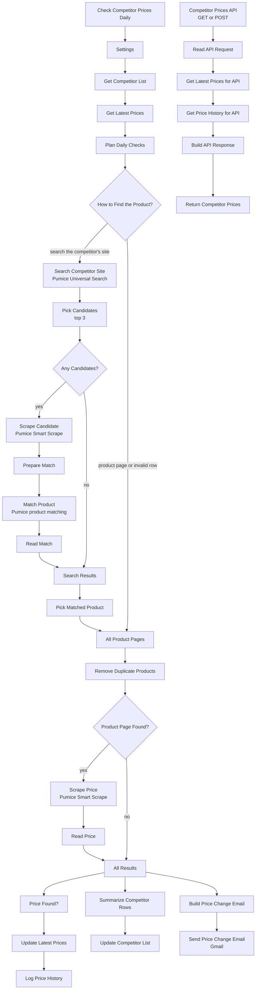

# Track Competitor Prices API | Monitor Competitor Prices on Any Website Every Day with n8n and Pumice AI

**Workflow file:** [`pumice-track-competitor-prices-api-workflow-n8n.json`](../pumice-track-competitor-prices-api-workflow-n8n.json)

This n8n workflow lets you track competitor prices on any website and read them from your own API. You keep a list in Google Sheets of your products and the competitor sites that sell them, identified by SKU, UPC, MPN, or product name, or by a direct product page link. Every morning the workflow finds each product on the competitor's site, confirms it is the same product, and reads the live price. It saves the latest prices and a full price history to the same spreadsheet, and emails you one summary of every competitor price change and stock change. Your apps, dashboards, and repricing scripts read the stored prices from an API endpoint that compares each product's price across competitors.

Pumice AI does the finding, checking, and scraping. Universal Search searches only the competitor's site with `site:<domain>` and your product's identifier. Smart Scrape reads each result, and Pumice product matching confirms the page is the same product as your row before it is tracked. Smart Scrape then reads the price from the product page on any store, with proxies, CAPTCHAs, and page changes handled inside Pumice, so there are no HTML selectors to maintain for each site.

The API returns the prices stored by the daily run, so calls are fast and use no Pumice credits. For Amazon only, see the [Amazon competitor price tracking API workflow](pumice-amazon-competitor-price-tracking-api-workflow-n8n.md).

---

## What it's used for

- **Tracking competitor prices across retailers.** Watch the same product at Best Buy, Target, Walmart, a brand's own store, or any other site, with the previous price, the change in percent, and the lowest price so far.
- **Comparing your price with the market.** Call the API with a UPC or MPN and get every competitor's price for that product, with the lowest price and who has it.
- **Finding competitor product pages from your catalog data.** Enter the competitor's website and your product's UPC or MPN. The workflow finds the page, and product matching makes sure a similar model or a different size isn't tracked by mistake.
- **Spotting stock-outs.** Get an email when a competitor's product sells out, loses its price, or comes back in stock.
- **Building a price history.** Every check is logged with price, regular price, stock status, and currency, ready for charts or analysis.

## At a glance

| | |
|---|---|
| **Triggers** | A daily schedule at 8:00 that checks the competitor list, and an API call (`GET` or `POST` to `/webhook/competitor-prices`) that reads the stored prices |
| **Competitor list** | A **Competitors** tab in Google Sheets with one row per product at each competitor: a `competitor_url` plus a `sku`, `upc`, `mpn`, or `product_name`, or a direct `product_url` |
| **Search** | Pumice Universal Search with `site:<domain> <identifier>`, using the row's MPN, UPC, SKU, or product name, in that order of preference |
| **Match check** | The top 3 pages on the competitor's site are scraped and checked with Pumice product matching (`answer: "yes"` or `"no"`), and the highest-ranked match is used. The matched page is saved to the row, so later runs skip the search. |
| **Sites** | Any online store that shows a price on the product page |
| **Stored data** | A **Latest Prices** tab with one row per competitor product, and a **Price History** tab with one row per check |
| **API returns** | Each competitor product's latest price, previous price, change, lowest price, regular price, and stock status, a price comparison per product and per competitor, and price history |
| **Alerts** | One Gmail email per run with every price change of at least 5% (adjustable) and every stock change |
| **Pumice usage** | Per product per day: one Smart Scrape request. A search row's first run also uses one Universal Search request and up to 3 Smart Scrape and 3 product matching requests, repeated each day until a match is found. API calls use none. |
| **AI** | Pumice AI (Universal Search, Smart Scrape, and product matching) |
| **Credentials** | Pumice API key (HTTP Header Auth), Google Sheets, Gmail |

---

## How it works



The canvas is organized into five labeled sections. Sections 1 to 4 are the daily run. Section 5 is the API.

### Step 1: Read the competitor list

| Node | What it does |
|---|---|
| `Check Competitor Prices Daily` | Starts the run every day at 8:00, in the workflow's time zone. |
| `Settings` | Holds `alert_change_percent` (5), the smallest price change in percent that goes in the email, and `default_currency` (`USD`), used when a page doesn't show its currency. |
| `Get Competitor List` | Reads every row of your **Competitors** tab. |
| `Get Latest Prices` | Reads the **Latest Prices** tab once, so each new price can be compared with the last saved one. |
| `Plan Daily Checks` | Skips empty rows and turns each row into a check. A row with a `product_url`, or a `matched_url` from an earlier run, is priced directly. Any other row needs a `competitor_url` and at least one identifier, and its search is built as `site:<domain> <identifier>`, using the MPN, then the UPC, then the SKU, then the product name. URLs lose tracking parameters such as `utm_source` and `srsltid`, and a UPC that Google Sheets shortened to 11 digits gets its leading zero back. |
| `How to Find the Product?` | Sends rows to search to `Search Competitor Site`, and product pages and invalid rows straight on. |

The **Competitors** tab has these columns. Use one row per product at each competitor.

| Column | Meaning |
|---|---|
| `competitor` | The competitor's name, for example `Best Buy`. It labels the product in the sheet, the email, and the API. Defaults to the site's domain. |
| `competitor_url` | The competitor's website, for example `bestbuy.com` or `https://www.bestbuy.com`. Searched with `site:`. |
| `product_url` | Optional. The competitor's product page. When it's set, there is no search or match. |
| `sku`, `upc`, `mpn` | Your product's identifiers. The site is searched for the MPN, then the UPC, then the SKU, whichever the row has first. |
| `product_name` | Optional. Your product's name. Used for matching, and for searching when the row has no identifier. |
| `brand` | Optional. Your product's brand, used for matching. |

### Step 2: Find the product on the competitor's site and confirm it

| Node | What it does |
|---|---|
| `Search Competitor Site` | Sends the `site:` search to Pumice Universal Search (`/api/scraper/universal`). |
| `Pick Candidates` | Takes the top 3 results on the competitor's site, including its subdomains, in search-result order. The site's home page and search pages are left out. If there are none, the row gets an error. |
| `Any Candidates?` | Sends rows with candidates on to be checked, and rows without any straight to `Search Results`. |
| `Scrape Candidate` | Reads each candidate page with Pumice Smart Scrape: title, brand, SKU, UPC, MPN, and key features. Pages that aren't a single product page come back empty. |
| `Prepare Match` | Builds the two product records to compare (see below). |
| `Match Product` | Sends both records to Pumice product matching (`/v1/merchandising-api/product_matching`). |
| `Read Match` | Reads the answer for each candidate: `yes`, `no`, or `error` if the request failed. |
| `Search Results` | Waits for every candidate and every row without candidates. |
| `Pick Matched Product` | For each row, keeps the highest-ranked candidate that matched. If none matched, the row gets an error listing the pages it checked, and nothing is tracked for it. If every match request failed, the row is tried again on the next run. |
| `All Product Pages` | Combines matched pages with the rows that gave a product page. |
| `Remove Duplicate Products` | Keeps one check per product page. A row with a `product_url` wins over a row found by search. Skipped duplicates are noted on their row. |
| `Product Page Found?` | Sends rows with a product page to the price scrape, and errors straight to the results. |

**What's compared in `Match Product`**

| Record | Fields |
|---|---|
| `product_1` (your row) | `title` (the row's `product_name`), `brand`, `upc`, and `mpn`. The `sku` is only sent when the row has no product name, UPC, or MPN, because SKUs are often different at each store. |
| `product_2` (the competitor's page) | `title`, `brand`, `sku`, `upc`, `mpn`, and `description` from `Scrape Candidate` |

Empty fields are left out. Both records are sent as JSON strings, as the product matching endpoint expects. `customer_rules`, `fields`, and `examples` are sent empty. The matched page is scraped again in Step 3 for its price, so a search row's first run uses one more Smart Scrape request than later runs.

### Step 3: Scrape the live price

| Node | What it does |
|---|---|
| `Scrape Price` | Sends each product page to Pumice Smart Scrape with a plain-English prompt asking for the title, current price (the sale price if there is one), currency, regular price, availability, stock status, rating, and review count. Requests are spaced one second apart, and the node is retried once after 5 seconds if Pumice returns an error. |
| `Read Price` | Cleans up the values. Prices such as `$1,299.99` and `1.299,99 €` become numbers, and the currency falls back to `default_currency` if the page doesn't show one. Stock status is read from the availability text when needed, for example "Sold out" or "Add to cart". It compares the price and stock status with the product's row in **Latest Prices**, works out the change, the change in percent, and the lowest price so far, and decides what goes in the email (see below). A page with a title but no price is saved with an empty price and `in_stock` set to `no`. A page with no title and no price is an error. |
| `All Results` | Waits for every price and every error from the run and combines them, so the sheet updates and the email cover the whole run. |

A product goes in the email when:

- its price changed by at least `alert_change_percent` since the last check, up or down (a drop to the lowest price so far is noted),
- it had a price last time and has no price now,
- it went out of stock, or
- it came back in stock.

### Step 4: Save prices and send one email

| Node | What it does |
|---|---|
| `Price Found?` | Keeps the products that were priced. |
| `Build Latest Price Row` / `Update Latest Prices` | Adds or updates the product's row in **Latest Prices**, matched on `product_key` (the product page URL). Columns are created on the first run. |
| `Build History Row` / `Log Price History` | Adds one row per check to **Price History**. Columns are created on the first run. |
| `Summarize Competitor Rows` / `Update Competitor List` | Writes a status back to each row of your **Competitors** tab. |
| `Build Price Change Email` / `Send Price Change Email` | Sends one email, grouped by competitor, with each changed product's link and identifiers, the change, the price, the previous price, and stock status. If nothing changed, no email is sent. |

After a daily run, each row of the **Competitors** tab also has:

| Column | Meaning |
|---|---|
| `status` | `ok` or `error` |
| `last_price` | The price from the latest check |
| `note` | The error, or a duplicate that was skipped, for example `https://www.target.com/p/... is already tracked from row 3.` |
| `last_checked` | When the row was last checked |
| `matched_url`, `matched_title` | Rows found by search only: the page and title that matched. Later runs price this page without searching again. Clear `matched_url` to search and match again. |

The **Latest Prices** tab has one row per competitor product:

| Column | Meaning |
|---|---|
| `product_key` | The product page URL, used to match the row |
| `competitor`, `domain` | Whose product this is |
| `product_name`, `sku`, `upc`, `mpn` | Your product's details, copied from your row |
| `title`, `url` | The title and link of the competitor's page |
| `price`, `currency` | The latest price. Empty when the page shows no price. |
| `previous_price`, `price_change`, `change_percent` | The price at the previous check, and the change since then |
| `lowest_price` | The lowest price seen so far |
| `list_price`, `discount_percent` | The regular price when the product is on sale, and the discount from it |
| `in_stock` | `yes` or `no` |
| `rating`, `review_count` | The star rating and number of reviews, when the page shows them |
| `found_by` | `product url` or `search` |
| `alert` | What went in the email for this product on the latest check, if anything |
| `last_checked` | When the product was last priced |

The **Price History** tab has one row per check, with `checked_at`, `product_key`, `competitor`, `domain`, `sku`, `upc`, `mpn`, `title`, `price`, `currency`, `list_price`, `in_stock`, and `url`.

### Step 5: Competitor price API

| Node | What it does |
|---|---|
| `Competitor Prices API` | Receives API calls at `/webhook/competitor-prices`. It accepts `GET` with query parameters and `POST` with a JSON body. |
| `Read API Request` | Reads and checks the filters. |
| `Get Latest Prices for API` | Reads the **Latest Prices** tab. |
| `Get Price History for API` | Reads the **Price History** tab once. |
| `Build API Response` | Filters the products, adds each product's price history, builds the comparisons per product and per competitor, and picks the HTTP status code. |
| `Return Competitor Prices` | Sends the response to the caller. |

All filters are optional. With none, every tracked product is returned. Filters aren't case sensitive.

| Filter | Meaning |
|---|---|
| `competitor` | A competitor's name or domain, or several separated by commas (an array also works in a `POST` body) |
| `sku`, `upc`, `mpn` | Your product's identifiers, one or several separated by commas (or an array) |
| `history_days` | How many days of price history to include for each product. Default 30, at most 365, and `0` for none. |

A successful call returns status `200`:

```json
{
  "ok": true,
  "count": 2,
  "as_of": "2026-11-05 08:03",
  "by_product": [
    {
      "product_name": "Acme ABC-1000 Headphones",
      "sku": "",
      "upc": "012345678905",
      "mpn": "ABC-1000",
      "competitors": 2,
      "in_stock": 2,
      "currency": "USD",
      "lowest_price": 279.99,
      "highest_price": 299.99,
      "average_price": 289.99,
      "lowest_price_competitor": "Target"
    }
  ],
  "by_competitor": [
    { "competitor": "Best Buy", "products": 1, "in_stock": 1, "currency": "USD", "lowest_price": 299.99, "highest_price": 299.99, "average_price": 299.99 },
    { "competitor": "Target", "products": 1, "in_stock": 1, "currency": "USD", "lowest_price": 279.99, "highest_price": 279.99, "average_price": 279.99 }
  ],
  "products": [
    {
      "competitor": "Target",
      "domain": "target.com",
      "product_name": "Acme ABC-1000 Headphones",
      "sku": "",
      "upc": "012345678905",
      "mpn": "ABC-1000",
      "title": "Acme ABC-1000 Wireless Noise Canceling Headphones",
      "url": "https://www.target.com/p/acme-abc-1000-headphones/-/A-00000000",
      "price": 279.99,
      "currency": "USD",
      "previous_price": 299.99,
      "price_change": -20,
      "change_percent": -6.7,
      "lowest_price": 279.99,
      "list_price": 299.99,
      "discount_percent": 7,
      "in_stock": true,
      "rating": 4.6,
      "review_count": 1234,
      "found_by": "search",
      "alert": "Price dropped 6.7% from $299.99, lowest price so far",
      "last_checked": "2026-11-05 08:02",
      "history": [
        { "checked_at": "2026-11-04 08:02", "price": 299.99, "in_stock": true },
        { "checked_at": "2026-11-05 08:02", "price": 279.99, "in_stock": true }
      ]
    }
  ]
}
```

Only one of the two products is shown here. `by_product` groups the rows for the same product by UPC, then MPN, then product name, so give each competitor row for a product the same UPC or MPN. Numbers that weren't found on the page are `null`. Times are in the workflow's time zone. A price range is `null` when the prices in a group are in more than one currency. `history` is left out when `history_days` is `0`.

Errors return `ok: false` with a `code` and a readable `error`:

| Status | `code` | Meaning |
|---|---|---|
| `400` | `invalid_request` | `history_days` isn't a whole number of 0 or more |
| `404` | `no_data` | Nothing is stored yet. Run the daily check once. |
| `404` | `not_found` | No tracked product matches the filters. The response lists the tracked competitors in `tracked_competitors`. |
| `500` | `sheet_error` | The **Latest Prices** tab couldn't be read |

---

## Setup

Plan on about 15 minutes.

### 1. Get a Pumice API key

Sign in to [Pumice](https://app.pumice.ai) and copy your API key.

### 2. Import the workflow and add the credential

1. In n8n, go to **Workflows → Import from File** and select `pumice-track-competitor-prices-api-workflow-n8n.json`.
2. Create an **HTTP Header Auth** credential named `Pumice API`:
   - **Name:** `x-api-key`
   - **Value:** your Pumice API key
3. Select that credential in each Pumice node:

| Service | Nodes |
|---|---|
| Pumice API (HTTP Header Auth) | `Search Competitor Site`, `Scrape Candidate`, `Match Product`, `Scrape Price` |

### 3. Create the spreadsheet

1. Create a Google Sheet with a tab for your competitor list (for example **Competitors**) and this header row: `competitor`, `competitor_url`, `product_url`, `sku`, `upc`, `mpn`, `product_name`, `brand`.
2. Format the `upc` column as **Plain text** (**Format → Number → Plain text**) so UPCs keep their leading zeros.
3. Add one row per product at each competitor:

| competitor | competitor_url | product_url | sku | upc | mpn | product_name | brand |
|---|---|---|---|---|---|---|---|
| Best Buy | bestbuy.com | | | 012345678905 | ABC-1000 | Acme ABC-1000 Headphones | Acme |
| Target | target.com | | | 012345678905 | ABC-1000 | Acme ABC-1000 Headphones | Acme |
| Acme Store | | https://shop.example.com/products/abc-1000 | | 012345678905 | ABC-1000 | Acme ABC-1000 Headphones | Acme |

4. Add two empty tabs named exactly `Latest Prices` and `Price History`.

### 4. Connect Google Sheets and Gmail

1. Connect your credentials:

| Service | Nodes |
|---|---|
| Google Sheets | `Get Competitor List`, `Get Latest Prices`, `Update Latest Prices`, `Log Price History`, `Update Competitor List`, `Get Latest Prices for API`, `Get Price History for API` |
| Gmail | `Send Price Change Email` |

2. In `Get Competitor List`, choose your spreadsheet and competitor tab **From list** or **By URL**. All the other Sheets nodes use the same spreadsheet automatically.
3. In `Send Price Change Email`, replace `you@example.com` with your address.

### 5. Run the first check

1. Click **Execute workflow** on `Check Competitor Prices Daily`.
2. Check the **Latest Prices** tab, and the `status` and `note` columns of your competitor list. For rows found by search, check that `matched_title` is the product you meant.
3. The first run only saves prices. Emails start from the second run, when there is a previous price to compare with.
4. Publish the workflow so it runs every day.

### 6. Call the API

Once the workflow is published, call the production URL:

```bash
curl "https://your-n8n-domain/webhook/competitor-prices?mpn=ABC-1000"

curl "https://your-n8n-domain/webhook/competitor-prices?competitor=bestbuy.com&history_days=90"

curl -X POST "https://your-n8n-domain/webhook/competitor-prices" \
  -H "Content-Type: application/json" \
  -d '{"upc": ["012345678905"], "competitor": ["Best Buy", "Target"], "history_days": 0}'
```

To test before publishing, open `Competitor Prices API`, click **Listen for test event**, and use the test URL (`/webhook-test/competitor-prices`). Anyone with the production URL can read your competitor data, so see **Make it yours** to require an API key.

### 7. Make it yours

- **Require an API key:** in `Competitor Prices API`, set **Authentication** to **Header Auth** and create a credential with the header name and key your callers should send.
- **Alert on every price change:** set `alert_change_percent` in `Settings` to `0`.
- **Change what counts as a match:** add rules to `customer_rules` in `Match Product`, for example to treat different colors or pack sizes of the same model as a match.
- **Check more search results:** change `MAX_CANDIDATES` at the top of `Pick Candidates`. Each extra candidate costs one Smart Scrape and one product matching request on a row's first run.
- **Search by a different identifier first:** change the line `const identifier = ids.mpn || ids.upc || ids.sku || productName;` in `Plan Daily Checks`, for example to put the UPC first.
- **Re-match a row:** clear `matched_url` on the row, for example after you change its identifiers. The next run searches and matches again.
- **Check more often:** change the interval in `Check Competitor Prices Daily`, for example every 6 hours. Price changes are measured from the previous check.
- **Send the email somewhere else:** replace `Send Price Change Email` with another email node, such as Microsoft Outlook or Send Email (SMTP), using the same `subject` and `html` fields.
- **Pull more data from the page:** add fields to the `prompt` in `Scrape Price`, such as shipping cost or a promotion, then add them to the output of `Read Price` and to `Build Latest Price Row`.
- **Stop tracking a product:** delete its row in your competitor list. Its row in **Latest Prices** stays until you delete it too.

---

## Troubleshooting

| Symptom | Likely cause |
|---|---|
| `401` or `403` from a Pumice node | The `Pumice API` credential is missing, or the header name isn't exactly `x-api-key` |
| The daily run fails with "Parameter Document is required" | No spreadsheet or tab is selected in `Get Competitor List` |
| The daily run fails with "Sheet with name Latest Prices not found" | The spreadsheet has no tab named exactly `Latest Prices` (or `Price History`) |
| `Update Competitor List` fails with "Sheet with ID … not found" | The tab in `Get Competitor List` was chosen **By Name**. Choose it **From list** or **By URL** instead. |
| A row says "No pages on … were found" | The site search returned nothing on that site. Check `competitor_url`, try another identifier (the MPN usually works best, since most stores show it), or add the page in `product_url`. |
| A row says "None of the top 3 results … matched" | Product matching rejected every candidate, so nothing is tracked for that row. The note lists the pages checked. Add `product_name` and `brand` so there is more to compare, check the identifiers, or add the page in `product_url`. |
| A row says "Pumice product matching failed" | The product matching request failed for every candidate. Check the `Match Product` output and the `Pumice API` credential. The row is tried again on the next run. |
| A row tracks the wrong product | Check `matched_title` on the row. Clear `matched_url` and add more detail to the row, or put the right page in `product_url`. |
| A UPC has lost its leading zero | The `upc` column is formatted as a number. Format it as **Plain text**. A 12-digit UPC shortened to 11 digits is fixed automatically, but other lengths aren't. |
| The API returns `500` with `sheet_error` | No spreadsheet is selected in `Get Competitor List`, the **Latest Prices** tab is missing, or the Google Sheets credential isn't selected in `Get Latest Prices for API` |
| The API returns `404` with `no_data` | The daily check hasn't run yet. Run it once from `Check Competitor Prices Daily`. |
| The API returns "The requested webhook … is not registered" | The workflow isn't published, or you called the test URL without clicking **Listen for test event** first |
| `by_product` lists the same product twice | The competitor rows for that product have different UPCs or MPNs. Give each row the same identifiers. |
| A product shows an empty price and `in_stock` as `no` | The page showed no price, usually because the product is sold out or unavailable. It is checked again on the next run. |
| The price is a member, bulk, or per-unit price | Some pages show several prices. Make the `prompt` in `Scrape Price` more specific for that site, or use the `product_url` of the exact variant. |
| The currency is wrong | The page didn't show a currency, so `default_currency` was used. Set it in `Settings`, or track sites in different currencies in separate workflows. |
| No email arrives | Nothing changed by at least `alert_change_percent`, or it was the first run. Also check the Gmail credential and the recipient in `Send Price Change Email`. |
| Large lists take a long time | Each product takes about a second plus Pumice's scrape time. Lower **Batch Interval** in `Scrape Price`, or split the list across several workflows. |
